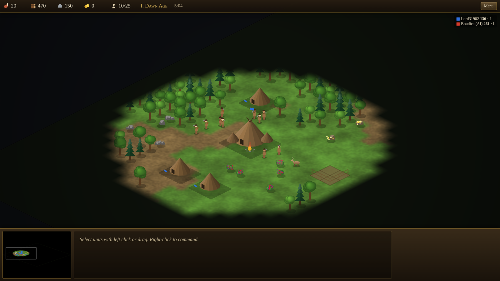
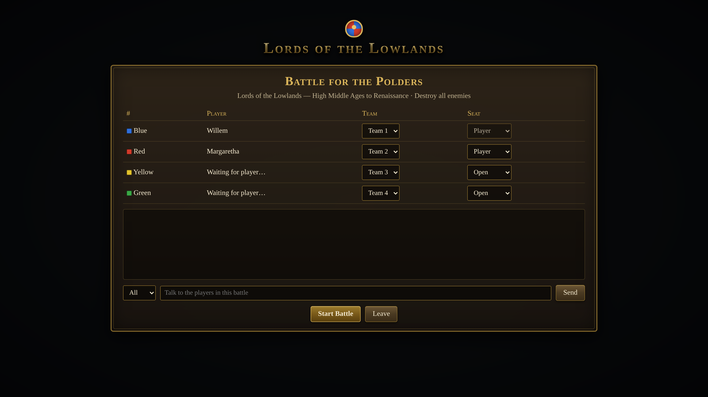

# Lords of the Lowlands

*From the first fire to the farthest stars.*

**Lords of the Lowlands** is a historical real-time strategy game for the web browser, in the spirit of
the classic isometric RTS games. You lead a people from a band of hunter-gatherers around a camp fire in
the **Dawn Age**, through bronze, iron, castles, gunpowder, steam and silicon, until your fleets of
starfighters and void dreadnoughts fight for the galaxy in the **Interstellar Age**.

The game server, the simulation and the computer opponents are written in **Go**; the client runs in any
modern browser with no plug-ins and no downloaded assets — every building, unit, tree, explosion, sound
effect and piece of music is generated procedurally at runtime.


## Features

- **17 ages** — Dawn, Neolithic, Copper, Bronze, Iron, Classical, Early & High Middle Ages, Renaissance,
  Imperial, Industrial, Machine, Atomic, Information, Orbital, Interplanetary and Interstellar.
- **17-chapter campaign** (≥ 15 levels as required). Each chapter starts in one age and lets you advance to
  the next, with conquest, survival and "advance first" objectives, on temperate, desert, winter, tropical,
  lunar, Martian and deep-space maps.
- **Economy** — hunt deer, boar and mammoth, forage berries, farm, cut wood, quarry stone, mine gold and,
  from the Industrial Age, generate **energy**. Workers carry goods to drop-off buildings; techs improve
  gathering; houses limit population.
- **Military** — four unit lines (infantry, ranged, mounted/armour/fighters, siege) with a counter system
  (spear beats horse, horse beats archer, archer beats infantry, siege beats buildings), 60+ unit types
  from clubmen and slingers to hover tanks, railgunners and dreadnoughts, area damage, minimum ranges,
  towers and armed town centres, attack-move and formations.
- **Technology** — 68 researchable technologies (tools, weapons, armour, construction per age) plus age
  advancement at the town centre.
- **Modes** — single player vs computer, multiplayer player-vs-player, and mixed teams of players and AI
  (up to 8 slots, free team assignment, easy/normal/hard AI).
- **Back-end** — accounts (or guest play), lobby with live room list and online players, high scores per
  level, leaderboard, campaign progress, reconnect to running games.
- **Chat** — global broadcast chat in the lobby, private whispers (`/w name text`), room chat and
  team-only chat in game (Enter to talk, Tab to switch channel).
- **Level editor** — paint terrain, place resources and animals, set start positions, ages, objective,
  theme and starting resources; generate random maps, open campaign maps as templates, save to the
  server, download/upload JSON and play-test instantly.
- **Graphics** — isometric renderer with a per-pixel terrain shader (blended tiles, noise texturing,
  shore depth), animated water, rocks, procedurally drawn buildings for ten architectural eras, walking/
  fighting/working animations, projectiles, muzzle flashes, explosions, smoke, fire and dust particles,
  soft fog of war, minimap and vignette lighting.
- **Sound** — Web Audio synthesised effects (axes, pickaxes, hammers, clashing steel, arrows, muskets,
  cannon, lasers, plasma, explosions, horns) with stereo panning, and generative background music whose
  mode, tempo and instruments change with the age.
- **Security** — strict CSP, CSRF protection, Argon2id, rate limiting, fog-filtered snapshots (no map
  hacks), server-authoritative commands, plus an OS sandbox with **seccomp-BPF, Landlock, capability
  dropping, no_new_privs**, a hardened **systemd** unit and an **SELinux** policy module.

## Screenshots

| | |
|---|---|
|  |  |
| *The campaign: 17 chapters from the Dawn Age to the stars* | *Dawn Age: hunting, foraging and the first huts* |
|  |  |
| *High Middle Ages: keeps, knights and longbows* | *Industrial Age: brick, rifles and power plants* |
|  |  |
| *Interstellar Age: void marines and starfighters* | *The level editor* |
|  |  |
| *Multiplayer lobby with global chat* | *A battle room: humans and AI, teams and seats* |

## Quick start

Requirements: Go 1.24+ on Linux (the sandbox is Linux-only; the game runs elsewhere with `-no-sandbox`).

```bash
make build
```

```bash
./bin/lotl-server -port 8080 -data ./data
```

Open <http://localhost:8080>, sign in as a guest (or register to enter the Hall of Fame) and choose
**Campaign**, **Skirmish vs Computer** or **Multiplayer**.

### Selecting the port

The back-end listens on `127.0.0.1:8080` by default. Any of these select another port:

| Method | Example |
|---|---|
| flag | `lotl-server -port 9000` |
| full address | `lotl-server -listen 0.0.0.0:9000` |
| environment | `LOTL_PORT=9000 lotl-server` |
| systemd socket | edit `ListenStream=` in `deploy/systemd/lotl.socket` |

Other flags: `-data DIR`, `-tls-cert/-tls-key` (HTTPS), `-secure-cookies`, `-trust-proxy`,
`-allow-origin host,...`, `-max-rooms N`, `-log-level`, `-no-sandbox` (debugging only).

## How to play

| Action | Control |
|---|---|
| Select / box select | left click / drag (Shift adds, double-click selects all of a type) |
| Move, gather, build, attack, repair | right click (context-sensitive) |
| Attack-move / stop / delete | `A` + click / `S` / `Del` |
| Build menu & production | buttons bottom right (hotkeys `Q W E R T …`) |
| Town centre / idle worker | `H` / `.` |
| Control groups | `Ctrl+1…9`, recall `1…9` (double tap to centre) |
| Camera | arrow keys, screen edge, minimap, mouse wheel to zoom |
| Chat | `Enter`, `Tab` switches All / Team / Global |

Gather food and wood early, build houses before you are housed, add drop-off camps near resources,
research at the academy, and save up to **advance the age** at the town centre — every age unlocks
stronger units and buildings. From the Industrial Age on, build **generators**: modern armies run on energy.

## Development

```bash
make test          # unit + integration tests
make cover         # coverage over all packages (fails below 80 %)
make fuzz          # runs every Go fuzz target (FUZZTIME=30s each)
make race          # race detector on the server
make long          # hour-long AI-vs-AI matches across ages
```

Current coverage: **93 %** of statements across all packages (`make cover`).

Fuzz targets: `FuzzParseClientMsg`, `FuzzHTTPAPI` (server), `FuzzLevelJSON`, `FuzzApply`, `FuzzFog`,
`FuzzCleanText` (game), `FuzzOpenCorruptFiles`, `FuzzValidName` (store).

### Layout

```
cmd/lotl-server     entry point, flags, TLS, socket activation, sandbox start-up
internal/game       simulation: ages, units, techs, economy, combat, A*, fog, AI, map generator
internal/levels     the 17-level campaign and skirmish maps
internal/server     HTTP API, sessions, CSRF, rate limits, WebSocket hub, lobby, rooms, chat
internal/store      accounts (Argon2id), scores, custom levels — atomic JSON files
internal/hardening  no_new_privs, capabilities, Landlock, seccomp-BPF
web/                browser client (embedded): renderer, sprites, audio, HUD, editor
deploy/             systemd units, SELinux policy, seccomp notes, Dockerfile, install script
docs/               architecture, design, ADRs, ASRs, API, security, tests, operations
```

## Documentation

See [docs/README.md](docs/README.md): architecture, detailed design, game design, API, security,
architecture decision records, architecturally significant requirements, testing, operations and the
level-editor guide.

## License

GNU General Public License v3.0 — see [LICENSE](LICENSE).
