# Lords of the Lowlands

*From the first fire to the farthest stars.*

**Lords of the Lowlands** is a historical real-time strategy game for the web browser, in the spirit of
the classic isometric RTS games. You lead a people from a band of hunter-gatherers around a camp fire in
the **Dawn Age**, through bronze, iron, castles, gunpowder, steam and silicon, until your fleets of
starfighters and void dreadnoughts fight for the galaxy in the **Interstellar Age**.

The game server, the simulation and the computer opponents are written in **Go**; the client runs in any
modern browser with no plug-ins and no downloaded assets — every building, unit, tree, explosion, sound
effect and piece of music is generated procedurally at runtime.

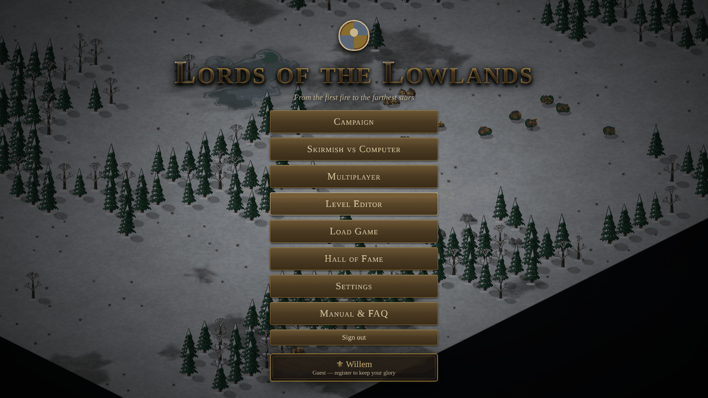

## Features

- **17 ages** — Dawn, Neolithic, Copper, Bronze, Iron, Classical, Early & High Middle Ages, Renaissance,
  Imperial, Industrial, Machine, Atomic, Information, Orbital, Interplanetary and Interstellar.
- **17-chapter campaign** (≥ 15 levels as required). Each chapter starts in one age and lets you advance to
  the next, with conquest, survival and "advance first" objectives, on temperate, desert, winter, tropical,
  lunar, Martian and deep-space maps.
- **Six map types** — inland, coastal, riverland, lakes, desert and highland. They change the terrain, the
  farm yield (desert 60 %, riverland 115 %) and the tech tree (irrigation, qanats, fishing nets, navigation,
  steam ships, deep mining, terrace farming, caravans).
- **Naval play** on coastal, riverland and lakes maps — docks, fish, fishing boats and a warship line from the
  war canoe to the hover frigate; boats sail on water and fords only.
- **Economy** — hunt deer, boar and mammoth, forage berries, farm, fish, cut wood, quarry stone, mine gold
  and, from the Industrial Age, generate **energy**. Workers carry goods to drop-off buildings; techs improve
  gathering; houses limit population.
- **Military** — four land unit lines (infantry, ranged, mounted/armour/fighters, siege) plus warships, with a
  counter system (spear beats horse, horse beats archer, archer beats infantry, siege beats buildings),
  60+ land unit types from clubmen and slingers to hover tanks, railgunners and dreadnoughts, area damage,
  minimum ranges, towers and armed town centres, attack-move and formations.
- **Technology** — 68 researchable technologies (tools, weapons, armour, construction per age), 8
  map-specific technologies, plus age advancement at the town centre.
- **Modes** — single player vs computer, multiplayer player-vs-player, and mixed teams of players and AI
  (up to 8 slots, free team assignment). **Six AI levels**: super easy, easy, normal, hard, super hard and
  insane.
- **Save and resume** — registered players save running matches on the server and resume them later; other
  human seats are reserved for their players or taken over by the computer.
- **Demo mode** — an idle menu turns into a self-playing AI showcase with an automatic camera; any input
  returns to the menu.
- **Back-end** — accounts (or guest play), lobby with live room list and online players, high scores per
  level, leaderboard, campaign progress, reconnect to running games.
- **Accounts and administration** — open, approval-only or closed registration, optional guest play,
  **TOTP two-factor sign-in** (any authenticator app), and an **admin page** to approve, block, delete and
  reset accounts, require MFA, kick players, watch games and read the audit log.
- **Diagnostics** — `/healthz`, `/readyz`, JSON statistics and a **Prometheus** `/metrics` endpoint (tick and
  HTTP latency histograms, WebSocket traffic, logins, games, cheat flags, Go runtime).
- **Anti-cheat** — HMAC-signed, sequenced commands, client integrity report, server-side detection of
  map-hack symptoms, unit spoofing and inhuman action rates; flagged players are warned, removed and reported.
- **Chat** — global broadcast chat in the lobby, private whispers (`/w name text`), room chat and
  team-only chat in game (Enter to talk, Tab to switch channel).
- **Level editor** — paint terrain, place resources, fish and animals, set start positions, ages, objective,
  map type, theme and starting resources; generate random maps, open campaign maps as templates, save to the
  server, download/upload JSON and play-test instantly.
- **Graphics** — isometric renderer with a per-pixel terrain shader (blended tiles, noise texturing,
  shore depth), animated water, rocks, procedurally drawn buildings for ten architectural eras, walking/
  fighting/working animations, projectiles, muzzle flashes, explosions, smoke, fire and dust particles,
  soft fog of war, minimap and vignette lighting.
- **Sound** — Web Audio synthesised effects with stereo panning and reverb, varied on every play and
  matched to the era: axes become chainsaws and plasma cutters, pickaxes become pneumatic drills,
  scythes become tractors; gold rings brighter than stone, crystals chime, fish splash, berries rustle.
  Combat has clashing and parried steel, bow twangs, muskets, cannon, lasers and plasma, plus a
  separate sound for each projectile landing (arrow thunk, ricochet, blast), groans of the fallen and
  crumbling buildings. "Under attack" alarms follow the age — war drums and horns, church bells,
  bugle and drum roll, air-raid siren, starship klaxon — and a building under attack sounds different
  from units and is named in the warning. Generative background music changes mode, tempo and
  instruments with the age.
- **Security** — strict CSP, CSRF protection, Argon2id, TOTP MFA, audit log, rate limiting, fog-filtered
  snapshots (no map hacks), server-authoritative commands, plus an OS sandbox with **seccomp-BPF, Landlock,
  capability dropping, no_new_privs**, a hardened **systemd** unit and an **SELinux** policy module.

## Screenshots

| | |
|---|---|
| 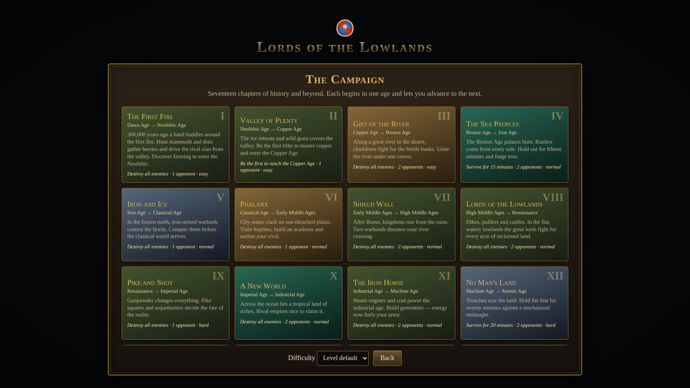 |  |
| *The campaign: 17 chapters from the Dawn Age to the stars* | *Dawn Age: hunting, foraging and the first huts* |
| 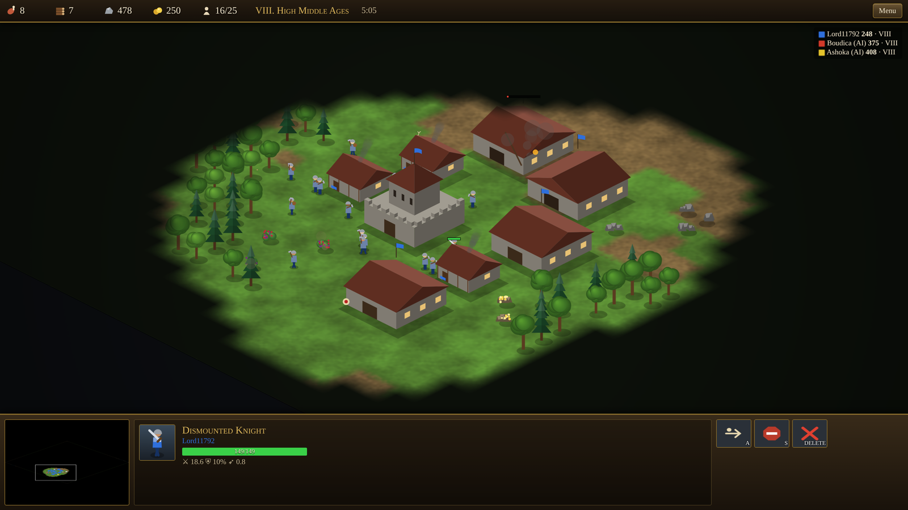 | 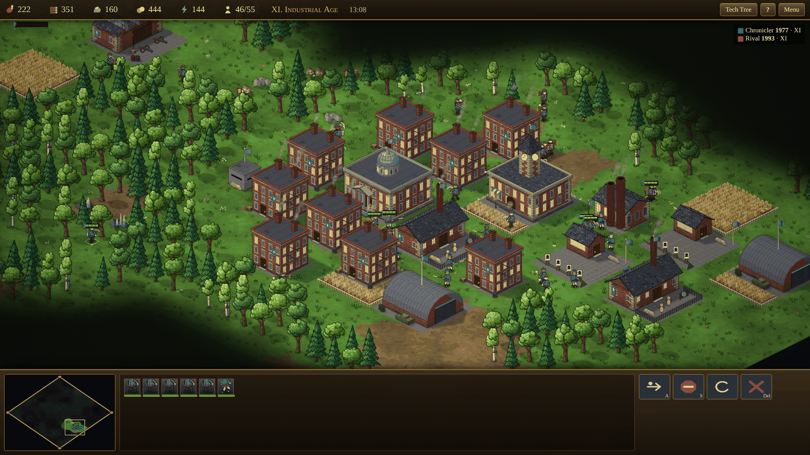 |
| *High Middle Ages: keeps, knights and longbows* | *Industrial Age: brick, rifles and power plants* |
| 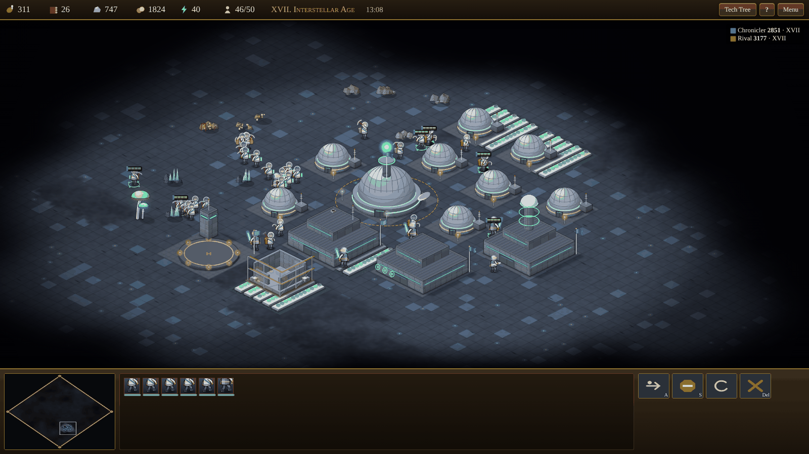 | 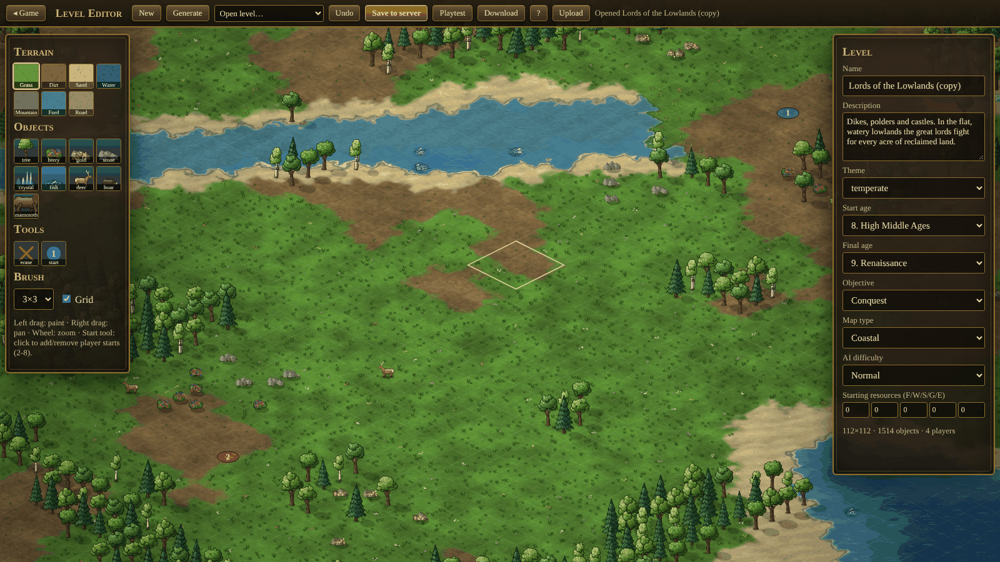 |
| *Interstellar Age: void marines and starfighters* | *The level editor* |
| 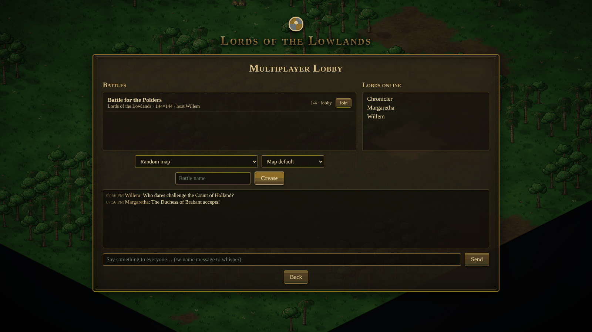 |  |
| *Multiplayer lobby with global chat* | *A battle room: humans and AI, teams and seats* |
| 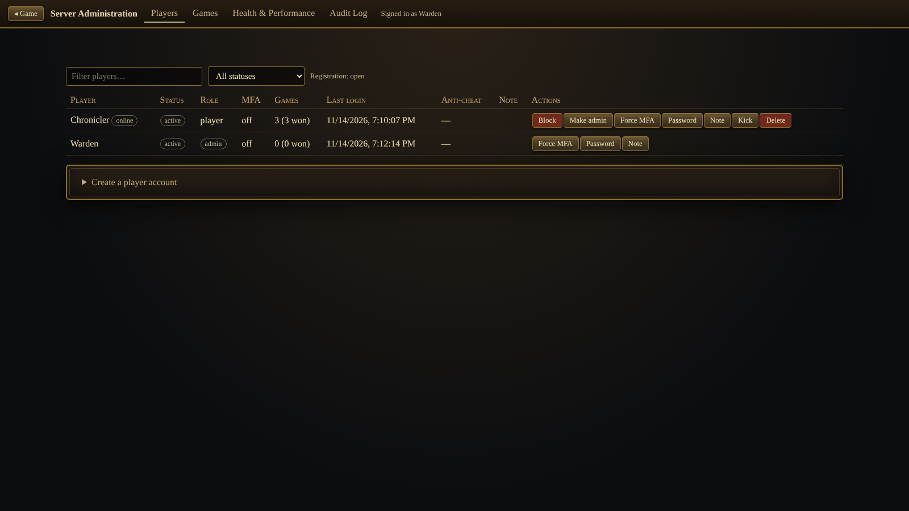 | 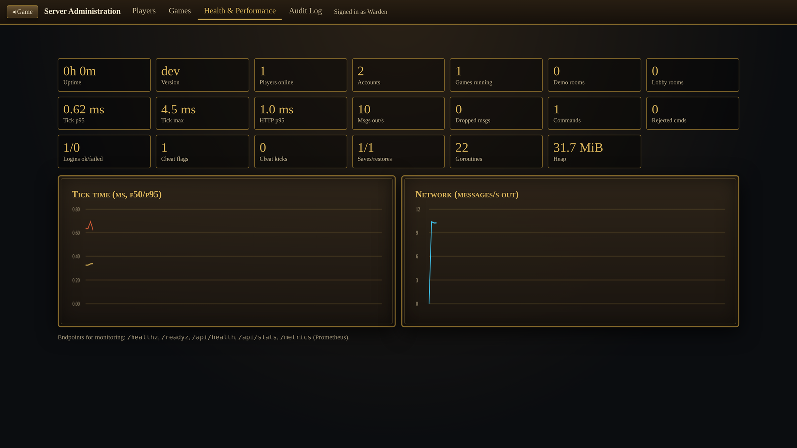 |
| *Administration: approve, block, roles, MFA, passwords* | *Live health and performance dashboard* |
| 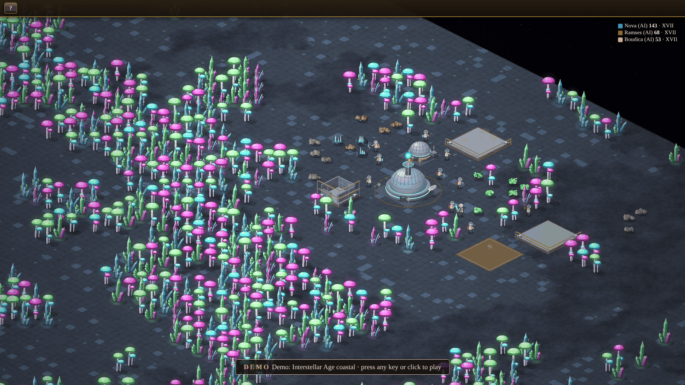 | 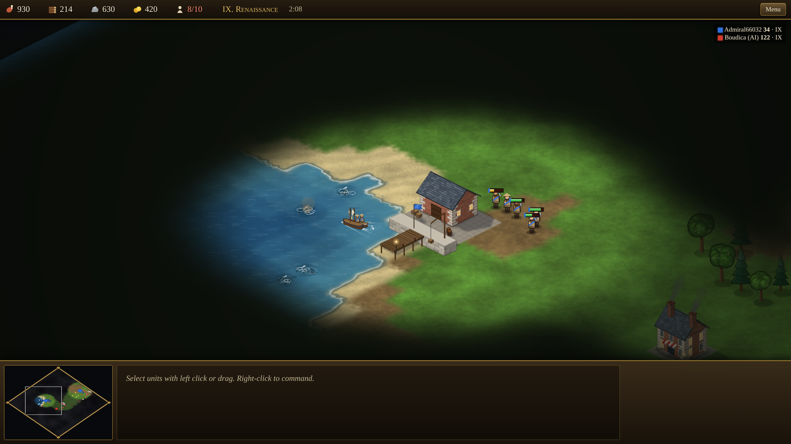 |
| *Demo mode: the game plays itself when nobody is at the keyboard* | *Coastal map: harbour, fishing boat and fish schools* |

## Quick start

Requirements: Go 1.25+ on Linux (the sandbox is Linux-only; the game runs elsewhere with `-no-sandbox`).

```bash
make build
```

```bash
./bin/lotl-server -port 8080 -data ./data
```

Open <http://localhost:8080>, sign in as a guest (or register to enter the Hall of Fame) and choose
**Campaign**, **Skirmish vs Computer** or **Multiplayer**.

### Selecting the port

The back-end listens on `127.0.0.1:8080` by default. Any of these select another port:

| Method | Example |
|---|---|
| flag | `lotl-server -port 9000` |
| full address | `lotl-server -listen 0.0.0.0:9000` |
| environment | `LOTL_PORT=9000 lotl-server` |
| config file | `server: {port: 9000}` in the YAML file |
| systemd socket | edit `ListenStream=` in `deploy/systemd/lotl.socket` |

Other flags: `-config FILE`, `-data DIR`, `-tls-cert/-tls-key` (HTTPS), `-secure-cookies`, `-trust-proxy`,
`-allow-origin host,...`, `-max-rooms N`, `-log-level`, `-no-sandbox` (debugging only).

### Configuration file

All settings — including account policy, anti-cheat, demo mode, save limits and metrics access — live in a
YAML file; [deploy/config/lotl.yaml](deploy/config/lotl.yaml) lists every key with its default.

```bash
./bin/lotl-server -config deploy/config/lotl.yaml      # or LOTL_CONFIG=/etc/lotl/lotl.yaml
```

Precedence: **flag > `LOTL_*` environment > config file > built-in default**. Unknown keys and out-of-range
values stop the server with an error. The file is read once at start-up, before the sandbox is applied.

### Administration

```yaml
accounts:
  registration: approval     # open | approval | closed
  allowGuests: false
  bootstrapAdmin: admin      # created on first start
  requireAdminMFA: true
```

```bash
LOTL_ADMIN_PASSWORD='a long passphrase' ./bin/lotl-server -config lotl.yaml
```

Sign in as `admin`, enrol an authenticator app when asked, then open **Administration** in the main menu
(`/admin.html`): players (approve, block, role, require/reset MFA, password reset, delete, clear cheat flags,
notes), running games, health & performance and the audit log. See [docs/operations.md](docs/operations.md).

### Diagnostics

| Endpoint | Access | Content |
|---|---|---|
| `GET /healthz` | public | `ok` |
| `GET /readyz` | public | 200 if the data directory is writable, else 503 |
| `GET /api/health` | public | status, version, uptime |
| `GET /api/stats` | token / admin / loopback | JSON statistics |
| `GET /metrics` | token / admin / loopback | Prometheus text format |

Set `metrics.token` (≥ 16 characters) and scrape with `Authorization: Bearer <token>`.

## How to play

Press **`?`** (or `F1`, or the **?** button) in a game for the full shortcut sheet; the level editor has its own (`?` there too).

| Action | Control |
|---|---|
| Select / box select | left click / drag (Shift adds, double-click selects all of a type) |
| Move, gather, build, attack, repair | right click (context-sensitive) |
| Attack-move / stop / delete | `A` + click / `S` / `Del` (buildings ask for confirmation) |
| Build menu & production | buttons bottom right (hotkeys `Q W E R T …`, shown on each button; `Shift` + train key = 5) |
| Build directly (workers selected) | `Shift+E` house, `G` granary, `L` lumber camp, `N` mining camp, `F` farm, `D` dock, `C` town centre, `P` generator, `B` barracks, `R` range, `S` stable, `K` workshop, `Y` academy, `T` tower |
| Town centre / idle worker / idle soldier | `H` (`Shift+H` cycles) / `.` / `,` (`Ctrl` selects all idle) |
| Select all military / all units | `M` / `Ctrl+A` |
| Control groups | `Ctrl+1…9` set, `Shift+1…9` add, `1…9` recall (double tap to centre) |
| Camera | arrow keys, screen edge, minimap, wheel or `+`/`-` to zoom, `0` reset, `Space` last alert, `Backspace` selection |
| Chat | `Enter`, `Tab` switches All / Team / Global |
| Menu / quick save / mute / help | `F10` / `Ctrl+S` / `Shift+M` / `?` |

Gather food and wood early, build houses before you are housed, add drop-off camps near resources,
research at the academy, and save up to **advance the age** at the town centre — every age unlocks
stronger units and buildings. From the Industrial Age on, build **generators**: modern armies run on energy.

## Development

```bash
make test          # unit + integration tests
make cover         # coverage over all packages (fails below 80 %)
make fuzz          # runs every Go fuzz target (FUZZTIME=30s each)
make race          # race detector on the server
make long          # hour-long AI-vs-AI matches across ages
```

Current coverage: **92.8 %** of statements across all packages (`make cover`).

Fuzz targets: `FuzzParseClientMsg`, `FuzzHTTPAPI` (server), `FuzzLevelJSON`, `FuzzApply`, `FuzzFog`,
`FuzzCleanText`, `FuzzLoadGame` (game), `FuzzOpenCorruptFiles`, `FuzzValidName` (store).

### Layout

```
cmd/lotl-server     entry point, flags, config loading, TLS, socket activation, sandbox start-up
internal/config     YAML configuration: defaults, loading, validation
internal/game       simulation: ages, units, techs, economy, combat, naval, A*, fog, AI, map generator, save/load
internal/levels     the 17-level campaign and skirmish maps
internal/server     HTTP API, sessions, MFA, admin API, metrics, anti-cheat, WebSocket hub, lobby, rooms, demo, chat
internal/store      accounts (Argon2id, roles, MFA), scores, custom levels, saved games, audit log — atomic JSON files
internal/totp       RFC 6238 one-time passwords
internal/hardening  no_new_privs, capabilities, Landlock, seccomp-BPF
web/                browser client (embedded): renderer, sprites, audio, HUD, editor, admin page, integrity
deploy/             systemd units, example config, SELinux policy, seccomp notes, install script
docs/               architecture, design, ADRs, ASRs, API, security, tests, operations
```

## Documentation

See [docs/README.md](docs/README.md): architecture, detailed design, game design, API, security,
architecture decision records, architecturally significant requirements, testing, operations and the
level-editor guide.

## License

GNU General Public License v3.0 — see [LICENSE](LICENSE).
