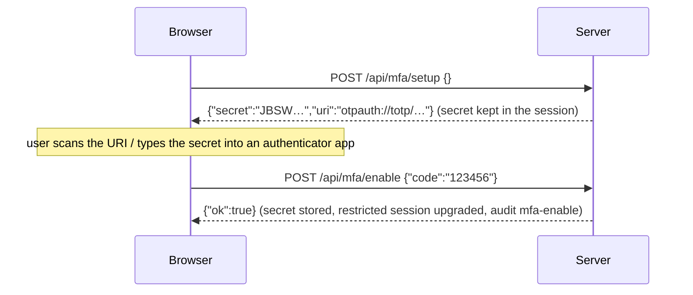
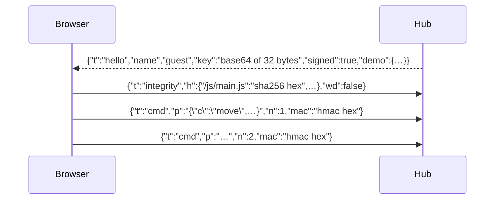

# API reference

All endpoints are served by `lotl-server` on the same origin as the web
client. Routes are registered in `Server.routes()`
(`internal/server/server.go`); the WebSocket protocol lives in
`protocol.go`, `hub.go` and `room.go`.

## Conventions

Values in *italics* are defaults from the YAML configuration
([operations.md](operations.md#configuration-file)).

| Topic | Rule |
|---|---|
| Format | JSON (`application/json; charset=utf-8`), `Cache-Control: no-store` on API responses |
| Errors | `{"error": "<message>"}` with a 4xx/5xx status |
| Authentication | session cookie `lotl_session` (32 random bytes, base64url, 43 chars), `HttpOnly`, `SameSite=Strict`, `Path=/`, `Max-Age` = `security.sessionTTL` (*168h*), `Secure` when TLS or `secureCookies` |
| Session re-validation | on **every** request the account behind a registered session is re-read: deleted, `blocked` or `pending` accounts lose the session immediately, and the admin flag follows the current role |
| Restricted session | an account that must use MFA but has not enrolled gets a session with `mfaSetup: true`; it is accepted only by `/api/me`, `/api/mfa/setup`, `/api/mfa/enable` and `/api/logout` (everything else answers as if not logged in) |
| Request bodies | `Content-Type: application/json` required for every non-GET `/api/*` request except `DELETE` (else **415**); at most `security.maxBodyBytes` (*1 MiB*; **1 MiB** for `POST /api/levels`); exactly one JSON value; **unknown fields are rejected** → **400** `invalid JSON body` |
| CSRF | non-GET `/api/*` requests must carry an `Origin` (or `Referer`) whose host equals the request `Host` or one of `allowedOrigins`; requests without either header are accepted only if `Sec-Fetch-Site` is absent or `same-origin` → else **403** `cross-origin request refused` |
| Rate limits | all `/api/*`: `apiRate`/`apiBurst` (*20/s, burst 60*) per client IP → **429** `rate limit exceeded`; `register`/`login` additionally `authRate`/`authBurst` (*0.2/s, burst 8*) → **429** `too many attempts, try later` |
| Client IP | `RemoteAddr`; the last `X-Forwarded-For` entry only with `trustProxy` |
| Security headers | every response: CSP, `X-Content-Type-Options: nosniff`, `X-Frame-Options: DENY`, `Referrer-Policy: no-referrer`, COOP/CORP `same-origin`, `Permissions-Policy`; HSTS with secure cookies |

## REST endpoints

| Method | Path | Auth | Success | Errors |
|---|---|---|---|---|
| GET | `/healthz` | — | 200 `ok` (text) | |
| GET | `/readyz` | — | 200 `ready` (text) | 503 |
| GET | `/api/health` | — | 200 | |
| GET | `/api/stats` | diagnostics¹ | 200 | 403 |
| GET | `/metrics` | diagnostics¹ | 200 (Prometheus text) | 403 |
| GET | `/api/config` | — | 200 | |
| POST | `/api/register` | — | 201, 202 (approval) | 400, 403, 409, 415, 429 |
| POST | `/api/login` | — | 200 | 400, 401, 403, 415, 429 |
| POST | `/api/guest` | — | 200 | 400, 403, 409, 415 |
| POST | `/api/logout` | cookie (optional) | 200 | |
| GET | `/api/me` | cookie (incl. restricted) | 200 | 401 |
| POST | `/api/mfa/setup` | registered (incl. restricted) | 200 | 401 |
| POST | `/api/mfa/enable` | registered (incl. restricted) | 200 | 400, 500 |
| POST | `/api/mfa/disable` | registered | 200 | 400, 401, 403 |
| GET | `/api/saves` | registered | 200 | 401 |
| DELETE | `/api/saves/{id}` | registered, owner | 200 | 401, 404 |
| GET | `/api/admin/users` | admin | 200 | 401, 403 |
| POST | `/api/admin/users` | admin | 201 | 400, 401, 403, 409 |
| PATCH | `/api/admin/users/{name}` | admin | 200 | 400, 401, 403, 404, 409 |
| POST | `/api/admin/users/{name}/password` | admin | 200 | 400, 401, 403, 404 |
| DELETE | `/api/admin/users/{name}` | admin | 200 | 401, 403, 404, 409 |
| POST | `/api/admin/kick/{name}` | admin | 200 | 401, 403, 404 |
| GET | `/api/admin/rooms` | admin | 200 | 401, 403 |
| GET | `/api/admin/audit` | admin | 200 | 401, 403 |
| GET | `/api/defs` | — | 200 | |
| GET | `/api/levels` | — | 200 | |
| GET | `/api/levels/{id}` | — | 200 | 404 |
| POST | `/api/levels` | registered | 201 | 400, 401, 403, 429 |
| DELETE | `/api/levels/{id}` | registered, owner | 200 | 401, 403, 404, 500 |
| POST | `/api/generate` | — | 200 | 400 |
| GET | `/api/scores?level=<id>` | — | 200 | 400 |
| GET | `/api/leaderboard` | — | 200 | |
| GET | `/api/online` | — | 200 | |
| GET | `/api/players/{name}` | — | 200 | 404 |
| GET | `/ws` | cookie (not restricted) | 101 | 401 |
| GET | `/`, `/editor.html`, `/admin.html`, `/js/*`, `/css/*` | — | 200 (embedded files, `Cache-Control: no-cache`) | 404 |

Every `/api/*` response may also be **429** (global limiter); every non-GET
may be **403** (CSRF) or **415** (content type).

¹ *diagnostics* = see [Diagnostics](#diagnostics). *admin* = active account
with role `admin` and no pending MFA enrolment (**401** `log in as an
administrator` without a full session, **403** `administrators only` for
other accounts).

### Accounts and sessions

#### `GET /api/config`

Public settings the client needs before login:

```json
{"registration":"open","allowGuests":true,"minPasswordLength":8,
 "demo":{"enabled":true,"idleMinutes":3,"rotateMinutes":6},"signedCommands":true}
```

#### `POST /api/register`

```http
POST /api/register HTTP/1.1
Content-Type: application/json
Origin: https://lotl.example

{"name": "Alice", "password": "correct horse"}
```

```http
HTTP/1.1 201 Created
Set-Cookie: lotl_session=CPmlDUxTrr…; Path=/; Max-Age=604800; HttpOnly; SameSite=Strict

{"guest":false,"name":"Alice"}
```

With `accounts.registration: approval` the account is created with status
`pending`, **no** cookie is set and the answer is

```http
HTTP/1.1 202 Accepted

{"name":"Alice","pending":true,"message":"Your account awaits approval by an administrator."}
```

| Status | Body | Cause |
|---|---|---|
| 400 | `name must be 3-20 letters, digits, _ or -` | name not `^[A-Za-z0-9_-]{3,20}$` |
| 400 | `password must be 8-128 characters` | shorter than `accounts.minPasswordLength` (*8*) or longer than 128 (the message is fixed) |
| 403 | `registration is closed on this server; ask an administrator for an account` | `registration: closed` |
| 409 | `name already taken` | registered, or currently used by a logged-in guest (case-insensitive) |
| 429 | `too many attempts, try later` | auth limiter |

Every registration is written to the audit log (`register`).

#### `POST /api/login`

Body `{"name","password","code"?}`. `code` is the 6-digit authenticator code
for accounts with MFA.

```json
{"name":"Alice","guest":false,"admin":false,"mfaSetup":false}
```

| Status | Body | Cause |
|---|---|---|
| 200 | as above + cookie | success; `mfaSetup: true` = restricted session, enrol MFA first |
| 401 | `{"error":"invalid name or password"}` | same message and comparable timing for unknown users (dummy argon2id hash) |
| 401 | `{"error":"authenticator code required","mfa":true}` | password correct, MFA enabled, no `code` |
| 401 | `{"error":"invalid authenticator code","mfa":true}` | wrong, expired or already used code (audit `mfa-fail`) |
| 403 | `your account awaits approval by an administrator` | status `pending` |
| 403 | `this account has been blocked` | status `blocked` (audit `login-blocked`) |
| 429 | `too many attempts, try later` | auth limiter |

Names are case-insensitive; the stored spelling is returned. A successful
login stores `lastLogin`.

#### `POST /api/guest`

Body `{"name":"Bob_1"}`. **200** `{"guest":true,"name":"Bob_1"}` + cookie.
**400** bad name, **403** `guest play is disabled on this server`
(`allowGuests: false`), **409** `name is registered or in use`. Guests can
play everything but cannot save levels or games and are not recorded in
scores.

#### `POST /api/logout`

Deletes the server-side session and expires the cookie. Always **200**
`{"ok":true}`.

#### `GET /api/me`

```json
{"name":"Alice","guest":false,"admin":false,"mfaSetup":false,"mfaEnabled":true,"mfaRequired":false,
 "stats":{"name":"Alice","games":3,"wins":2,"losses":1,"bestScore":5120,"campaign":2}}
```

`stats`, `mfaEnabled` and `mfaRequired` are present only for registered
users. Also answers for restricted sessions. **401** `not logged in`.

### Two-factor authentication (TOTP)

RFC 6238: HMAC-SHA1, 6 digits, 30 s step, ±1 step tolerance, each step
usable once (`MFALastStep`). Enrolment:



| Endpoint | Body | Success | Errors |
|---|---|---|---|
| `POST /api/mfa/setup` | `{}` | `{"secret","uri"}` — `uri` = `otpauth://totp/<issuer>:<name>?secret=…&issuer=…&algorithm=SHA1&digits=6&period=30` (issuer `accounts.mfaIssuer`) | **401** `log in with an account first` (none or guest) |
| `POST /api/mfa/enable` | `{"code"}` | `{"ok":true}` | **400** `start MFA setup first`, **400** `invalid code — check your authenticator's clock`, **500** `could not save` |
| `POST /api/mfa/disable` | `{"code"}` | `{"ok":true}` (audit `mfa-disable`) | **401** `not logged in`, **400** `MFA is not enabled`, **403** `MFA is required for this account`, **400** `invalid code` |

MFA is *required* when the account has `mfaRequired` (set by an admin) or is
an admin while `accounts.requireAdminMFA` is on. Such accounts without an
authenticator receive a restricted session at login.

### Saved games

Saving and resuming happen over the WebSocket (`save`, `restore`); REST only
lists and deletes. Registered users only (**401** `log in with an account to
use saved games` / `not logged in`).

| Endpoint | Response |
|---|---|
| `GET /api/saves` | newest first: `[{"id":"s-1f3a…","name":"Before the siege","level":"Shield Wall","age":7,"minutes":23.4,"players":["Alice","Boudica [AI]"],"created":"2026-11-14T13:00:00Z","size":183412}]` |
| `DELETE /api/saves/{id}` | **200** `{"ok":true}`; **404** `no such save` (also for malformed ids — ids are `s-` + 16 hex) |

### Administration

All endpoints need an admin session; the page `/admin.html` uses them.
Every change is written to the audit log.

#### `GET /api/admin/users`

```json
{"registration":"approval","users":[
  {"name":"Alice","games":3,"wins":2,"losses":1,"bestScore":5120,"campaign":2,
   "role":"user","status":"pending","created":"…","lastLogin":"0001-01-01T00:00:00Z",
   "mfaEnabled":false,"mfaRequired":false,"flags":null,"note":"","online":false}]}
```

`flags` lists anti-cheat findings `{"time","reason","score","game"}` (last 50).
Secrets (hash, salt, MFA secret) are never returned.

#### `POST /api/admin/users`

```json
{"name":"Carol","password":"long enough pw","role":"user","mfaRequired":true,"note":"tournament"}
```

Creates an **active** account (`role` default `user`; `note` cut to 300
characters, control characters removed). **201** `{"name":"Carol"}`,
**400** bad name/password/role (`invalid value`), **409** `name already taken`.
Works in every registration mode.

#### `PATCH /api/admin/users/{name}`

All fields optional; omitted fields are unchanged:

```json
{"role":"admin","status":"active","mfaRequired":true,"resetMfa":false,"clearFlags":true,"note":"approved"}
```

| Field | Values / effect |
|---|---|
| `role` | `user` \| `admin` |
| `status` | `active` \| `pending` \| `blocked` |
| `mfaRequired` | force MFA enrolment at next login |
| `resetMfa` | remove the authenticator (secret, enabled flag, last step) |
| `clearFlags` | delete anti-cheat flags |
| `note` | free text for administrators |

Setting a non-active status, `resetMfa` or `mfaRequired: true` ends all
sessions of that user and disconnects their WebSocket. **200** `{"ok":true}`;
**400** `invalid value`; **404** `no such user`; **409** `cannot demote or
block the last administrator`.

#### Other admin endpoints

| Endpoint | Body | Success | Errors |
|---|---|---|---|
| `POST /api/admin/users/{name}/password` | `{"password"}` | `{"ok":true}`; sessions ended, player kicked, audit `password-reset` | **400** bad password, **404** `no such user` |
| `DELETE /api/admin/users/{name}` | — | `{"ok":true}`; account and its saves removed (scores and levels stay), sessions ended, player kicked | **409** `you cannot delete your own account`, **409** `cannot delete the last administrator`, **404** `no such user` |
| `POST /api/admin/kick/{name}` | — | `{"ok":true}`; WebSocket closed with an error message (the session stays) | **404** `player is not online` |
| `GET /api/admin/rooms` | — | every room incl. demo rooms, as `roomSummary` (see `lobby`), sorted by id | |
| `GET /api/admin/audit` | — | newest 300 audit entries, newest first: `[{"time":"…","actor":"admin","action":"user-update","target":"Alice","detail":"status=active"}]` | |

Audit actions: `register`, `login-blocked`, `mfa-fail`, `mfa-enable`,
`mfa-disable`, `bootstrap-admin`, `user-create`, `user-update`,
`password-reset`, `user-delete`, `kick` (actor = admin, or `anticheat` with
the score and events in `detail`).

### Diagnostics

| Endpoint | Access | Response |
|---|---|---|
| `GET /healthz` | public, not rate limited | `ok` |
| `GET /readyz` | public, not rate limited | `ready` if a temp file can be created in the data directory, else **503** `data directory not writable` |
| `GET /api/health` | public | `{"status":"ok","version":"dev","uptimeSeconds":3600,"time":"…"}` |
| `GET /api/stats` | diagnostics | statistics JSON (below); **403** `statistics require the metrics token or an administrator` |
| `GET /metrics` | diagnostics | Prometheus text format 0.0.4; **403** `forbidden` |

*Diagnostics* access (`diagAllowed`):

| `metrics.token` | `metrics.public` | Allowed |
|---|---|---|
| set | (ignored) | `Authorization: Bearer <token>` or an admin session |
| empty | `true` | everyone |
| empty | `false` (*default*) | admin session or a loopback client address |

`version` is `internal/server.Version` (`dev` unless set with
`-ldflags "-X github.com/rom/lords_of_the_lowlands/internal/server.Version=…"`).

`GET /api/stats`:

```json
{"version":"dev","uptimeSeconds":3600,"users":42,"online":7,"sessions":9,
 "rooms":{"lobby":1,"playing":3,"demo":1},"playersInGames":5,
 "counters":{"http_requests":1200,"http_errors":0,"ws_messages_in":50211,"ws_messages_out":90122,
   "ws_bytes_out":81234567,"ws_dropped":12,"snapshots":88000,"commands":4100,"commands_rejected":37,
   "logins_ok":20,"logins_failed":3,"games_started":6,"games_ended":3,"cheat_flags":0,"cheat_kicks":0,
   "games_saved":2,"games_restored":1},
 "tickSeconds":{"count":36000,"p50":0.0004,"p95":0.0011,"p99":0.002,"max":0.009},
 "httpSeconds":{"count":1200,"p50":0.0002,"p95":0.003,"max":0.08},
 "runtime":{"goroutines":31,"heap_alloc_bytes":12345678,"heap_sys_bytes":23456789,"gc_cycles":40,"gc_pause_total_ns":1234567}}
```

Percentiles come from the last 1 024 samples; `tickSeconds` measures
simulation step + snapshot fan-out per room tick. `/ws` requests are not
counted in the HTTP numbers.

`GET /metrics` metric families:

| Metric | Type | Labels / notes |
|---|---|---|
| `lotl_uptime_seconds`, `lotl_users`, `lotl_online`, `lotl_sessions`, `lotl_players_in_games` | gauge | |
| `lotl_rooms` | gauge | `state` = `lobby`, `playing`, `done`, `demo` |
| `lotl_<counter>_total` | counter | one per `counters` key above, e.g. `lotl_http_requests_total`, `lotl_cheat_kicks_total`, `lotl_games_saved_total` |
| `lotl_tick_duration_seconds` | histogram | buckets 0.0005, 0.001, 0.0025, 0.005, 0.01, 0.025, 0.05, 0.1, 0.25, 1, +Inf |
| `lotl_http_request_duration_seconds` | histogram | same buckets |
| `lotl_go_goroutines`, `lotl_go_heap_alloc_bytes`, `lotl_go_heap_sys_bytes`, `lotl_go_gc_cycles` | gauge | |

### Game data

#### `GET /api/defs`

Static definitions used by the client to render and build its UI:

```json
{
  "ages": [{"id":0,"name":"Dawn Age","era":"stone","years":"c. 300,000 BC","desc":"…","advanceCost":[0,0,0,0,0],"advanceTime":0}, …],
  "units": {"clubman": {"id":"clubman","name":"Clubman","class":"infantry","age":0,"era":"stone",
            "cost":[80,0,0,0,0],"hp":48,"attack":6,"armor":0.1,"range":0.8,"minRange":0,"reload":1.4,
            "speed":1,"sight":5,"trainTime":14,"pop":1,"trainedAt":"barracks","projectile":"",
            "flying":false,"splash":0,"sprite":"club","desc":"Swings a heavy wooden club."}, …},
  "buildings": {"town_center": {"id":"town_center","name":"Camp Fire","age":0,"size":3,"hp":1400,
            "cost":[0,275,100,0,0],"buildTime":120,"pop":10,"dropoff":[0,1,2,3],"trains":["worker"], …}, …},
  "buildingNames": {"house": {"stone":"Hut","bronze":"Mud House", …}, …},
  "techs": {"gather_0": {"id":"gather_0","name":"Flint Knapping","age":0,"kind":"gather","amount":0.15,
            "cost":[100,75,0,0,0],"time":25,"desc":"+15% gather rate"}, …},
  "resources": {"tree": {"id":"tree","name":"Tree","res":1,"amount":120,"rate":1,"block":true}, …},
  "unitLine": {"infantry": ["clubman","spearman", …], "mounted": ["","","onager_rider", …], …},
  "resNames": ["Food","Wood","Stone","Gold","Energy"]
}
```

Resource arrays are always `[food, wood, stone, gold, energy]`.

#### `GET /api/levels`

```json
{
  "campaign": [
    {"id":"campaign-01","name":"The First Fire","description":"…","author":"Campaign","theme":"temperate",
     "width":56,"height":56,"startAge":0,"maxAge":1,"maxPlayers":4,
     "objective":{"type":"conquest"},"campaign":1,"opponents":1,"difficulty":"easy","mapType":"inland"}, …
  ],
  "custom": [
    {"id":"u-3f9c2a…","name":"Polder Wars","author":"Alice","description":"…","width":64,"height":64,
     "startAge":0,"maxAge":3,"maxPlayers":2,"theme":"temperate","created":"2026-11-14T13:00:00Z"}
  ]
}
```

#### `GET /api/levels/{id}`

Returns a complete `Level` (see [level-editor.md](level-editor.md#file-format)).
Built-in levels are materialised (tiles, objects and starts generated for
`maxPlayers`) and `gen` removed so the editor can open them. **404**
`level not found`.

#### `POST /api/levels`

Registered users only. Body: a `Level`. The server forces `author` to the
caller, clears `gen`, runs `Level.Validate()`, and

- if `id` names an existing level **owned by the caller** → replaces it;
- if `id` names someone else's level → **403** `forbidden`;
- otherwise assigns a new id `u-<16 hex>` (limits: 50 levels per user,
  5 000 total → **429** `limit reached`).

**201** `{"id":"u-3f9c2a…"}`. **400** with the validation message (e.g.
`level needs 2..8 start positions`). **401** `log in with an account to save levels`.

#### `DELETE /api/levels/{id}`

Owner only. **200** `{"ok":true}`, **401**, **403** `forbidden`, **404** `not found`.

#### `POST /api/generate`

Returns a random map as a full `Level` (`id` empty, `name` `"New Level"`).

```json
{"theme":"desert","size":72,"startAge":0,"maxAge":3,"seed":12345,"water":0.3,"players":4,"mapType":"riverland"}
```

All fields optional: `size` 0 → 112 (else 24..256), `players` outside 2..8 → 2,
`water` outside 0..1 → 0.3, `maxAge < startAge` → `startAge`. **400** on
validation errors (e.g. size out of range, unknown theme, `unknown map type "…"`).
`mapType` is one of `inland` (default), `coastal`, `riverland`, `lakes`,
`desert`, `highland`.

### Hall of fame

| Endpoint | Response |
|---|---|
| `GET /api/scores?level=campaign-03` | `[{"level":"campaign-03","name":"Alice","score":5120,"won":true,"age":3,"mins":18.2,"date":"…"}]` — top 25 of that level; without `level` the top 50 across all levels; **400** `bad level` if `level` > 64 bytes |
| `GET /api/leaderboard` | top 25 `PublicUser` by wins, then best score, then name |
| `GET /api/online` | `["Alice","Bob_1"]` — names with an open WebSocket |
| `GET /api/players/{name}` | `{"name":"Alice","games":3,"wins":2,"losses":1,"bestScore":5120,"campaign":2}`; **404** `no such player` |

Password salts and hashes are never serialised (`User.Public()`).

## WebSocket `/ws`

- Requires a valid session cookie, otherwise **401** before the upgrade.
- Origin is checked by `websocket.Accept`: the `Origin` host must equal the
  request host or match an `-allow-origin` pattern.
- **permessage-deflate** with context takeover is negotiated.
- Text frames only, one JSON object per frame. Client frames are limited to
  **16 KiB** (`MaxMessageBytes`; larger frames close the connection).
- The server pings every 20 s; a write that takes longer than 10 s closes
  the connection.
- A second connection with the same name replaces the first (the old one
  receives `error: logged in from another window`).
- Invalid messages are answered with `{"t":"error","msg":…}` and otherwise
  ignored; the connection stays open.
- Restricted (MFA-setup) sessions are refused (**401**).

### Connection handshake and anti-cheat



With `signed: true` (anti-cheat `enabled` and `signedCommands`) every `cmd`
must be signed: `p` is the JSON text of the command, `n` starts at 1 and
increases by exactly 1, `mac` = hex(HMAC-SHA256(key, `"<n>:<p>"`)), 64 hex
characters. Unsigned, badly signed or out-of-sequence commands are dropped
and scored (see [security.md §3.5](security.md#35-anti-cheat)). With
`signed: false` the plain form `{"t":"cmd","cmd":{…}}` is used. The key and
counter are per connection; a reconnect starts over.

The client sends one `integrity` report after `hello`: SHA-256 hex of each
of its modules (`h`, ≤ 64 entries, keys ≤ 64 chars, values 64 chars) and
`wd` = `navigator.webdriver`.

### Client → server

Every message has a type `t`. Only fields relevant to the type are read;
all are validated by `ParseClientMsg`.

| `t` | Fields | Effect | Limits |
|---|---|---|---|
| `ping` | — | `pong` reply | |
| `chat` | `ch` (`global`\|`room`\|`team`\|`whisper`), `text`, `to` (whisper) | chat | text cleaned and cut to 300 runes, must be non-empty; `to` ≤ 32 bytes; 1 msg/s, burst 5 |
| `create` | `name`, `level` or `skirmish`, `diff`, `mapSize` | create a lobby room (you are host) | name cleaned to 48 runes (default `Battle`); `level` ≤ 64 bytes; skirmish rooms have 4 seats |
| `quick` | `level` or `skirmish`, `opp`, `diff`, `mapSize` | create and immediately start a game vs AI | `opp` 0..7 (0 = level default); skirmish players = `opp + 1` |
| `join` | `room` | take the first open seat (also reserved seats of a restored game) | `room` ≤ 32 bytes; lobby state only (demo rooms cannot be joined) |
| `leave` | — | leave the room; resigns if the game is running; ends a demo | |
| `slot` | `slot`, `kind` (`open`\|`closed`\|`ai`), `team`, `diff` | host edits a seat | `slot` 0..7, `team` 0..8 |
| `team` | `team` | change your own team | 0..8 |
| `start` | — | host starts the match | ≥ 2 players on ≥ 2 teams (not checked for restored games) |
| `cmd` | `p`, `n`, `mac` (signed) or `cmd` (unsigned) | game command | 25 cmds/s, burst 60 (excess silently dropped); ≤ 120 ids; `w` ≤ 40 chars without `<>"'\` |
| `integrity` | `h`, `wd` | client integrity report | ≤ 64 hashes |
| `save` | `name` | save the running game of your room | registered; name cleaned to 48 runes (default `Saved game`); 1 per 10 s, burst 2; `game.maxSavesPerUser` (*20*) |
| `restore` | `save` | open a lobby room from a saved game | registered; `save` = 18-char id |
| `demo` | — | start watching a demo match | demo enabled; not in a room; `game.demo.maxRooms` (*10*) |

`diff` is `""` (normal), `super_easy`, `easy`, `normal`, `hard`,
`super_hard` or `insane`. `skirmish` is
`{"theme","size","startAge","maxAge","seed","water","mapType"}` (size 0..256,
ages 0..16, map type as for `/api/generate`).

`mapSize` picks a size preset and overrides `size` and the level's own size:
`mini` 48, `tiny` 64, `small` 80, `normal` 112, `large` 144, `very_large` 176,
`huge` 208, `enormous` 256 (tiles per side; also listed in `/api/defs` as
`mapSizes`). Empty keeps the level's size. Campaign chapters and other
generated levels can be resized; hand-drawn custom levels keep their size
(`error`: *this map was drawn by hand and has a fixed size*); an unknown preset
is rejected by the parser. Lobby room summaries carry the map edge length as
`size`.

Examples:

```json
{"t":"chat","ch":"global","text":"gg"}
{"t":"chat","ch":"whisper","to":"Alice","text":"rematch?"}
{"t":"quick","level":"campaign-04","diff":"hard"}
{"t":"quick","opp":3,"diff":"normal","skirmish":{"theme":"winter","size":96,"startAge":4,"maxAge":9,"seed":42,"water":0.25}}
{"t":"create","name":"Friday night","level":"u-3f9c2a0d11aa47e0"}
{"t":"slot","slot":2,"kind":"ai","team":2,"diff":"super_hard"}
{"t":"start"}
{"t":"save","name":"Before the siege"}
{"t":"restore","save":"s-1f3a9c0d22b14e77"}
{"t":"demo"}
```

#### Save and restore

| Step | Message | Notes |
|---|---|---|
| save | `{"t":"save","name"}` → `{"t":"saved","id","name"}` | the whole match (all players) is stored in `data/saves/<you>/`; the game keeps running |
| restore | `{"t":"restore","save":id}` → `{"t":"room",…}` | new lobby room named `<save name> (restored)` with one seat per saved player: yours is taken (the seat with your name, else the last one), AI seats stay AI, other human seats are `open` with `reserved: true` and the original name |
| start | `{"t":"start"}` (host) | the saved state continues; seats without a connected human are played by the computer (`normal` unless set) |

Errors (`error` message): `register an account to save games`, `please wait
before saving again`, `you are not in a game`, `the game is not running`,
`save slots full — delete an old save first`, `could not save`,
`register an account to use saved games`, `saved game not found`,
`saved game is damaged: <reason>`.

#### Demo mode

The client sends `{"t":"demo"}` after `game.demo.idleMinutes` without input
on a menu screen. The server creates a hidden room (`d<n>`) with 2–4 AI
players and answers with `start` (`you: -1`, `demo: true`,
`rotateMinutes`); snapshots are unfogged (`you: -1`). Every
`rotateMinutes`, or when the match ends, a new `start` follows in the same
room. `{"t":"leave"}` ends it. Errors: `demo mode is disabled on this
server`, `leave your current room first`, `no demo available right now`,
`could not start the demo`.

#### Game commands (`cmd`)

`game.Command`: `c` type, `ids` unit ids, `x`/`y` world coordinates (tile
units, floats; NaN/Inf rejected, clamped to the map), `t` target entity id,
`w` argument, `i` index/count. The player is **never** read from the
message; it is the seat of the connection.

| `c` | Fields | Meaning | Validation in `Game.Apply` |
|---|---|---|---|
| `move` | `ids, x, y` | move in formation | own units |
| `amove` | `ids, x, y` | attack-move | own units |
| `smart` | `ids, t, x, y` | context action on target (gather, hunt, build/repair, farm, attack); falls back to move to `x,y` | own units; target must be visible to the player |
| `attack` | `ids, t` | attack target | visible target |
| `gather` | `ids, t` | gather/hunt | visible target, workers |
| `repair` | `ids, t` | build/repair own building | |
| `build` | `ids, x, y, w` | place building `w` with its top-left tile at `x,y` | workers among `ids`; age requirement; explored, free, non-ford footprint; cost; a `dock` only on naval maps with ≥ 2 water tiles along its edge |
| `train` | `t, w, i` | queue unit of class or id `w` at building `t`; `i` 2..5 = repeat | own built building; trains that class (dock: `fisher`, `naval`); age; cost; queue ≤ 10 |
| `research` | `t, w` | tech id or `"age"` | academy for techs / town centre for `age`; age; allowed on this map type; not yet researched or queued; cost |
| `cancel` | `t, i` | cancel queue item `i` (full refund) or an unfinished building (75 % refund) | own building |
| `rally` | `t, x, y` | set rally point | own building |
| `stop` | `ids` | idle | |
| `delete` | `ids` | destroy own units/buildings | |
| `resign` | — | concede | |

Unsigned form (when `hello.signed` is false); with signing the same object
is sent as the string `p`:

```json
{"t":"cmd","cmd":{"c":"build","ids":[17,18],"x":31,"y":22,"w":"house"}}
{"t":"cmd","cmd":{"c":"train","t":5,"w":"infantry","i":5}}
{"t":"cmd","cmd":{"c":"research","t":5,"w":"age"}}
{"t":"cmd","cmd":{"c":"smart","ids":[17],"t":262,"x":8.5,"y":28.5}}
{"t":"cmd","p":"{\"c\":\"stop\",\"ids\":[17]}","n":7,"mac":"9f2c…(64 hex)"}
```

Rejected commands produce `{"t":"cmderr","msg":…}` with one of
`not your entity`, `not enough resources`, `invalid command`,
`cannot build there`, `queue full`, `not available in your age`.

### Server → client

| `t` | Delivery | Payload |
|---|---|---|
| `hello` | reliable | `{"name","guest","key","signed","demo":{"enabled","idleMinutes","rotateMinutes"}}` — first message after connect |
| `chat` | reliable | `{"ch","from","to"?,"text","ts"}` (Unix seconds); last 50 global messages are replayed after `hello` |
| `lobby` | lossy | `{"rooms":[roomSummary],"online":[names]}` — on every lobby change; demo rooms are not listed |
| `room` | reliable | room view: `{"id","name","host","state","level":{levelInfo},"slots":[{"kind","name","team","diff","reserved"?}]}` |
| `start` | reliable | `{"map":MapView,"you","players","cam":[x,y],"level":{levelInfo},"room"}`; demo: `you: -1`, `demo: true`, `rotateMinutes` |
| `snap` | lossy, 10 Hz | `{"s": Snapshot}` |
| `cmderr` | lossy | `{"msg"}` |
| `end` | reliable | `{"results":[Result],"winner":team}` |
| `saved` | reliable | `{"id","name"}` |
| `warn` | reliable | `{"msg"}` — anti-cheat warning |
| `error` | reliable | `{"msg"}` (also sent before the server closes the socket: kick, anti-cheat, account change) |
| `pong` | lossy | `{}` |

*Lossy* messages are dropped if the client's 256-message send queue is
full; if a *reliable* message does not fit, the client is disconnected.

Examples (abridged):

```json
{"t":"hello","name":"Alice","guest":false,"key":"q8Zb…=","signed":true,
 "demo":{"enabled":true,"idleMinutes":3,"rotateMinutes":6}}
{"t":"lobby","rooms":[{"id":"r3","name":"Friday night","host":"Alice","level":"Polder Wars",
  "levelId":"u-3f9c2a0d11aa47e0","state":"lobby","players":2,"max":4,"open":2}],"online":["Alice","Bob_1"]}
{"t":"start","room":"r1","you":0,"cam":[11.5,37.5],
 "map":{"w":56,"h":56,"tiles":"0000000000000000000000001111111111100000…","theme":"temperate",
        "name":"The First Fire","desc":"…","objective":{"type":"conquest"},"maxAge":1,"startAge":0},
 "players":[{"i":0,"n":"Alice","t":1,"c":0,"ai":false,"g":0,"d":false,"s":0},
            {"i":1,"n":"Boudica (AI)","t":2,"c":1,"ai":true,"g":0,"d":false,"s":0}],
 "level":{"id":"campaign-01","name":"The First Fire", "…":"…"}}
{"t":"end","winner":2,"results":[{"player":1,"name":"Boudica (AI)","team":2,"ai":true,"won":true,
  "score":3499,"age":0,"kills":0,"lost":0,"gathered":0,"techs":0}, …]}
```

#### Snapshot

```json
{"t":"snap","s":{
  "tick":1,"time":0.1,"you":0,"res":[200,200,150,0,0],"pop":3,"cap":10,"age":0,"techs":null,
  "ents":[
    {"i":262,"k":2,"t":"tree","o":-1,"x":8.5,"y":28.5,"h":1,"a":120},
    {"i":301,"k":1,"t":"town_center","o":0,"x":11.5,"y":37.5,"h":1,"m":1400,"q":[{"u":"worker_0","p":0.35}]},
    {"i":305,"k":0,"t":"worker_0","o":0,"x":13.12,"y":37.9,"h":1,"m":25,"s":4,"b":true,"f":1.57,"c":6,"r":1}
  ],
  "ev":[{"k":"work","x":8.5,"y":28.5,"o":0,"p":"tree"}],
  "fog":"01576,27,047,211,044,213,…",
  "players":[…],"winner":-1}}
```

| Key | Meaning |
|---|---|
| `i,k,t,o` | id; kind 0 unit, 1 building, 2 resource; type id; owner (−1 nature) |
| `x,y` | position (tile units, 2 decimals) |
| `h` | HP fraction 0..1 |
| `m` | max HP (own/allied only) |
| `s,b,f` | order (0 idle, 1 move, 2 attack-move, 3 attack, 4 gather, 5 build, 6 flee, 7 wander), busy, facing (radians) |
| `p` | construction progress 0..1 (unfinished buildings) |
| `c,r` | carried amount and resource index (own/allied only) |
| `a` | resource amount, or remaining farm food (own/allied) |
| `g` | age of the entity |
| `q` | production queue (own/allied): `u` unit, `t` tech, `a` age advance, `p` progress |
| `rl` | rally point `[x,y]` (own buildings) |
| `fog` | every 5th tick: RLE of `<state><count>,` (0 unexplored, 1 explored, 2 visible), row-major |

Event kinds (`ev[].k`): `shot` (`p` projectile, `tx,ty` target, `d` flight
time), `melee`, `boom` (splash, `d` radius), `death`, `collapse`, `work`,
`hammer`, `place`, `built`, `trained`, `tech`, `age` (`d` new age),
`alert` (own only), `depleted`, `defeated`, `gameover` (`d` winning team).

## Limits summary

| Limit | Value | Where |
|---|---|---|
| HTTP header bytes | 16 KiB | `main.go` `MaxHeaderBytes` |
| Header / read / idle timeout | 10 s / 30 s / 120 s | `main.go` |
| REST body | `security.maxBodyBytes` (1 MiB; 64 KiB..16 MiB) | `server.go` `limit` |
| WebSocket message | 16 KiB | `MaxMessageBytes` |
| Chat message | 300 runes | `MaxChatLen` |
| Global chat history | 50 | `hub.go` |
| Units per command | 120 | `game.MaxCommandIDs` |
| Production queue | 10 | `game.MaxQueue` |
| Client send queue | 256 messages | `hub.go` |
| Room command channel / per-tick commands | 512 / 1024 | `room.go` |
| Concurrent rooms | `server.maxRooms` / `-max-rooms` (200) | `hub.newRoom` |
| Demo rooms | `game.demo.maxRooms` (10) | `room_extra.go` |
| Players per game | 2..8 | `game.MaxPlayers` |
| Session lifetime | `security.sessionTTL` (7 days, in memory) | `auth.go` |
| Level size / objects / starts | 24..256 / 20 000 / 2..8 | `level.go` |
| Custom levels | 50 per user, 5 000 total | `store.go` |
| Saved games | `game.maxSavesPerUser` (20; 0 disables) per user, 8 MiB each | `store/admin.go` |
| Save rate | 1 per 10 s, burst 2, per connection | `hub.go` |
| Scores kept | 25 per level | `store.go` |
| Anti-cheat flags kept | 50 per account | `store/admin.go` |
| Admin note | 300 characters | `admin.go` |
| Audit entries returned | 300 | `admin.go` |
| Rate-limiter keys | 100 000 (new keys refused beyond) | `ratelimit.go` |
