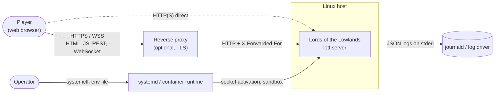
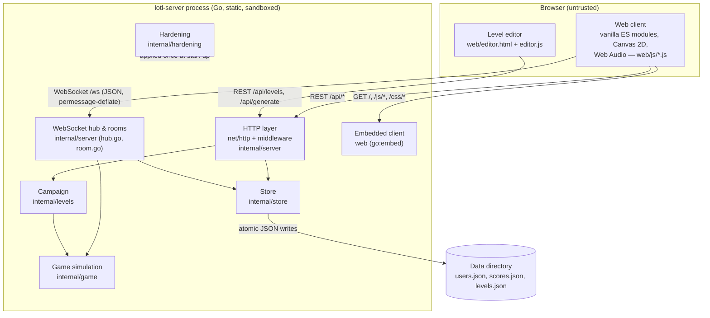
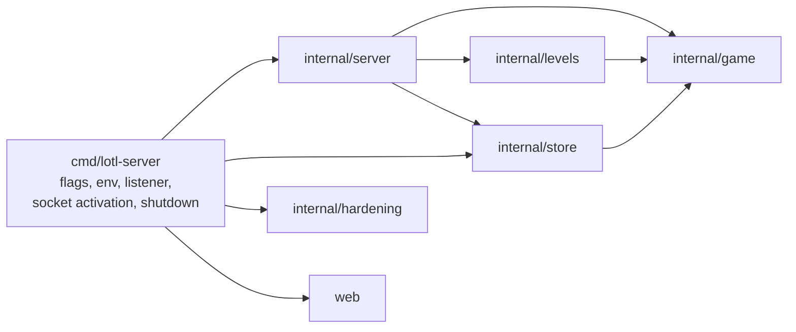
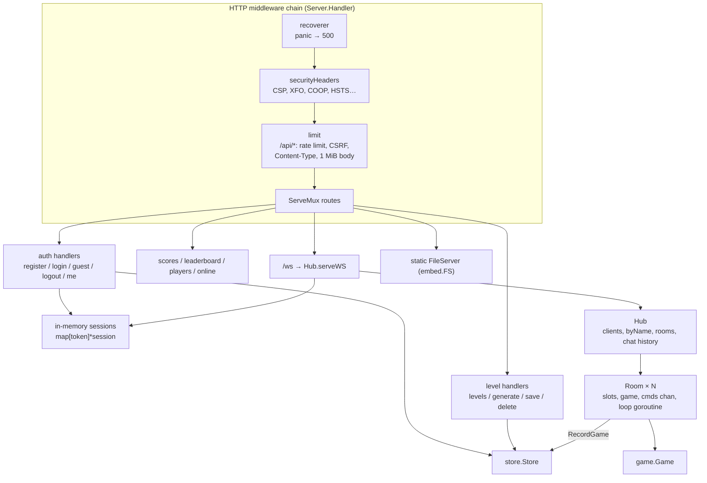
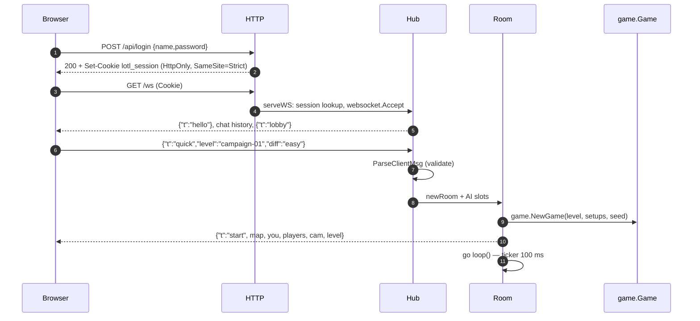
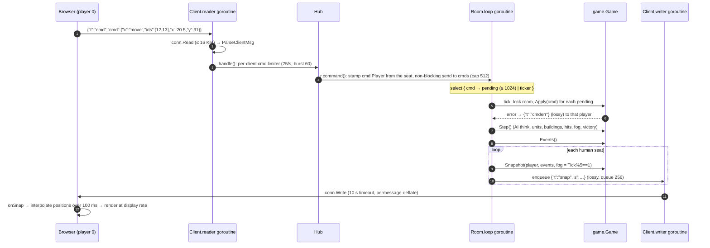
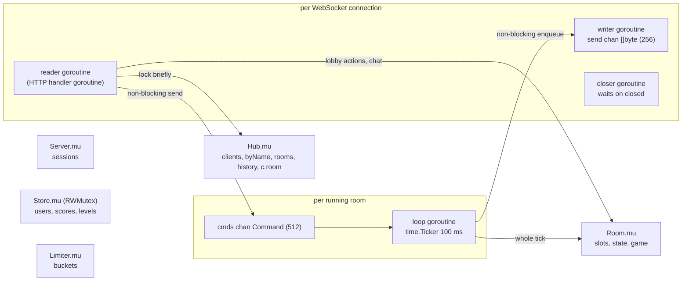
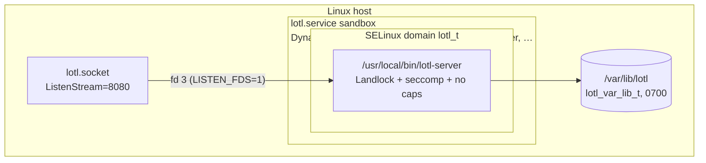

# Architecture

Lords of the Lowlands is a single Go binary (`lotl-server`) that hosts the
game simulation, the lobby/chat back-end, a small JSON-file database and the
embedded browser client. Browsers render the game and send commands; the
server is the only authority over game state.

The views below follow the [C4 model](https://c4model.com/): context →
containers → components, followed by the run-time view of a match, the
concurrency model and persistence.

## 1. System context

There are no outbound dependencies: no database server, no CDN, no external
identity provider, no telemetry. The server never opens an outbound
connection (enforced by Landlock and SELinux, see [security.md](security.md)).

## 2. Containers

| Container | Technology | Responsibility |
|---|---|---|
| Web client | ES modules, Canvas 2D, Web Audio, no build step | rendering, input, HUD, interpolation, procedural art/audio |
| Level editor | same stack, `editor.html` | painting terrain/objects/starts, save/download/upload |
| HTTP layer | `net/http` (Go 1.22+ pattern routing) | accounts, sessions, REST API, static files, security headers, CSRF and rate limiting |
| Hub & rooms | `github.com/coder/websocket` | connections, chat, lobby, room/slot management, match loop |
| Simulation | pure Go, no I/O | deterministic tick-based game rules, AI, pathfinding, fog, snapshots |
| Store | `encoding/json`, `golang.org/x/crypto/argon2` | accounts (argon2id), scores, custom levels |
| Hardening | `golang.org/x/sys/unix` | no_new_privs, capability drop, Landlock, seccomp |

## 3. Components

### 3.1 Packages

The dependency graph is acyclic and layered: `game` depends on nothing but
the standard library; `levels` and `store` depend on `game` (for `Level`
validation); `server` composes everything; `hardening` is independent and is
only called from `main`.

| Package | Key files | Main types / functions |
|---|---|---|
| `cmd/lotl-server` | `main.go` | `parseFlags`, `listener` (systemd `LISTEN_FDS`), `run` |
| `internal/server` | `server.go` | `Server`, `Config`, `routes()`, middleware `recoverer → securityHeaders → limit` |
| | `ratelimit.go` | `Limiter` (keyed token bucket), `clientIP` |
| | `protocol.go` | `ClientMsg`, `ParseClientMsg` (validation of every WebSocket message) |
| | `hub.go` | `Hub`, `Client` (reader/writer goroutines, bounded send queue), chat |
| | `room.go` | `Room`, `Slot`, lobby actions, `loop()` / `tick()`, result recording |
| `internal/game` | `game.go` | `Game`, `Entity`, `Player`, `Step()`, combat, economy, visibility, victory |
| | `commands.go` | `Command`, `Apply()` (validation + execution of player orders) |
| | `defs.go` | `Ages`, `Units`, `Buildings`, `Techs`, `Resources`, `Counter()` |
| | `path.go` | A* `findPath`, `smoothPath`, `lineClear` |
| | `ai.go` | `AI.think()` — economy, construction, research, military |
| | `snapshot.go` | `Snapshot()`, `EncodeFog()`/`DecodeFog()`, `MapView` |
| | `level.go` | `Level`, `Validate()`, `Materialize()`, procedural `generate()` |
| `internal/levels` | `levels.go` | 17 campaign `spec`s, `Campaign()`, `Get()`, `Skirmish()` |
| `internal/store` | `store.go` | `Store`, `Register`/`Authenticate`, `RecordGame`, `SaveLevel` |
| `internal/hardening` | `hardening_linux.go`, `seccomp_*.go` | `Apply()`, `DropCapabilities()`, Landlock, `BuildFilter()` |
| `web` | `embed.go`, `index.html`, `editor.html`, `js/`, `css/` | `FS()` |

### 3.2 Server components

### 3.3 Client components

| Module | Role |
|---|---|
| `main.js` | application shell: screens (login, menu, campaign, skirmish, lobby, room, hall of fame, settings), `Net` wiring, message dispatch |
| `net.js` | `Net`: WebSocket with exponential reconnect and an outbound queue (≤ 50 messages while offline) |
| `game.js` | in-match client: snapshot ingestion, interpolation, selection, control groups, command buttons, HUD, minimap, chat box |
| `render.js` | `Renderer`: isometric terrain chunks, water, entities, particles, projectiles, fog, minimap |
| `sprites.js` | procedural art: terrain palettes per theme, buildings per era, units per sprite key, icons |
| `audio.js` | Web Audio synthesiser: sound effects and generative era music |
| `editor.js` | level editor |
| `util.js` | iso projection, colours, noise, DOM helper `el()` (textContent only), `api()` fetch wrapper |

## 4. Run-time view: a match

### 4.1 Starting a game

### 4.2 One tick: command → simulation → per-player snapshot

Key properties of this flow:

- **The player index is never taken from the client.** `Room.command`
  derives it from the seat the connection occupies (`cmd.Player` has
  `json:"-"`).
- **Validation happens twice.** `ParseClientMsg` checks shape and bounds;
  `Game.Apply` checks game semantics (ownership, visibility, affordability,
  placement, age requirements).
- **Snapshots are personalised.** `Game.Snapshot(player, …)` includes only
  what that player's team can see (see [design.md §8](design.md#8-fog-of-war-and-visibility)).
- **Back-pressure is explicit.** A slow client loses snapshots (lossy) but
  never blocks the room; reliable messages that do not fit disconnect it.

### 4.3 End of game

When `Game.Over` becomes true in `tick`, the room broadcasts
`{"t":"end","results":[…],"winner":team}` (reliable), sets `State = "done"`,
leaves the loop and calls `store.RecordGame` for every registered human
(guests and AI are skipped). The room is deleted when its last human leaves.

## 5. Concurrency model

| Goroutine | Count | Blocks on | Owns |
|---|---|---|---|
| HTTP handler / WS reader | 1 per request / connection | `conn.Read` | message parsing, dispatch |
| WS writer | 1 per connection | `send` channel, `conn.Write` (10 s timeout), 20 s ping ticker | the socket's write side |
| WS closer | 1 per connection | `closed` channel | cancels the connection context |
| Room loop | 1 per playing room | ticker, `cmds`, `stop` | exclusive access to `game.Game` (under `Room.mu`) |

Rules that keep this deadlock-free and bounded:

1. **Lock order is Hub → Room.** Code that needs both (`joinRoom`) takes
   `Hub.mu` first; everything else holds only one lock at a time and copies
   what it needs before releasing it (e.g. `broadcastLobby` snapshots the
   client list, unlocks, then enqueues).
2. **No goroutine blocks while holding a lock on another goroutine's
   progress.** All sends into `Client.send` and `Room.cmds` use
   `select { case ch <- v: default: }`.
3. **`game.Game` is single-threaded.** It is only touched by the room loop
   (and by `leaveRoom`/`rejoin` under the same `Room.mu`). The simulation
   package itself contains no locks or goroutines.
4. **Every queue is bounded**: send queue 256 messages, command channel 512,
   pending commands per tick 1024, chat history 50, rate-limiter buckets
   100 000 keys.
5. **Shutdown**: `SIGINT`/`SIGTERM` → `Hub.Shutdown()` closes every room's
   `stop` channel and every client, then `http.Server.Shutdown` drains for up
   to 10 s.

## 6. Persistence

| File (in `-data`) | Content | Written when |
|---|---|---|
| `users.json` | map lower-case name → `User` (name, salt, argon2id hash, created, games, wins, losses, best score, campaign progress) | register, game recorded |
| `scores.json` | map level id → top 25 `Score` | game recorded |
| `levels.json` | map id → custom `game.Level` | level saved / deleted |

- The whole map is re-serialised on each change and written **atomically**:
  `os.CreateTemp` in the data directory → `Chmod 0600` → write → `fsync` →
  `rename` over the target. A crash leaves either the old or the new file.
- All state lives in memory and is loaded once at `store.Open`; invalid
  custom levels are dropped on load (`Level.Validate`).
- **Not persisted**: sessions (users must log in again after a restart), chat
  history, rooms and running matches.
- The data directory is the only writable path for the process (Landlock,
  systemd `ProtectSystem=strict`, SELinux `lotl_var_lib_t`).

See [ADR-0006](adr/0006-json-file-store.md) for the rationale and its limits.

## 7. Deployment view

Alternatives: the multi-stage `Dockerfile` (distroless, UID 65532,
read-only root, `/data` volume) and `docker-compose.yml`. See
[operations.md](operations.md).
