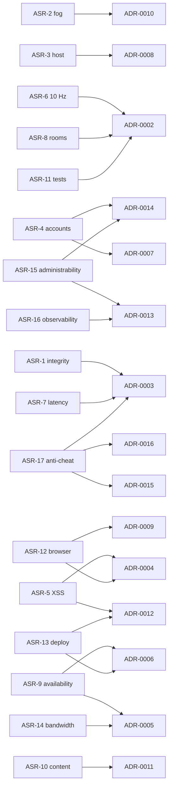

# Architecturally significant requirements

Requirements that shaped the architecture, each with a quality-attribute
scenario (source → stimulus → environment → artifact → response → measure)
and the design decisions that satisfy it. Decisions are recorded in
[adr/](adr/README.md).

## Overview

| ID | Quality attribute | Requirement | Key decisions |
|---|---|---|---|
| ASR-1 | Security — integrity | Clients cannot cheat: the server alone decides game state | [ADR-0003](adr/0003-server-authoritative-snapshots.md) |
| ASR-2 | Security — confidentiality | Clients receive no information hidden by fog of war | [ADR-0010](adr/0010-server-side-fog-filtering.md) |
| ASR-3 | Security — host protection | A compromised process cannot harm the host | [ADR-0008](adr/0008-defence-in-depth-sandbox.md) |
| ASR-4 | Security — accounts | Passwords and sessions resist offline cracking, theft and CSRF; a stolen password alone does not take over an MFA account | [ADR-0007](adr/0007-argon2id-sessions.md), [ADR-0014](adr/0014-totp-mfa-without-dependencies.md) |
| ASR-5 | Security — web | No XSS; strict CSP without `unsafe-inline` | [ADR-0004](adr/0004-vanilla-js-canvas-client.md), [ADR-0012](adr/0012-embedded-static-assets.md) |
| ASR-6 | Performance | Fixed 10 Hz simulation per match | [ADR-0002](adr/0002-go-server-and-simulation.md), [ADR-0003](adr/0003-server-authoritative-snapshots.md) |
| ASR-7 | Performance — latency | Commands take effect within one tick; smooth rendering | [ADR-0003](adr/0003-server-authoritative-snapshots.md), [ADR-0005](adr/0005-coder-websocket-deflate.md) |
| ASR-8 | Scalability | Many concurrent rooms on one modest host | [ADR-0002](adr/0002-go-server-and-simulation.md) |
| ASR-9 | Availability | One bad or slow client cannot degrade others; quick recovery | [ADR-0005](adr/0005-coder-websocket-deflate.md), [ADR-0006](adr/0006-json-file-store.md) |
| ASR-10 | Maintainability | Content (ages, units, techs, levels) is data, not code | [ADR-0011](adr/0011-data-driven-definitions.md) |
| ASR-11 | Testability | ≥ 80 % statement coverage; simulation testable headless | [ADR-0002](adr/0002-go-server-and-simulation.md), [testing.md](testing.md) |
| ASR-12 | Portability | Runs in any current desktop browser without install or plug-ins | [ADR-0004](adr/0004-vanilla-js-canvas-client.md), [ADR-0009](adr/0009-procedural-webaudio.md) |
| ASR-13 | Deployability | Single static binary; no external services | [ADR-0006](adr/0006-json-file-store.md), [ADR-0012](adr/0012-embedded-static-assets.md) |
| ASR-14 | Bandwidth | A match is playable on a modest connection | [ADR-0005](adr/0005-coder-websocket-deflate.md) |
| ASR-15 | Administrability | Operators control who plays and can act on abuse at once, with an audit trail | [ADR-0013](adr/0013-yaml-configuration.md), [ADR-0014](adr/0014-totp-mfa-without-dependencies.md) |
| ASR-16 | Observability | Health, load and latency are visible to standard monitoring without extra agents | [ADR-0013](adr/0013-yaml-configuration.md) |
| ASR-17 | Security — fair play | Cheating attempts beyond what the server already rejects are detected and acted upon | [ADR-0015](adr/0015-layered-anti-cheat.md), [ADR-0016](adr/0016-server-side-save-games.md) |

## Scenarios

### ASR-1 — Server-authoritative integrity

| | |
|---|---|
| Source | malicious player with a modified client |
| Stimulus | sends commands for enemy units, unaffordable buildings, units of a future age, placements in unexplored or blocked tiles, NaN coordinates |
| Environment | running match |
| Artifact | `Hub.handle` → `Room.command` → `Game.Apply` |
| Response | command rejected with `cmderr`; game state unchanged |
| Measure | 100 % of such commands rejected; covered by unit and fuzz tests of `Apply` and `ParseClientMsg` |

**How:** the player index comes from the seat, not the message;
`ParseClientMsg` bounds shape; `Game.Apply` validates semantics
(`ownUnits`, `canSee`, `Covers`, age checks, `footprintFree`, `finite`).
The client only renders snapshots.

### ASR-2 — No map hacking

| | |
|---|---|
| Source | player inspecting WebSocket traffic |
| Stimulus | reads every snapshot |
| Environment | running match with fog of war |
| Artifact | `Game.Snapshot`, `canSee`, event filter |
| Response | snapshots contain only allied entities, enemy units on visible tiles, buildings/resources on explored tiles; private fields only for allies |
| Measure | 0 hidden enemy units in any snapshot (test: snapshot of player A never contains player B's units outside A's team vision) |

Known gap: remembered enemy buildings are sent with live state
([security.md](security.md#38-known-limitations)).

### ASR-3 — Host protection

| | |
|---|---|
| Source | attacker with remote code execution in the server process |
| Stimulus | tries to spawn a shell, read `/etc/shadow` or other services' files, connect to internal services, load a kernel module, ptrace |
| Environment | production (systemd unit or container) |
| Artifact | process sandbox |
| Response | each attempt fails with `EPERM`/`EACCES` |
| Measure | `execve`, `ptrace`, `mount`, `bpf`, … denied by seccomp; reads/writes outside the data dir and outbound TCP denied by Landlock (ABI ≥ 4) and SELinux; `systemd-analyze security` exposure ≤ 2.0 (currently 1.2) |

**How:** in-process `hardening.Apply` (no_new_privs, caps, Landlock,
seccomp) plus systemd and SELinux as independent outer layers, plus
distroless/read-only containers.

### ASR-4 — Account security

| | |
|---|---|
| Source | attacker with a copy of `users.json`; attacker site visited by a logged-in user; online guesser |
| Stimulus | offline cracking; cross-site POST/WebSocket; password spraying |
| Artifact | `store`, `server` sessions and middleware |
| Response | hashes are memory-hard; cross-site requests refused; guessing throttled |
| Measure | argon2id m = 19 MiB, t = 2 (≈ tens of ms per guess on a server core); CSRF requests → 403; ≤ 12 login attempts per IP per minute after the burst (default `authRate`); with MFA a password without the current TOTP code yields no session, and each code works once |

### ASR-5 — XSS resistance

| | |
|---|---|
| Source | player choosing a name, chat text or level description |
| Stimulus | injects `<script>`, event handlers or bidi tricks |
| Artifact | `CleanText`, `ValidName`, client `el()`, CSP |
| Response | text displayed literally; no script executes |
| Measure | CSP `script-src 'self'` with no inline/eval; no `innerHTML` in `web/js` (grep check) |

### ASR-6 — Simulation rate

| | |
|---|---|
| Source | room loop ticker |
| Stimulus | 100 ms tick |
| Environment | normal load: ≤ 200 rooms, up to 8 players and 200 population each on ≤ 128×128 maps |
| Artifact | `Room.tick` → `Game.Step` |
| Response | tick completes and snapshots are queued |
| Measure | `Step` + snapshots take well under 100 ms (target < 10 ms per room at typical sizes; benchmark with `go test -bench`); `time.Ticker` drops ticks rather than piling up under overload |

**How:** spatial hash (4×4 cells) for proximity queries; A* bounded to
4 000 expansions with reused scratch arrays; AI thinks once per second,
staggered by player; fog every 2nd tick; one goroutine per room so rooms
run on all cores.

### ASR-7 — Latency and smoothness

| | |
|---|---|
| Source | player |
| Stimulus | issues a move order |
| Response | units start moving at the next tick; motion rendered smoothly at display rate |
| Measure | server-side latency ≤ 1 tick (100 ms) + network RTT; client interpolates over 100 ms so motion is continuous at 60 fps |

**How:** commands are queued to the room immediately (non-blocking
channel) and applied at the start of the next tick; snapshots are written
by a per-client writer goroutine; the client lerps between snapshots.

### ASR-8 — Rooms scale

| | |
|---|---|
| Source | many players |
| Stimulus | 200 concurrent rooms |
| Artifact | hub, rooms |
| Response | all rooms tick independently |
| Measure | `-max-rooms` (default 200) enforced; memory per room dominated by the map (`W·H` arrays) and entities — bounded by the map and population limits; `MemoryMax=1G` in the unit |

**How:** rooms share nothing but the hub's index; the simulation has no
global state besides immutable definitions; Go schedules room goroutines
across cores.

### ASR-9 — Availability under misbehaving clients

| | |
|---|---|
| Source | slow, malicious or buggy client |
| Stimulus | stops reading; floods messages; sends oversized frames; causes a panic |
| Artifact | `Client.enqueue`, limiters, `recoverer`, read limits |
| Response | that client loses snapshots or is disconnected; others unaffected; process keeps running |
| Measure | per-client queue ≤ 256; write timeout 10 s; 25 cmd/s, 1 chat/s; 16 KiB frames; HTTP timeouts; restart on failure within 2 s (`Restart=on-failure`, `RestartSec=2s`); data never half-written (atomic rename) |

### ASR-10 — Data-driven content

| | |
|---|---|
| Source | game designer |
| Stimulus | adds an age-specific unit or changes balance |
| Artifact | `defs.go` rosters and templates, `levels.go` specs |
| Response | new unit appears in the right building with scaled stats; client needs no change (it reads `/api/defs`) |
| Measure | one roster entry (≈ 1 line) per new unit; one `spec` per campaign level; no client code change for new units with an existing sprite key |

### ASR-11 — Testability

| | |
|---|---|
| Source | developer / CI |
| Stimulus | `make cover` |
| Response | all packages tested without network or browser |
| Measure | ≥ 80 % statement coverage overall (currently 92.4 %); AI-vs-AI simulations run headless in seconds; fuzz targets for all parsers, including saved games |

**How:** `internal/game` is pure (no I/O, no goroutines, no clock); server
components accept injected clocks (`Server.now`, `Limiter.now`) and run
under `httptest`; the store works on a temporary directory.

### ASR-12 — Browser portability

| | |
|---|---|
| Source | player |
| Stimulus | opens the URL in a current Chrome, Firefox, Safari or Edge |
| Response | game loads and plays with sound |
| Measure | no plug-ins, no WebGL requirement, no downloads besides about 210 KB of uncompressed JS/CSS/HTML; Canvas 2D, ES modules, WebSocket, Web Audio only |

### ASR-13 — Deployability

| | |
|---|---|
| Source | operator |
| Stimulus | installs on a fresh Linux host |
| Response | running service in minutes |
| Measure | one static binary + optional unit files; no database, no runtime, no outbound network; `deploy/install.sh` or `docker compose up` |

### ASR-14 — Bandwidth

| | |
|---|---|
| Source | player on a modest connection |
| Stimulus | 10 snapshots per second |
| Response | game remains playable |
| Measure | compact JSON (≈ 6 KB raw per snapshot at the start of a small map), permessage-deflate with context takeover, fog RLE at 2 Hz; dropped snapshots are harmless because each is complete |

### ASR-15 — Administrability

| | |
|---|---|
| Source | game administrator |
| Stimulus | a griefer must be stopped; a new account must be approved; an admin lost their phone |
| Environment | production, players online |
| Artifact | `/admin.html`, `/api/admin/*`, `rawSession`, `store` |
| Response | block takes effect on the next request and closes the player's socket; approval activates the account; another admin resets MFA; every action lands in `audit.log` |
| Measure | 1 request per action; 0 requests served to a blocked account after the change; the last admin cannot be locked out; 100 % of admin changes audited |

**How:** per-request session re-validation, `dropSessionsOf` + `hub.kick`,
registration modes, bootstrap admin from configuration, TOTP for admins,
JSON-lines audit log.

### ASR-16 — Observability

| | |
|---|---|
| Source | operator / Prometheus |
| Stimulus | scrapes every 15–60 s; load balancer health checks |
| Environment | production behind a proxy |
| Artifact | `/healthz`, `/readyz`, `/api/health`, `/api/stats`, `/metrics` |
| Response | liveness, readiness (data dir writable), counters, tick and HTTP latency histograms, runtime gauges |
| Measure | standard Prometheus text format; scrape cost O(rooms + users) with only brief hub/room/histogram locks; diagnostics not public unless configured (token ≥ 16 chars) |

**How:** atomic counters on hot paths, fixed-bucket histograms with a
1 024-sample ring for percentiles, `diagAllowed` access rule.

### ASR-17 — Anti-cheat

| | |
|---|---|
| Source | player with a modified client, a bot, or a proxy injecting traffic |
| Stimulus | replays/injects commands, runs scripted micro at inhuman speed, probes hidden entities, edits a saved game |
| Environment | running match |
| Artifact | `anticheat.go`, `integrity.js`, `Room.tick`, `store` saves |
| Response | forged commands dropped; events scored; warn, then removal from the game, account flag, audit entry; results not recorded; saves cannot be edited |
| Measure | 100 % of unsigned/forged/replayed commands rejected when signing is on; kick at `kickScore` (default 100, i.e. ≥ 4 forged commands); no single honest-latency event exceeds `warnScore`; save tampering impossible without file-system access |

**How:** HMAC-SHA256 with per-connection key and sequence numbers, module
digests vs served files, fog-based inspection before `Apply`, sliding APM
window, server-side saves. Limitation: client checks can be bypassed by a
determined cheater; server authority (ASR-1) and fog filtering (ASR-2)
remain the real protection.

## Traceability

