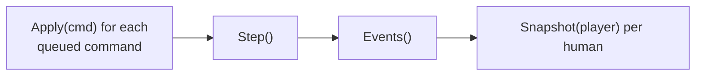
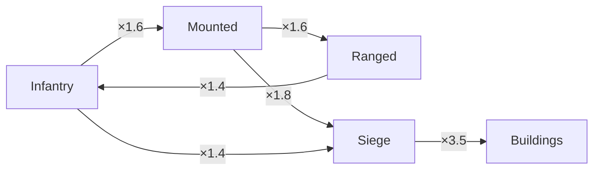
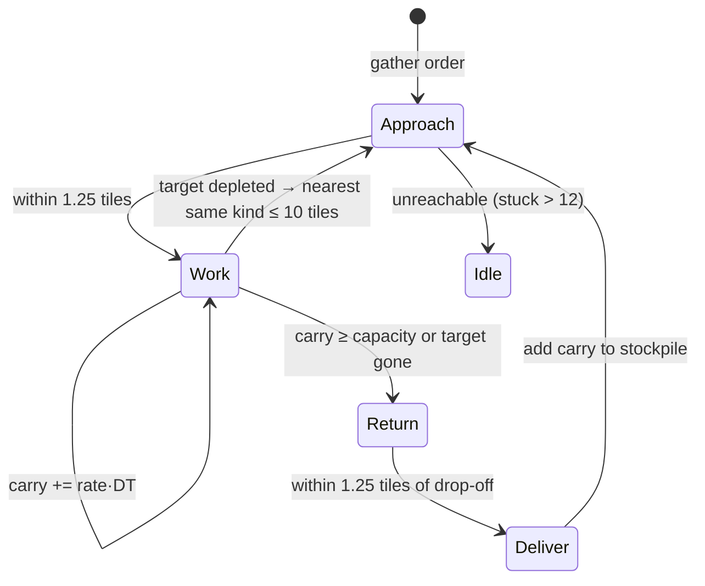
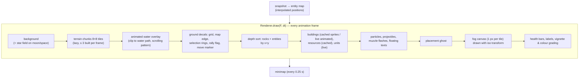
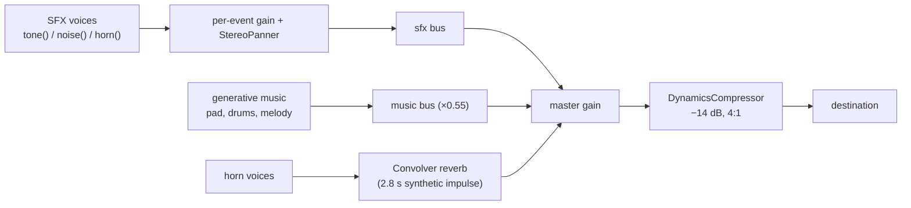

# Detailed design

This document describes how the game works internally. Player-facing rules
and tables are in [game-design.md](game-design.md); the system structure is
in [architecture.md](architecture.md). Numeric constants are quoted from the
source at the time of writing — `internal/game/defs.go` and `GET /api/defs`
are authoritative.

## 1. Simulation model

| Property | Value | Source |
|---|---|---|
| Tick rate | 10 Hz (`TickRate = 10`, `DT = 0.1 s`) | `game.go` |
| Authority | server only; clients send intents (`Command`) | `room.go`, `commands.go` |
| Time base | integer `Game.Tick`; all rates are per second × `DT` | |
| Random numbers | one `math/rand.Rand` per game, seeded with `time.Now().UnixNano()` | `room.startLocked` |
| Coordinates | continuous `float64` tile units; tile `(x,y)` covers `[x,x+1)×[y,y+1)` | |
| Population cap | 200 (`PopLimit`) | |
| Players | 2–8 (`MaxPlayers = 8`); owner `-1` (`Nature`) for animals/resources | |

`Room.tick` performs, under the room mutex:

`Game.Step()` order:

1. `Tick++`, rebuild the spatial hash (`buildGrid`: 4×4-tile cells of units and buildings).
2. AI players think once per second: `(Tick + index*3) % 10 == 0` (staggered).
3. Every live entity in creation order (`g.order`): `stepUnit` or `stepBuilding`.
4. `separate()` — soft collision: push overlapping ground units apart (0.45 tiles, 0.7 if either has pop > 1). Busy (working) units are never pushed; units walking along a path are never pushed either and pass through other walkers and busy units, while units standing in their way step aside. This keeps workers flowing in narrow lanes between trees and around crowded drop-offs (before, two workers meeting head-on shoved each other back indefinitely). A gather order remembers the resource kind, so a worker whose tree is felled by someone else moves on to the next tree of that kind; a worker that cannot reach its drop-off stops but keeps its load.
5. `resolveHits()` — apply damage whose impact tick has arrived.
6. Every 2nd tick: `updateVisibility()`.
7. Every 10th tick: recompute population of every player and `checkVictory()`.

**Determinism.** The simulation is seeded and contains no wall-clock or I/O
dependence, but it is *not* designed for bit-identical replay: a few searches
iterate Go maps (`nearestResource`, `nearestDropoff`, spatial-hash cells) and
can break ties differently between runs. This is acceptable because the
server is the single authority (no lockstep, see
[ADR-0003](adr/0003-server-authoritative-snapshots.md)).

## 2. Entity model

One struct, `game.Entity`, represents everything on the map; `Kind`
selects which fields are meaningful.

| Kind | Const | Def pointer | Notable fields |
|---|---|---|---|
| Unit | `KUnit = 0` | `U *UnitDef` | `Order`, `Target`, `TX/TY`, `Path`, `Carry/CarryRes`, `Cooldown`, `Facing`, `Busy` |
| Building | `KBuilding = 1` | `B *BuildingDef` | `TileX/TileY`, `Built`, `Progress`, `Queue []QItem` (≤ 10), rally point, `Food` (farms) |
| Resource | `KResource = 2` | `R *ResourceDef` | `Amount` |

Common: `ID` (monotonic), `Type`, `Owner`, `X/Y`, `HP/MaxHP`, `Age` (the
owner's age at creation — units and buildings keep the stats they were
created with).

**Unit orders** (`Order`): `OIdle, OMove, OAttackMove, OAttack, OGather,
OBuild, OFlee, OWander`. Animals use `OWander`/`OFlee`/`OAttack`.

**Occupancy.** `Game.occ[]` maps each tile to the blocking entity ID (0 =
free). Buildings (except farms) and blocking resources (trees, mines,
berries, crystals) occupy tiles; `walkable(x,y)` = passable terrain and
`occ == 0`. Units do not occupy tiles; they are kept apart by `separate()`.

**Lifecycle.** `newEntity` → `g.Ents[id]` + append to `g.order`; `remove`
marks `dead`, clears occupancy and deletes from the map; `g.order` is
compacted lazily at the next `Step`. Killing an animal spawns a non-blocking
`carcass` resource with the animal's food value; hunters switch to gathering
it.

## 3. Ages and eras

Seventeen ages (`Ages[0..16]`) are grouped into ten visual **eras** that
drive building names, sprites and music:

| Era | Ages |
|---|---|
| stone | 0 Dawn, 1 Neolithic |
| bronze | 2 Copper, 3 Bronze |
| iron | 4 Iron |
| classical | 5 Classical |
| medieval | 6 Early Middle Ages, 7 High Middle Ages |
| gunpowder | 8 Renaissance, 9 Imperial |
| industrial | 10 Industrial, 11 Machine |
| modern | 12 Atomic, 13 Information |
| future | 14 Orbital |
| space | 15 Interplanetary, 16 Interstellar |

Advancing is a town-centre queue item (`research` with `w: "age"`) costing
`Ages[age+1].AdvanceCost` and taking `AdvanceTime` seconds; only one age
advance may be queued per player and never beyond the level's `MaxAge`.

## 4. Units

### 4.1 Data-driven unit lines

Units are generated in `buildDefs()` from **five line templates** (age-0
stats) and **per-age rosters** (name, sprite, projectile, flying, splash):

| Line | HP | Atk | Armor | Range | Reload | Speed | Sight | Train s | Base cost | Pop | Trained at | First age |
|---|---|---|---|---|---|---|---|---|---|---|---|---|
| worker | 25 | 3 | 0 | 0.7 | 1.5 | 1.05 | 4 | 10 | 50 F | 1 | town_center | 0 |
| infantry | 48 | 6 | 0.10 | 0.8 | 1.4 | 1.0 | 5 | 14 | 55 F 25 G | 1 | barracks | 0 |
| ranged | 32 | 5 | 0 | 5.0 | 1.8 | 1.0 | 7 | 15 | 30 F 40 W 15 G | 1 | range | 0 |
| mounted | 95 | 8 | 0.15 | 0.9 | 1.6 | 1.7 | 6 | 20 | 70 F 60 G | 2 | stable | 2 |
| siege | 85 | 26 | 0.25 | 7.0 (min 2) | 4.0 | 0.65 | 8 | 30 | 160 W 110 G | 3 | workshop | 3 |

`makeUnit(template, spec, age)`:

| Rule | Formula |
|---|---|
| HP, attack | × `ageScale = 1 + 0.30·age` |
| Cost | × `costScale = 1 + 0.22·age` (rounded) |
| No gold before Copper Age | age < 2: gold cost is added to food |
| Money economy | age ≥ 8, non-workers: food ← round(food·0.5), gold += round(food·0.35) |
| Energy | age ≥ 10, non-workers: `round(10 + 4·(age−10)·(1+pop))` energy |
| Speed | mounted/siege ×1.15 from age 11, ×1.35 from age 14; workers ×1.15 from age 10 |
| Firearm infantry | infantry with a projectile: range 3.5 |
| Mounted shooters | range 4; with splash (tanks): range 5, reload 2.6 |
| Flying | speed 2.1, range ≥ 3.5 (fighters, drones, frigates, dreadnoughts) |
| Ram | melee: range 0.9, no projectile, no minimum range |
| Gunpowder ranged | age ≥ 8: range 5.5 |

Boats are generated separately by `buildNaval()` (all `Naval: true`,
trained at the `dock`):

| Line | HP | Atk | Armor | Range | Reload | Speed | Sight | Train s | Base cost | Pop | Ages |
|---|---|---|---|---|---|---|---|---|---|---|---|
| fisher | 45 | — | 0 | 0.7 | 1.5 | 1.4 | 5 | 14 | 60 W | 1 | 1–16 |
| naval (warship) | 130 | 7 | 0.15 | 5.5 | 2.2 | 1.45 | 7 | 26 | 20 F 110 W 45 G | 2 | 1–14 |

HP and attack × `ageScale`, cost × `costScale`; warships charge gold as food
before age 2 and `round(20 + 8·(age−10))` energy from age 10.

A building always trains the **best unit of its line for the owner's
current age** (`BestUnit`), whatever id the client requested; units already
on the field are not upgraded.

### 4.2 Counter matrix

`Counter(attackerClass, targetClass)` multiplies damage. Buildings shoot as
`ranged`. Rows: attacker; columns: target.

| att \ tgt | worker | infantry | ranged | mounted | siege | animal | building |
|---|---|---|---|---|---|---|---|
| **worker** | 1 | 1 | 1 | 1 | 1 | 1 | **0.3** |
| **infantry** | 1 | 1 | 1 | **1.6** | **1.4** | 1 | 1 |
| **ranged** | 1 | **1.4** | 1 | 1 | 1 | 1 | **0.4** |
| **mounted** | 1 | 1 | **1.6** | 1 | **1.8** | 1 | 1 |
| **siege** | 0.7 | 0.7 | 0.7 | 0.7 | 0.7 | 0.7 | **3.5** |
| animal | 1 | 1 | 1 | 1 | 1 | 1 | 1 |

Boats: attacker class `naval` deals ×1.3 to buildings and ×1.2 to `fisher`
and `naval` targets, ×1 otherwise; siege deals 0.7 to boats; all other
classes deal ×1 to boats.

The resulting cycle: infantry → mounted → ranged → infantry, with siege as
the building breaker that every other line (especially mounted) punishes.

### 4.3 Combat

| Step | Rule |
|---|---|
| Target acquisition | idle military units scan every 5 ticks within `Sight`; attack-move scans every 4 ticks; `findEnemy` prefers units (buildings +6, workers +1.5 distance penalty) |
| Approach | direct chase without pathfinding when the line is clear and target < 10 tiles; otherwise A* with periodic repath; give up after 25 failed chase steps or when a non-visible target is > 3×sight away |
| Minimum range | units with `MinRange` (siege, 2 tiles) step back from units that come too close |
| Firing | on cooldown expiry: attack × owner `attackMul` (workers: × `1 + 0.25·age`); building attack × `(1 + 0.3·age) × attackMul` |
| Projectile flight | impact delay `1 + ⌊dist / speed · 10⌋` ticks; speed 30 (bullet, laser, rail, ion), 14 (plasma, missile, rocket), 8 (boulder, shell, cannonball), 9 otherwise; melee hits land next tick |
| Damage | `dmg = atk · Counter · (1 − armor)`, minimum 0.5; unit armor = def armor + owner `armorAdd` (not for workers); buildings 0.5 (0.2 while unbuilt); armor capped at 0.8 |
| Splash | half damage to every hostile entity within `Splash` tiles of the impact point |
| Retaliation | idle military units counter-attack; passive animals flee 6 tiles, aggressive ones (boar, mammoth) attack |
| Alerts | the victim's owner gets an `alert` event at most every 10 s |

## 5. Economy

### 5.1 Resources

Five resources: Food, Wood, Stone, Gold, Energy (`Res [5]float64`).

| Object | Resource | Amount | Rate mult. | Blocks tile |
|---|---|---|---|---|
| tree | Wood | 120 | 1.0 | yes |
| berry | Food | 150 | 0.9 | yes |
| gold | Gold | 800 | 0.8 | yes |
| stone | Stone | 700 | 0.8 | yes |
| crystal | Energy | 600 | 0.7 | yes |
| carcass | Food | animal's food (deer 120, boar 260, mammoth 650) | 1.3 | no |
| fish | Food | 350 | 1.1 | no (in water; boats only) |

### 5.2 Gathering loop

| Quantity | Formula |
|---|---|
| Gather rate (per s) | `0.7 · rateMult · gatherMul · (1 + 0.06·age) · aiBonus`, × `fishMul` for fish, × `miningMul` for gold and stone |
| Farm rate | as above with rateMult 0.8 |
| Carry capacity | `10 + unitAge` |
| Worker move speed | × `1 + 0.03 · techsResearched` |
| Drop-offs | town centre: F/W/S/G · granary: F · lumber camp: W · mining camp: S/G/Energy · dock: F (the only drop-off for boats) |

**Farms** are 3×3, non-blocking buildings holding
`320 · (1 + 0.25·age) · farmBase · farmMul` food (`farmBase` 0.6 on desert,
1.15 on riverland, else 1; `farmMul` from farm techs); one worker gathers from a farm until it is exhausted, then the farm
disappears (`depleted` event). Workers ordered to a foundation build it;
after finishing a farm they start farming it, after finishing a drop-off
they gather the nearest matching resource within 7 tiles.

**Energy** (from the Industrial Age) comes from crystals and from
**generators**: each built generator yields
`0.6 · (1 + 0.25·(age − 10)) · gatherMul` energy per second. From age 10
most military units and from age 11 technologies cost energy.

**Housing.** Town centre +10, house +5 population, capped at 200. A unit
queue item does not start while `pop + unit.pop > popCap`.

**Costs of buildings** scale with the builder's age:
`cost · (1 + 0.12·age)` (houses `1 + 0.05·age`); before the Copper Age gold
is charged as food. Building HP scales with `1 + 0.2·age`. Cancelling a
foundation refunds 75 %; cancelling a queue item refunds its full price.

## 6. Technologies

68 technologies: one of each kind per age (`<kind>_<age>`), researched at
the academy, available from their age onward.

| Kind | Effect per tech | Base cost (× `1 + 0.35·age`) |
|---|---|---|
| gather | `gatherMul += 0.15` (also boosts generators) | 100 F 75 W |
| attack | `attackMul += 0.10` (units and buildings) | 120 F 60 G |
| armor | `armorAdd += 0.05` (non-worker units) | 120 F 60 W 40 G |
| hp | `hpMul += 0.10`, applied retroactively to all own units and buildings | 80 F 80 W 60 S |

Research time is `25 + 2·age` s; gold is charged as food before age 2;
from age 11 each tech also costs `50 + 20·(age − 11)` energy. Each tech
also makes workers 3 % faster.

**Map-specific technologies** (`mapTechs`) have a `mapTypes` list;
`TechDef.AllowedOn(level.mapType)` gates research (`queueResearch`).

| id | Age | Kind | Effect | Map types |
|---|---|---|---|---|
| `irrigation` | 1 | farm | `farmMul += 0.5` | desert, riverland |
| `qanats` | 5 | farm | `farmMul += 0.4` | desert |
| `terraces` | 2 | farm | `farmMul += 0.25` | highland |
| `fishing_nets` | 2 | fish | `fishMul += 0.3` | coastal, riverland, lakes |
| `navigation` | 4 | naval | `navalMul += 0.2` | coastal, riverland, lakes |
| `steam_ships` | 10 | naval | `navalMul += 0.25` | coastal, riverland, lakes |
| `deep_mining` | 3 | mining | `miningMul += 0.3` | highland, desert |
| `caravans` | 4 | gather | `gatherMul += 0.1` | desert, inland |

`farmMul` applies to farms placed afterwards. `navalMul` scales the hit
points of new and existing boats and the attack of warships.

## 7. Computer opponent

`internal/game/ai.go`. The AI is a player like any other: it reads the
same `Game` state but issues orders through the same functions as
`Apply` (`queueUnit`, `queueResearch`, `Apply(CmdBuild/CmdAMove)`), so it
pays costs, respects population, age and placement rules. Its advantages
are fixed by its `DifficultyProfile` (`Profiles` in `ai.go`):

| Difficulty | `Bonus` (gather, build, train speed) | `AttackSize` | `FirstAttack` (min) | `Trickle` (res/s each) | `FullVision` |
|---|---|---|---|---|---|
| `super_easy` | 0.55 | 20 | 12 | — | — |
| `easy` | 0.75 | 14 | 7 | — | — |
| `normal` | 1.0 | 10 | 4 | — | — |
| `hard` | 1.3 | 8 | 3.5 | — | — |
| `super_hard` | 1.6 | 7 | 3 | 0.3 | — |
| `insane` | 2.0 | 6 | 2.5 | 0.8 | yes |

`Trickle` is added every tick in `Step` for every resource (energy only from
age 10). `FullVision` marks every tile visible for that AI in
`updateVisibility` (it only affects the AI itself; snapshots for humans are
unchanged). The profile's `Defend` flag controls whether the AI pulls its army back to fight raiders near its town centre; `super_easy` does not defend.

Every second (`think`) it runs four planners:

| Planner | Behaviour |
|---|---|
| economy | keeps up to `14 + 3·age` workers (max 45); target split F/W/S/G = 45/35/10/10 (50/38/12/0 before Copper, 35/25/10/18/12 incl. energy from Industrial); idle workers go to the most under-staffed resource; every 5th `think` (every 5 s) one worker moves from the most over-stocked to the scarcest resource; food prefers free farms, then hunting/foraging within 26 tiles, then new farms |
| construction | houses when within 6 of the cap; drop-off camps when a resource is > 9 tiles from one; a fixed build plan (barracks, range, academy, stable, workshop, tower, generator, then second barracks/range/stable) gated by age and worker count; more farms when wild food runs out |
| research | advance the age when it has ≥ `10 + age` workers and can pay; otherwise academy techs in the order gather → attack → armor → hp, keeping half the next age cost in reserve |
| military | trains the best unit at every military building (≤ 2 queued). It keeps a standing army of `4 + age/3 + minutes/4` (capped at the attack size) and only then saves for the next age, unless the advance is already 60 % paid. Defends against visible enemies within 14 tiles of its town centre with every soldier not out on an attack. After `FirstAttack` minutes, when the army reaches the attack size (`AttackSize` + age/2, minus 1 per 3 minutes after minute 40, at least 6), it commits exactly those units as a **wave** (`AI.wave`), stages them at 55 % of the way to the nearest enemy building (town centres preferred) for 30 s, then attack-moves; recruits wait at home for the next wave. When the wave falls below a third it regroups at home and waits 60 s; each wave raises the next attack size by 2. Once no enemy town centre is left, all soldiers join the wave (mop-up) |
| fleet (`fleet`) | warships are steered separately from the land army: idle ships attack-move to the nearest enemy ship or fishing boat (preferred, distance halved) or to any enemy within 4 tiles of open water |

| naval (`naval`) | only if `Game.Naval` and the dock's age is reached: builds one dock on the nearest explored water tile within 30 tiles of the town centre (needs ≥ 8 workers; at most one dock placement per 40 s); trains fishing boats up to `3 + age/3`, then warships when it has > 4 military units and half the next age cost; sends idle boats to the nearest fish within 40 tiles |

If its town centre is lost the AI tries to rebuild one with any surviving
worker.

Attack-moves (and moves) aimed at a tile nobody can stand on — the centre of
a building, a forest, a cliff — path to the nearest ring (up to 6 tiles) that
can be stood on (`findPath`). Previously such orders found no path at all,
which left whole armies standing still in front of an enemy town centre. In campaign quick games all AI opponents share team 2 against the
human on team 1.

## 8. Fog of war and visibility

- **Vision sources**: every owned unit (`Sight`) and building
  (`Sight + size/2`, 2 while unbuilt) marks tiles within a circle as
  *visible* for its **team**; visible tiles also become *explored*.
  Recomputed every 2nd tick.
- **Filtering** (`Game.canSee`, used by `Snapshot` and `Apply`):
  - own and allied entities: always;
  - enemy and wild **units**: only on currently *visible* tiles;
  - **resources**: once their tile is *explored*;
  - enemy **buildings**: once they have been *seen* (on a visible tile) at
    least once; remembered afterwards.
- **Commands** may only target entities the player can see; buildings may
  only be placed on explored tiles.
- **Events** (shots, deaths, construction sounds …) are forwarded only if
  they belong to an ally or happen on a visible tile; `alert` events only to
  their owner; `gameover`/`defeated` to everyone.
- **Hidden fields**: for non-allied entities the snapshot omits carried
  resources, absolute max HP, production queues, rally points and farm food.

Limitation: remembered enemy buildings are reported with their *current*
state (HP fraction, construction progress, destruction) rather than a frozen
last-seen copy. See [security.md](security.md#38-known-limitations).

## 9. Pathfinding and movement

`internal/game/path.go`.

| Aspect | Implementation |
|---|---|
| Graph | tile grid, 8-connected; diagonal moves forbidden if either orthogonal neighbour is blocked (no corner cutting) |
| Cost | 1 orthogonal, √2 diagonal, × 1.3 on fords (`TShallow`) |
| Search | A* with a binary heap and `heap.Fix` decrease-key; weighted heuristic `1.2 × octile distance` to a goal **rectangle** |
| Effort bound | at most max(4 000, map area / 6) expansions per request (`expandBudget`, e.g. ≈ 10 900 on 256×256); if the goal is not reached the path leads to the closest tile found |
| Goals | rectangles: the ring around a building, the 3×3 around a blocking resource, a single tile for moves; goal tiles may be entered even if occupied by the target |
| Memory | per-game scratch arrays (`pathG`, `pathFrom`, generation-stamped marks) reused across searches — no per-search allocation of `W·H` arrays |
| Smoothing | greedy line-of-sight pruning over a window of 24 waypoints; `lineClear` samples 3 points per tile with a ±0.3 box for unit radius |
| Repath | every 0.8–1.5 s when the path is exhausted, when a new building blocks the way, or when a chased unit moved > 2 tiles from the path end |
| Formations | group moves spread units on a √n × √n grid with 0.8-tile spacing around the target |
| Flying units | move in straight lines, ignore terrain and occupancy, never separate from ground units |
| Naval units | same A*, but `terrainOK` accepts only water and fords while `Game.navalCtx` is set ([ADR-0017](adr/0017-naval-movement-domain.md)); the flag is set around boat updates, spawning at a dock, orders in `Apply`, separation and AI fishing; boats only separate from boats |

## 10. Snapshot protocol and compression

At game start each human receives one `start` message containing the
static `MapView` (dimensions, tiles as a string of digits `'0'..'6'`,
theme, objective). Thereafter every tick (10 Hz) each human receives a
per-player snapshot. Units, buildings and state are always complete;
**resources** (trees, mines, bushes — most of a large map's entities, and
almost static) are delta-encoded (`Game.SnapshotDelta`):

| Field | Content |
|---|---|
| `tick`, `time` | simulation tick, seconds |
| `you`, `res`, `pop`, `cap`, `age`, `techs` | private player state (resources truncated to integers) |
| `ents` | `EntView` per visible entity: compact one/two-letter keys, coordinates rounded to 0.01, HP as a 0..1 fraction, zero values omitted (`omitempty`) |
| `ev` | filtered events of this tick |
| `fog` | run-length-encoded visibility, **only every 5th tick** (`Tick % 5 == 1`) |
| `players` | public per-player info (name, team, colour, AI, age, defeated, score) |
| `over`, `winner` | end state |
| `key` | keyframe: `ents` lists every resource the player knows. Sent every 50 ticks (5 s, `keyframeTicks`) and as the first snapshot a client gets for a game (`Client.keyedFor`) |
| `gone` | in deltas: ids of resources used up this tick |

In a delta, a resource is listed only if it appeared or its amount changed
this tick, or if it is currently in the player's sight (so newly explored
resources appear at once). The client keeps unlisted resources between
keyframes, drops `gone` ones, and on a keyframe removes anything not listed.

Bandwidth techniques:

1. **Compact JSON** — short keys (`i,k,t,o,x,y,h,…`), rounding, `omitempty`.
2. **Fog RLE** — `EncodeFog` writes runs as `<state><count>,` with states
   `0` unexplored, `1` explored, `2` visible (row-major); because vision is
   made of large contiguous areas this is far smaller than one byte per
   tile, and it is sent at only 2 Hz.
3. **permessage-deflate with context takeover**
   (`websocket.CompressionContextTakeover`): consecutive snapshots are
   highly similar, so the shared LZ77 window removes most of the
   repetition (e.g. static resources).
4. **Lossy delivery** — snapshots are enqueued with `lossy=true`; when a
   client's 256-message queue is full the snapshot is dropped and the next
   one supersedes it. Units and buildings are always complete, so drops are
   harmless; a dropped resource change is repaired by the next keyframe.
5. **Resource deltas** — see `key` / `gone` above.

Measured uncompressed sizes of a spectator snapshot (everything visible):
85 KB keyframe vs 15 KB delta on 84×84; 1 MB keyframe vs 15 KB delta on
192×192. Player snapshots early in a game are 6–12 KB; the wire size after
deflate is much smaller.

The client keeps an entity map keyed by id, records the previous rendered
position and **linearly interpolates** to the new position over 100 ms
(one tick), giving smooth motion at any display refresh rate. Entities
absent from a snapshot are removed.

## 11. Client rendering pipeline

`web/js/render.js`, `web/js/sprites.js`. Canvas 2D only, no WebGL, no image
files; everything is drawn procedurally.

| Stage | Technique |
|---|---|
| Projection | isometric 2:1, tile 64×32 px, height unit 32 px (`util.js` `iso()`/`unIso()`) |
| Terrain "shader" | each 8×8-tile chunk is rendered once into an off-screen canvas by a per-pixel software shader (`buildChunk`): inverse-project the pixel to world space, sample fBm and value noise, **bilinearly blend the colours of the four nearest tiles** with noise-perturbed, smooth-stepped weights (soft, organic transitions instead of hard tile edges), shade shores by distance to water, apply a low-frequency light gradient; colours come from the theme palette (`THEMES` in `sprites.js`) |
| Water | each chunk keeps a `Path2D` of its water/ford tiles; per frame the chunk is clipped to it and a pre-rendered wave-crest pattern is scrolled diagonally with time at 35 % opacity (skipped in the space theme) |
| Mountains | pre-built rock sprites in 6 variants, depth-sorted with entities |
| Depth sorting | painter's algorithm on `x + y`; buildings sort by their far corner (`(x−s/2)+(y−s/2)+2s−1.2`), farms always first, carcasses slightly behind, flying units last |
| Buildings | cached per `type|era|team|stage` at 2× resolution; stages 0–2 are construction foundations; a few era buildings (granary, town centre, generator in medieval/gunpowder/future/space) are animated live; chimney smoke, camp fire and damage fire are particles |
| Units | drawn live every frame from vector parts (humans with era headgear and weapons, quadrupeds, rotated 3-D boxes for vehicles), animated by walk/attack phase, facing, carried resource and team colour |
| Particles | smoke, chimney, dust, fire, campfire, spark, wood chip, gold glint; simple ballistic integration; capped at 1 500 |
| Projectiles | arcs per type (arrow, stone, boulder, cannonball, shell, grenade, bolt) or straight beams; flight time from the server's `shot` event |
| Fog | a `W×H` canvas with one pixel per tile (alpha 255 unexplored, 120 explored, 0 visible) drawn with the iso affine transform and image smoothing → soft fog edges for free |
| Minimap | diamond projection of terrain, entities and fog, view rectangle; redrawn at 4 Hz |

Device pixel ratio is capped at 2. Terrain chunks are rebuilt only when the
map changes (editor) — in a match terrain is static.

## 12. Audio synthesis

`web/js/audio.js`; no audio files.

| Element | Design |
|---|---|
| Primitives | `tone` (oscillator + exponential envelope + optional pitch sweep), `noise` (2 s white-noise buffer through a biquad with optional frequency sweep), `horn` (three sawtooth partials through an opening low-pass filter, sent to reverb) |
| Effects | about 30 named sounds (chop, mine, hammer, clash, arrow, musket, cannon, laser, plasma, collapse, age fanfare, alert, victory, …) composed from the primitives |
| Spatialisation | pan from the event's screen x; volume 1 on screen, falling with distance off-screen |
| Throttling | per sound name (30–90 ms) so a large battle does not saturate the graph |
| Music | one style per era: mode (pentatonic, phrygian, aeolian, dorian, major, mixolydian), root note, tempo 72–104 BPM, lead/pad/drum instruments; a 4-chord progression (re-chosen every 8 bars); pad chord each bar, percussion pattern, melody as a constrained random walk on the scale |
| Scheduling | look-ahead scheduler (`setInterval` 100 ms, schedules 0.5 s ahead on the audio clock) |
| Settings | master / effects / music / mute in `localStorage["lotl.audio"]`; the context is created on the first user gesture |

## 13. Levels

### 13.1 Format

A level is a JSON-serialised `game.Level`:

| Field | Type | Meaning |
|---|---|---|
| `id` | string | `campaign-NN`, `u-<16 hex>` (custom) or empty (new) |
| `name`, `description`, `author` | string | cleaned text (see limits) |
| `theme` | string | `temperate, desert, winter, tropical, moon, mars, space` |
| `width`, `height` | int | 24..256 |
| `startAge`, `maxAge` | int | 0..16, `maxAge ≥ startAge` |
| `objective` | `{type, minutes?}` | `conquest`, `survive` (1..120 min), `advance` |
| `startRes` | `[5]float` | 0..100 000 each; all zero → defaults |
| `tiles` | string | `width·height` digits `'0'..'6'` (row-major) |
| `objects` | `[{k,x,y}]` | ≤ 20 000; kinds `tree, berry, gold, stone, crystal, fish, deer, boar, mammoth` |
| `starts` | `[{x,y}]` | 2..8 start positions |
| `maxPlayers` | int | derived from `len(starts)` |
| `opponents` | int | default AI count for quick play |
| `difficulty` | string | `super_easy`, `easy`, `normal` (default), `hard`, `super_hard`, `insane` |
| `mapType` | string | `inland` (default), `coastal`, `riverland`, `lakes`, `desert`, `highland` |
| `gen` | `GenParams` | generator parameters instead of tiles (built-in levels only) |

Terrain codes: `0` grass, `1` dirt, `2` sand, `3` water (impassable; void in
space), `4` mountain (impassable), `5` ford (passable, slower), `6` road.

### 13.2 Validation (`Level.Validate`)

Run on every save, on every load from disk and for every built-in level at
start-up (panics if a campaign level is invalid). It normalises text
(`CleanText`: strips C0/C1 control characters, U+2028/9, bidi overrides
U+202A–E and U+2066–9, trims to the rune limit) and rejects
out-of-range values. The full limit table is in
[level-editor.md](level-editor.md#limits). Custom levels sent by clients
always have `gen` cleared, so they must carry explicit tiles.

### 13.3 Procedural generation

`generate(w, h, players, gen, theme, mapType, startAge)` — deterministic per seed.
`gen.forMapType(mapType)` first adjusts the parameters:

| Map type | Generator changes |
|---|---|
| `inland` | none |
| `coastal` | water ≤ 0.25; an ocean along one side (noisy edge, beach), start ring shifted away from it with radius `0.25 · min(w,h)` |
| `riverland` | river forced on, water ≤ 0.3 |
| `lakes` | water ≥ 0.6, no river |
| `desert` | no water, no river, forest × 0.3, animals × 0.4, riches + 0.4; grass turns to sand except on dirt; `2 + w·h/2500` oases (water + grass + palms) away from starts |
| `highland` | mountains ≥ 0.65, water × 0.4, riches + 0.3 |

1. Start positions on a ring of radius `0.68 · min(w,h)/2` at a random
   offset angle.
2. Two value-noise fields (fBm, 4 and 3 octaves) → water (`e > 1 − 0.45·water`,
   ≥ 9 tiles from a start), beaches, dirt patches, mountains
   (`> 1 − 0.35·mountains`, ≥ 10 tiles away); optional river across the
   centre with a noisy edge and sandy banks.
3. Connectivity: a wiggly 3-wide corridor is carved from each start to the
   next and to the map centre, turning water into fords and mountains into
   dirt — every start can reach every other.
4. Clear a radius 6.5 around each start; reserve 7×7 for the town centre.
5. Forests from a third noise field; scattered single trees.
6. **Fair personal resources** for each start (identical counts): 6 berries,
   4 gold, 4 stone, 3 tree clusters, 3 crystals (from age 10 or on
   moon/mars/space), deer and one mammoth (≤ Neolithic) or boar.
7. Extra contested clusters scaled by map area and `riches`, ≥ 14 tiles from
   any start.
8. On naval map types (`NavalMap`: coastal, riverland, lakes on earthly
   themes) `placeFish` scatters fish on water 2–4 tiles from shore (2.5 %
   chance per tile) and puts up to 8 fish near the closest such water to
   each start (if within 22 tiles).

Built-in campaign levels store only `gen` and are materialised for the
actual number of players when a game starts; `GET /api/levels/{id}`
returns the materialised map so the editor can open (a copy of) it.

## 14. Level editor

`web/editor.html` + `web/js/editor.js` reuse the game renderer. It edits a
level in memory (`Uint8Array` tiles, `Map` of objects keyed by tile index,
start list), validates client-side with the same rules as the server, and
talks to `GET /api/defs`, `GET /api/levels[/id]`, `POST /api/generate`,
`POST /api/levels`. Undo keeps 40 snapshots. Usage is documented in
[level-editor.md](level-editor.md).

## 15. Victory and scoring

| Objective | Win condition (checked every second) |
|---|---|
| conquest | only one team has non-defeated players |
| survive | after `minutes`, the team of the first surviving human wins |
| advance | first player to reach `maxAge` wins for their team |

A player is **defeated** when they own no unit and no building other than
farms and houses; their remaining entities are removed. Resigning removes
everything immediately.

Score (`Game.Score`):
`gathered/10 + killValue/5 + 60·techs + 400·(age − startAge) + 15·built + 5·trained`,
plus, for winners, `2000 + max(0, 1500 − 30·minutes)`. Only registered human
players' results are stored (top 25 per level).

## 16. Map types and naval play

| Rule | Code |
|---|---|
| Map types | `MapTypes` = inland, coastal, riverland, lakes, desert, highland; `""` = inland (`ValidMapType`) |
| Navigable map | `Game.Naval` = earthly theme (not moon/mars/space) **and** not desert **and** ≥ 2 % water tiles |
| Fish generated | only on `NavalMap` types (coastal, riverland, lakes); custom levels may place fish by hand |
| Farm base | `farmBase` 0.6 desert, 1.15 riverland, else 1 |
| Dock | age 1, 3×3, 150 W; `CmdBuild` requires `Game.Naval` and ≥ 2 water tiles on the ring around its footprint (`coastal`); trains `fisher` and `naval`; food drop-off |
| Boats | `UnitDef.Naval`; `fisher_<age>` (ages 1–16) and one warship per age 1–14 (`shipRoster`); they spawn on water next to the dock |
| Fishing | with `navalCtx` set `nearestResource` returns only fish; land workers never target fish; boats deliver only to docks |
| Combat | class `naval` ×1.3 vs buildings, ×1.2 vs boats; `navalMul` scales boat HP and warship attack |

## 17. Save games

`internal/game/save.go` ([ADR-0016](adr/0016-server-side-save-games.md)).

| Part | Content |
|---|---|
| `SaveState` | `version` (`SaveVersion` = 1), `level` (explicit tiles; objects and `gen` dropped), `tick`, `nextId`, `players`, `ents` |
| `SavePlayer` | name, team, colour, AI flag and difficulty, resources, age, techs, defeat, statistics, explored fog (RLE), remembered buildings, 8 modifiers (gather, attack, armour, hp, farm, fish, naval, mining), AI memory (`SaveAI`) |
| `SaveEnt` | id, kind, type, owner, position, HP, order/target, carry, building state, queue (`SaveQItem`), rally, farm food, resource amount |
| `LoadGame` | rejects: bad JSON, other version, invalid level, 0 or > 8 players, negative tick, NaN/Inf, ages out of range, unknown difficulty/unit/building/resource/tech, duplicate or out-of-range ids, wrong owners (animals belong to nature), positions off the map, unknown orders, oversized queues; then rebuilds occupancy, population and visibility |
| `SetController` | hands a saved player to a human or to an AI (new AI if the difficulty changed) when the restored room starts |

Server side: `Hub.saveGame` (registered, not in a demo, game running,
rate-limited) stores `{meta, game}`; `Hub.restoreGame` builds a lobby room
with `Room.restored` and one slot per saved player
([architecture §4.5](architecture.md#45-save-and-restore)).

## 18. Demo mode

| Aspect | Behaviour |
|---|---|
| Trigger | client `idleCheck` every 5 s: demo enabled, connected, not in a room or game, on menu/campaign/skirmish/hall of fame/load screen, no mouse/key/touch/wheel input (mouse moves > 3 px count) for `idleMinutes` → `{"t":"demo"}` |
| Match | `demoLevel`: 50 % a random campaign chapter (2–4 AIs, new seed), else a skirmish: random start age, earthly theme below age 14 and moon/mars/space from 14, random map type, size 56–80, 2–4 players, final age start + 2; AI difficulties random from normal, hard, super_hard, insane |
| View | `start` with `you: -1`, `demo: true`; `Snapshot(-1)` shows everything; `game.js` hides the HUD (`spectator` class), zooms to 0.85 and `autoCamera` drifts every 9 s to a random busy unit (or a building) |
| Rotation | `nextDemo` after `rotateMinutes` or game over |
| Exit | any input → `exitDemo` sends `leave`; the room stops when it has no spectators |
| Isolation | room ids `d<n>`, `Room.Demo`; not in `lobby` messages, not joinable (state `playing`), no results recorded, no saving; counted as `rooms{state="demo"}` |

## 19. Anti-cheat

See [ADR-0015](adr/0015-layered-anti-cheat.md) and
[security.md §3.5](security.md#35-anti-cheat) for weights and thresholds.

| Piece | Where | Notes |
|---|---|---|
| Key, sequence, score, APM window | `cheatState` per `Client` | key 32 random bytes, sent base64 in `hello` |
| MAC | `Mac(key, seq, payload)` = HMAC-SHA256 over `"<seq>:<payload>"`, hex | `hmac.Equal` |
| Client signer | `integrity.js` `makeSigner` | key and counter in a closure; pure-JS SHA-256/HMAC (works without `crypto.subtle` on plain HTTP) |
| Integrity | `integrityReport` hashes `/js/{main,game,render,sprites,audio,net,util,integrity}.js` (fetched with `force-cache`); server compares with `hashStatic(web.FS())` computed at start-up | missing report entries for served files are not penalised; reported paths must match |
| Inspection | `inspectCommand(g, cmd)` before `Apply`, inside `Room.tick` | uses `Game.Exists`, `Knows`, `ExploredAt`, `OwnerOf` |
| Reaction | `Hub.report` | `warn` once at `warnScore`; at `kickScore`: `Resign`, `Slot.flagged`, `AddFlag`, audit, `error`, close |

## 20. Metrics

`internal/server/metrics.go`. Counters are atomics incremented on the hot
paths (HTTP middleware `instrument`, WebSocket reader/writer, snapshots,
`Room.tick`, login, save/restore, anti-cheat). Two latency histograms
(fixed buckets 0.5 ms … 1 s, sum, count, max, plus a 1 024-sample ring for
p50/p95/p99): `Room.tick` duration (commands + `Step` + snapshot fan-out) and
HTTP request duration (excluding `/ws`). `collect()` builds the `Stats`
document from counters, hub/room state and `runtime.ReadMemStats`; `/metrics`
renders the same data in Prometheus text format. Names:
[api.md](api.md#diagnostics).

## 21. Configuration

`internal/config` ([ADR-0013](adr/0013-yaml-configuration.md)) defines the
`Config` tree; `server.Config.Settings` carries it into the server, which
reads it for rate limits (`security`), session TTL, body limit, account
policy, save limits, demo, anti-cheat and metrics access. `nil` means
`config.Default()` (used by tests).
