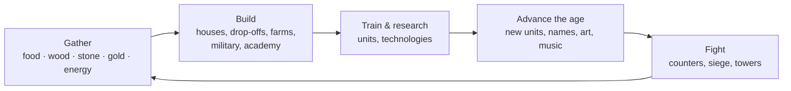

# Game design

*Lords of the Lowlands* is a real-time strategy game in the tradition of
*Age of Empires*: gather resources, build a settlement, raise an army and
defeat your rivals — across **seventeen ages**, from a Stone-Age camp fire
to void dreadnoughts between the stars.

This is the player-facing design. Implementation details are in
[design.md](design.md). Numbers below were taken from `GET /api/defs`
(generated from `internal/game/defs.go`) at the time of writing; balancing
is ongoing, so the in-game tooltips and `/api/defs` are authoritative.

## Core loop



- **Workers** gather and build; everything else costs resources they bring
  to a drop-off.
- **Population** is limited by housing (town centre 10, each house 5, hard
  cap 200).
- **Advancing an age** at the town centre unlocks the next unit of every
  line, new buildings and technologies and restyles your whole civilisation.
- **Win** by the level's objective: conquest, survival or being first to
  advance. In a conquest a player is out once they have no land units and no
  buildings other than houses and farms left — surviving ships alone do not
  keep a player in the game.
- **Plan** with your own tech tree (`F2`, `Y` or the *Tech Tree* button): one
  column per age, rows for the age advance, buildings, every unit line and
  every technology line, coloured by status (done, available now, in
  progress, later age, not on this map). Clicking an available technology
  researches it at your least busy academy.

## Resources

| Resource | Sources | Drop-off |
|---|---|---|
| Food | berry bushes (150), hunting deer (120) / boar (260) / mammoth (650), farms, fish (350, fishing boats only) | town centre, granary; dock for fish |
| Wood | trees (120 each) | town centre, lumber camp |
| Stone | stone quarries (700) | town centre, mining camp |
| Gold | gold mines (800); not used before the Copper Age | town centre, mining camp |
| Energy | energy crystals (600), generators — from the Industrial Age | mining camp (crystals) |

A worker carries `10 + its age` units per trip; gather speed grows 6 % per
age and 15 % per *gather* technology. Farms are renewable-feeling but
finite (320 food, +25 % per age; × 0.6 on desert and × 1.15 on riverland
maps; farm techs add more), worked by one worker each. Boars and
mammoths fight back — hunt them with several workers or soldiers.

## The seventeen ages

| # | Age | Era | Years | Advance cost (F/W/S/G/E) | Time (s) |
|---|---|---|---|---|---|
| 0 | Dawn Age | stone | c. 300,000 BC | — | 0 |
| 1 | Neolithic Age | stone | c. 10,000 BC | 500F | 40 |
| 2 | Copper Age | bronze | c. 4,500 BC | 800F 200W | 50 |
| 3 | Bronze Age | bronze | c. 3,000 BC | 1000F 300W 150S 100G | 60 |
| 4 | Iron Age | iron | c. 1,200 BC | 1200F 400W 200S 200G | 60 |
| 5 | Classical Age | classical | c. 500 BC | 1400F 500W 300S 300G | 65 |
| 6 | Early Middle Ages | medieval | c. 500 AD | 1600F 600W 350S 400G | 70 |
| 7 | High Middle Ages | medieval | c. 1,100 AD | 1800F 700W 400S 500G | 70 |
| 8 | Renaissance | gunpowder | c. 1,450 AD | 2000F 800W 450S 600G | 75 |
| 9 | Imperial Age | gunpowder | c. 1,650 AD | 2200F 900W 500S 700G | 75 |
| 10 | Industrial Age | industrial | c. 1,820 AD | 2400F 1000W 500S 800G | 80 |
| 11 | Machine Age | industrial | c. 1,914 AD | 2600F 1000W 600S 900G 300E | 80 |
| 12 | Atomic Age | modern | c. 1,945 AD | 2800F 1100W 600S 1000G 500E | 85 |
| 13 | Information Age | modern | c. 1,990 AD | 3000F 1100W 700S 1100G 700E | 85 |
| 14 | Orbital Age | future | c. 2,080 AD | 3200F 1200W 700S 1200G 900E | 90 |
| 15 | Interplanetary Age | space | c. 2,200 AD | 3400F 1200W 800S 1300G 1200E | 90 |
| 16 | Interstellar Age | space | c. 2,400 AD | 3600F 1300W 800S 1400G 1500E | 95 |

The *era* determines the look of buildings and units and the style of the
music. You start every level in its start age and can advance up to its
final age.

## Unit lines

There are five unit lines. Each age brings a new unit in every available
line; production buildings always train **the best unit of your current
age** (existing units keep their stats).

| Age | Worker | Infantry | Ranged | Mounted | Siege |
|---|---|---|---|---|---|
| 0 Dawn Age | Gatherer | Clubman | Stone Thrower | — | — |
| 1 Neolithic Age | Villager | Spearman | Slinger | — | — |
| 2 Copper Age | Villager | Axeman | Bowman | Onager Rider | — |
| 3 Bronze Age | Villager | Bronze Swordsman | Composite Archer | War Chariot | Battering Ram |
| 4 Iron Age | Villager | Iron Warrior | Iron Archer | Horseman | Catapult |
| 5 Classical Age | Citizen | Hoplite | Toxotes | Cataphract | Ballista |
| 6 Early Middle Ages | Peasant | Man-at-Arms | Crossbowman | Light Cavalry | Mangonel |
| 7 High Middle Ages | Peasant | Dismounted Knight | Longbowman | Knight | Trebuchet |
| 8 Renaissance | Labourer | Pikeman | Arquebusier | Cuirassier | Bombard |
| 9 Imperial Age | Labourer | Grenadier | Musketeer | Dragoon | Field Cannon |
| 10 Industrial Age | Worker | Fusilier | Rifleman | Lancer | Field Gun |
| 11 Machine Age | Worker | Trench Raider | Machine Gunner | Landship Mk I | Howitzer |
| 12 Atomic Age | Engineer | Assault Trooper | Bazooka Team | Battle Tank | Rocket Artillery |
| 13 Information Age | Engineer | Special Forces | Anti-Tank Team | Main Battle Tank | Missile Launcher |
| 14 Orbital Age | Technician | Exo-Trooper | Railgunner | Hover Tank | Drone Carrier |
| 15 Interplanetary Age | Colonist | Void Marine | Plasma Gunner | Starfighter | Bombard Frigate |
| 16 Interstellar Age | Colonist | Psi Templar | Ion Lancer | Void Interceptor | Void Dreadnought |

✈ = flying: moves in a straight line over water, mountains and forests
and is never blocked by other units; it can be attacked like any other unit.

### Counters

Damage is multiplied by the attacker-vs-target class:

| Attacker | Strong against | Weak against |
|---|---|---|
| Infantry | mounted ×1.6, siege ×1.4 | ranged (takes ×1.4) |
| Ranged | infantry ×1.4 | buildings ×0.4; mounted (takes ×1.6) |
| Mounted | ranged ×1.6, siege ×1.8 | infantry (takes ×1.6) |
| Siege | buildings ×3.5 | everything else ×0.7; mounted (takes ×1.8) |
| Worker | — | buildings ×0.3 |

Armour absorbs a fraction of damage (infantry 10 %, mounted 15 %, siege
25 %, +5 % per *armor* technology, max 80 %; buildings 50 %). Every hit does
at least 0.5 damage. Splash weapons (grenades, catapults, cannon, tanks,
artillery, missiles, dreadnoughts) deal half damage to every enemy near the
impact.

### Unit statistics

HP and attack grow by 30 % of the age-0 value per age; costs by 22 %. From
the Renaissance (age 8) armies are paid increasingly in **gold** rather
than food, and from the Industrial Age (age 10) every military unit also
needs **energy**.

#### Workers
| Age | Unit | HP | Atk | Armor | Range | Reload | Speed | Splash | Cost | Pop |
|---|---|---|---|---|---|---|---|---|---|---|
| 0 | Gatherer | 25 | 3 | 0 | 0.7 | 1.5 | 1.05 | 0 | 50F | 1 |
| 1 | Villager | 33 | 3.9 | 0 | 0.7 | 1.5 | 1.05 | 0 | 61F | 1 |
| 2 | Villager | 40 | 4.8 | 0 | 0.7 | 1.5 | 1.05 | 0 | 72F | 1 |
| 3 | Villager | 48 | 5.7 | 0 | 0.7 | 1.5 | 1.05 | 0 | 83F | 1 |
| 4 | Villager | 55 | 6.6 | 0 | 0.7 | 1.5 | 1.05 | 0 | 94F | 1 |
| 5 | Citizen | 63 | 7.5 | 0 | 0.7 | 1.5 | 1.05 | 0 | 105F | 1 |
| 6 | Peasant | 70 | 8.4 | 0 | 0.7 | 1.5 | 1.05 | 0 | 116F | 1 |
| 7 | Peasant | 78 | 9.3 | 0 | 0.7 | 1.5 | 1.05 | 0 | 127F | 1 |
| 8 | Labourer | 85 | 10.2 | 0 | 0.7 | 1.5 | 1.05 | 0 | 138F | 1 |
| 9 | Labourer | 93 | 11.1 | 0 | 0.7 | 1.5 | 1.05 | 0 | 149F | 1 |
| 10 | Worker | 100 | 12 | 0 | 0.7 | 1.5 | 1.21 | 0 | 160F | 1 |
| 11 | Worker | 108 | 12.9 | 0 | 0.7 | 1.5 | 1.21 | 0 | 171F | 1 |
| 12 | Engineer | 115 | 13.8 | 0 | 0.7 | 1.5 | 1.21 | 0 | 182F | 1 |
| 13 | Engineer | 123 | 14.7 | 0 | 0.7 | 1.5 | 1.21 | 0 | 193F | 1 |
| 14 | Technician | 130 | 15.6 | 0 | 0.7 | 1.5 | 1.21 | 0 | 204F | 1 |
| 15 | Colonist | 138 | 16.5 | 0 | 0.7 | 1.5 | 1.21 | 0 | 215F | 1 |
| 16 | Colonist | 145 | 17.4 | 0 | 0.7 | 1.5 | 1.21 | 0 | 226F | 1 |

#### Infantry
| Age | Unit | HP | Atk | Armor | Range | Reload | Speed | Splash | Cost | Pop |
|---|---|---|---|---|---|---|---|---|---|---|
| 0 | Clubman | 48 | 6 | 0.1 | 0.8 | 1.4 | 1.00 | 0 | 80F | 1 |
| 1 | Spearman | 62 | 7.8 | 0.1 | 0.8 | 1.4 | 1.00 | 0 | 98F | 1 |
| 2 | Axeman | 77 | 9.6 | 0.1 | 0.8 | 1.4 | 1.00 | 0 | 79F 36G | 1 |
| 3 | Bronze Swordsman | 91 | 11.4 | 0.1 | 0.8 | 1.4 | 1.00 | 0 | 91F 42G | 1 |
| 4 | Iron Warrior | 106 | 13.2 | 0.1 | 0.8 | 1.4 | 1.00 | 0 | 103F 47G | 1 |
| 5 | Hoplite | 120 | 15 | 0.1 | 0.8 | 1.4 | 1.00 | 0 | 116F 53G | 1 |
| 6 | Man-at-Arms | 134 | 16.8 | 0.1 | 0.8 | 1.4 | 1.00 | 0 | 128F 58G | 1 |
| 7 | Dismounted Knight | 149 | 18.6 | 0.1 | 0.8 | 1.4 | 1.00 | 0 | 140F 64G | 1 |
| 8 | Pikeman | 163 | 20.4 | 0.1 | 0.8 | 1.4 | 1.00 | 0 | 76F 122G | 1 |
| 9 | Grenadier | 178 | 22.2 | 0.1 | 3.5 | 1.4 | 1.00 | 0.8 | 82F 132G | 1 |
| 10 | Fusilier | 192 | 24 | 0.1 | 3.5 | 1.4 | 1.00 | 0 | 88F 142G 10E | 1 |
| 11 | Trench Raider | 206 | 25.8 | 0.1 | 3.5 | 1.4 | 1.00 | 0 | 94F 152G 18E | 1 |
| 12 | Assault Trooper | 221 | 27.6 | 0.1 | 3.5 | 1.4 | 1.00 | 0 | 100F 161G 26E | 1 |
| 13 | Special Forces | 235 | 29.4 | 0.1 | 3.5 | 1.4 | 1.00 | 0 | 106F 171G 34E | 1 |
| 14 | Exo-Trooper | 250 | 31.2 | 0.1 | 3.5 | 1.4 | 1.00 | 0 | 112F 180G 42E | 1 |
| 15 | Void Marine | 264 | 33 | 0.1 | 3.5 | 1.4 | 1.00 | 0 | 119F 191G 50E | 1 |
| 16 | Psi Templar | 278 | 34.8 | 0.1 | 3.5 | 1.4 | 1.00 | 0 | 125F 200G 58E | 1 |

#### Ranged
| Age | Unit | HP | Atk | Armor | Range | Reload | Speed | Splash | Cost | Pop |
|---|---|---|---|---|---|---|---|---|---|---|
| 0 | Stone Thrower | 32 | 5 | 0 | 5 | 1.8 | 1.00 | 0 | 45F 40W | 1 |
| 1 | Slinger | 42 | 6.5 | 0 | 5 | 1.8 | 1.00 | 0 | 55F 49W | 1 |
| 2 | Bowman | 51 | 8 | 0 | 5 | 1.8 | 1.00 | 0 | 43F 58W 22G | 1 |
| 3 | Composite Archer | 61 | 9.5 | 0 | 5 | 1.8 | 1.00 | 0 | 50F 66W 25G | 1 |
| 4 | Iron Archer | 70 | 11 | 0 | 5 | 1.8 | 1.00 | 0 | 56F 75W 28G | 1 |
| 5 | Toxotes | 80 | 12.5 | 0 | 5 | 1.8 | 1.00 | 0 | 63F 84W 32G | 1 |
| 6 | Crossbowman | 90 | 14 | 0 | 5 | 1.8 | 1.00 | 0 | 70F 93W 35G | 1 |
| 7 | Longbowman | 99 | 15.5 | 0 | 5 | 1.8 | 1.00 | 0 | 76F 102W 38G | 1 |
| 8 | Arquebusier | 109 | 17 | 0 | 5.5 | 1.8 | 1.00 | 0 | 42F 110W 70G | 1 |
| 9 | Musketeer | 118 | 18.5 | 0 | 5.5 | 1.8 | 1.00 | 0 | 45F 119W 76G | 1 |
| 10 | Rifleman | 128 | 20 | 0 | 5.5 | 1.8 | 1.00 | 0 | 48F 128W 82G 10E | 1 |
| 11 | Machine Gunner | 138 | 21.5 | 0 | 5.5 | 1.8 | 1.00 | 0 | 52F 137W 87G 18E | 1 |
| 12 | Bazooka Team | 147 | 23 | 0 | 5.5 | 1.8 | 1.00 | 0 | 55F 146W 93G 26E | 1 |
| 13 | Anti-Tank Team | 157 | 24.5 | 0 | 5.5 | 1.8 | 1.00 | 0 | 58F 154W 99G 34E | 1 |
| 14 | Railgunner | 166 | 26 | 0 | 5.5 | 1.8 | 1.00 | 0 | 61F 163W 104G 42E | 1 |
| 15 | Plasma Gunner | 176 | 27.5 | 0 | 5.5 | 1.8 | 1.00 | 0 | 65F 172W 110G 50E | 1 |
| 16 | Ion Lancer | 186 | 29 | 0 | 5.5 | 1.8 | 1.00 | 0 | 68F 181W 116G 58E | 1 |

#### Mounted
| Age | Unit | HP | Atk | Armor | Range | Reload | Speed | Splash | Cost | Pop |
|---|---|---|---|---|---|---|---|---|---|---|
| 2 | Onager Rider | 152 | 12.8 | 0.15 | 0.9 | 1.6 | 1.70 | 0 | 101F 86G | 2 |
| 3 | War Chariot | 181 | 15.2 | 0.15 | 4 | 1.6 | 1.70 | 0 | 116F 100G | 2 |
| 4 | Horseman | 209 | 17.6 | 0.15 | 0.9 | 1.6 | 1.70 | 0 | 132F 113G | 2 |
| 5 | Cataphract | 238 | 20 | 0.15 | 0.9 | 1.6 | 1.70 | 0 | 147F 126G | 2 |
| 6 | Light Cavalry | 266 | 22.4 | 0.15 | 0.9 | 1.6 | 1.70 | 0 | 162F 139G | 2 |
| 7 | Knight | 295 | 24.8 | 0.15 | 0.9 | 1.6 | 1.70 | 0 | 178F 152G | 2 |
| 8 | Cuirassier | 323 | 27.2 | 0.15 | 0.9 | 1.6 | 1.70 | 0 | 97F 234G | 2 |
| 9 | Dragoon | 352 | 29.6 | 0.15 | 4 | 1.6 | 1.70 | 0 | 105F 252G | 2 |
| 10 | Lancer | 380 | 32 | 0.15 | 0.9 | 1.6 | 1.70 | 0 | 112F 270G 10E | 2 |
| 11 | Landship Mk I | 409 | 34.4 | 0.15 | 5 | 2.6 | 1.95 | 0.6 | 120F 289G 22E | 2 |
| 12 | Battle Tank | 437 | 36.8 | 0.15 | 5 | 2.6 | 1.95 | 0.6 | 128F 307G 34E | 2 |
| 13 | Main Battle Tank | 466 | 39.2 | 0.15 | 5 | 2.6 | 1.95 | 0.7 | 135F 327G 46E | 2 |
| 14 | Hover Tank | 494 | 41.6 | 0.15 | 5 | 2.6 | 2.29 | 0.6 | 143F 345G 58E | 2 |
| 15 | Starfighter ✈ | 523 | 44 | 0.15 | 4 | 1.6 | 2.10 | 0 | 151F 363G 70E | 2 |
| 16 | Void Interceptor ✈ | 551 | 46.4 | 0.15 | 4 | 1.6 | 2.10 | 0 | 158F 382G 82E | 2 |

#### Siege
| Age | Unit | HP | Atk | Armor | Range | Reload | Speed | Splash | Cost | Pop |
|---|---|---|---|---|---|---|---|---|---|---|
| 3 | Battering Ram | 162 | 49.4 | 0.25 | 0.9 | 4 | 0.65 | 0 | 266W 183G | 3 |
| 4 | Catapult | 187 | 57.2 | 0.25 | 7 | 4 | 0.65 | 1 | 301W 207G | 3 |
| 5 | Ballista | 213 | 65 | 0.25 | 7 | 4 | 0.65 | 0 | 336W 231G | 3 |
| 6 | Mangonel | 238 | 72.8 | 0.25 | 7 | 4 | 0.65 | 1.2 | 371W 255G | 3 |
| 7 | Trebuchet | 264 | 80.6 | 0.25 | 7 | 4 | 0.65 | 1.3 | 406W 279G | 3 |
| 8 | Bombard | 289 | 88.4 | 0.25 | 7 | 4 | 0.65 | 0.9 | 442W 304G | 3 |
| 9 | Field Cannon | 315 | 96.2 | 0.25 | 7 | 4 | 0.65 | 1 | 477W 328G | 3 |
| 10 | Field Gun | 340 | 104 | 0.25 | 7 | 4 | 0.65 | 1.2 | 512W 352G 10E | 3 |
| 11 | Howitzer | 366 | 111.8 | 0.25 | 7 | 4 | 0.75 | 1.5 | 547W 376G 26E | 3 |
| 12 | Rocket Artillery | 391 | 119.6 | 0.25 | 7 | 4 | 0.75 | 1.6 | 582W 400G 42E | 3 |
| 13 | Missile Launcher | 417 | 127.4 | 0.25 | 7 | 4 | 0.75 | 1.5 | 618W 425G 58E | 3 |
| 14 | Drone Carrier ✈ | 442 | 135.2 | 0.25 | 7 | 4 | 2.10 | 1.4 | 653W 449G 74E | 3 |
| 15 | Bombard Frigate ✈ | 468 | 143 | 0.25 | 7 | 4 | 2.10 | 1.6 | 688W 473G 90E | 3 |
| 16 | Void Dreadnought ✈ | 493 | 150.8 | 0.25 | 7 | 4 | 2.10 | 2 | 723W 497G 106E | 3 |

Sight: worker 4, infantry 5, mounted 6, ranged 7, siege 8 tiles. Training
time: worker 10 s, infantry 14 s, ranged 15 s, mounted 20 s, siege 30 s.
Siege engines (except the ram) have a minimum range of 2 tiles and back off
from units that close in.

## Map types

Every level and random map has a **map type** that shapes terrain, economy
and the technology tree.

| Map type | Terrain | Economy | Naval | Extra technologies |
|---|---|---|---|---|
| **Inland** | lakes and hills as generated | normal | if the map has enough water (≥ 2 %) docks may be built, but no fish are generated | Caravans |
| **Coastal** | an ocean along one side; starts pushed inland | normal | yes, fish along the shore | Fishing Nets, Navigation, Steam Ships |
| **Riverland** | a river through the centre with sandy banks | farms +15 % | yes | Irrigation, Fishing Nets, Navigation, Steam Ships |
| **Lakes** | many large lakes, no river | normal | yes | Fishing Nets, Navigation, Steam Ships |
| **Desert** | sand, no water except small oases with palms; few trees and animals, richer mines | farms −40 % | never | Irrigation, Qanats, Deep Mining, Caravans |
| **Highland** | mountain ranges, little water, richer mines | normal | if enough water | Terrace Farming, Deep Mining |

Moon, Mars and space themes never have boats (their "water" is void).

### Naval play

The **dock** (Neolithic Age on, 150 wood, 3×3) must touch water on at least
two edge tiles. It trains fishing boats and warships and is the drop-off for
fish. Boats sail on water and fords only; land units cannot enter water.

| Age | Fishing boat | Warship | Weapon | Splash | HP | Attack | Cost |
|---|---|---|---|---|---|---|---|
| 1 Neolithic | Dugout | War Canoe | arrows | — | 169 | 9.1 | 79F 134W |
| 2 Copper | Fishing Boat | Galley | arrows | — | 208 | 11.2 | 29F 158W 65G |
| 3 Bronze | Fishing Boat | War Galley | arrows | — | 247 | 13.3 | 33F 183W 75G |
| 4 Iron | Fishing Boat | Bireme | bolts | — | 286 | 15.4 | 38F 207W 85G |
| 5 Classical | Fishing Ship | Trireme | bolts | — | 325 | 17.5 | 42F 231W 95G |
| 6 Early Middle | Fishing Ship | Longship | arrows | — | 364 | 19.6 | 46F 255W 104G |
| 7 High Middle | Fishing Ship | War Cog | bolts | — | 403 | 21.7 | 51F 279W 114G |
| 8 Renaissance | Fishing Sloop | Carrack | cannonballs | 0.6 | 442 | 23.8 | 55F 304W 124G |
| 9 Imperial | Fishing Sloop | Ship of the Line | cannonballs | 0.8 | 481 | 25.9 | 60F 328W 134G |
| 10 Industrial | Trawler | Ironclad | shells | 0.8 | 520 | 28.0 | 64F 352W 144G 20E |
| 11 Machine | Trawler | Battleship | shells | 1.0 | 559 | 30.1 | 68F 376W 154G 28E |
| 12 Atomic | Trawler | Destroyer | shells | 0.8 | 598 | 32.2 | 73F 400W 164G 36E |
| 13 Information | Factory Trawler | Missile Cruiser | missiles | 1.2 | 637 | 34.3 | 77F 425W 174G 44E |
| 14 Orbital | Factory Trawler | Hover Frigate | railgun | 1.0 | 676 | 36.4 | 82F 449W 184G 52E |
| 15–16 | Aqua Drone | — (best earlier ship) | | | | | |

Warships: range 5.5, armour 0.15, speed 1.45, sight 7, 2 population; +30 %
damage against buildings, +20 % against boats. Fishing boats: 60 wood
(+22 % per age), 45 HP (+30 % per age), speed 1.4, 1 population.

## Buildings

| id | Age | Size | HP | Cost | Pop | Drop-off | Trains | Notes |
|---|---|---|---|---|---|---|---|---|
| `academy` | 1 | 3×3 | 900 | 175W 50S | — | — | — | research |
| `barracks` | 0 | 3×3 | 900 | 150W | — | — | infantry |  |
| `dock` | 1 | 3×3 | 900 | 150W | — | Food (fish) | fishing boats, warships | on a shore; naval maps only |
| `farm` | 0 | 3×3 | 200 | 60W | — | — | — | 320 food |
| `generator` | 10 | 2×2 | 600 | 120W 80S 40G | — | — | — | 0.6 energy/s |
| `granary` | 0 | 2×2 | 500 | 80W | — | Food | — |  |
| `house` | 0 | 2×2 | 300 | 30W | 5 | — | — |  |
| `lumber_camp` | 0 | 2×2 | 500 | 80W | — | Wood | — |  |
| `mining_camp` | 0 | 2×2 | 500 | 80W | — | Stone, Gold, Energy | — |  |
| `range` | 0 | 3×3 | 900 | 150W | — | — | ranged |  |
| `stable` | 2 | 3×3 | 1000 | 150W 50S | — | — | mounted |  |
| `tower` | 1 | 1×1 | 700 | 40W 120S | — | — | — | attack 6, range 7 |
| `town_center` | 0 | 3×3 | 1400 | 275W 100S | 10 | Food, Wood, Stone, Gold | worker | attack 4, range 6 |
| `workshop` | 3 | 3×3 | 1000 | 200W 50G | — | — | siege |  |

Costs grow 12 % per age of the builder (houses 5 %); hit points 20 % per
age. The town centre shoots at enemies from the Neolithic Age on; towers
from the start. Cancelling a foundation refunds 75 %.

### Names through the eras

| id | stone | bronze | iron | classical | medieval | gunpowder | industrial | modern | future | space |
|---|---|---|---|---|---|---|---|---|---|---|
| `academy` | Shaman Hut | Elder Hut | Temple | Academy | Monastery | University | Institute | Laboratory | Research Spire | Xeno Institute |
| `dock` | Dockyard¹ | Jetty | Jetty | Harbour | Harbour | Harbour | Dockyard | Naval Base | Seaport | Seaport |
| `barracks` | War Camp | War Lodge | Barracks | Castrum | Barracks | Barracks | Garrison | Military Base | Exo Bay | Marine Barracks |
| `farm` | Wild Garden | Field | Field | Farm | Farm | Farm | Farmstead | Agri-Plant | Hydroponics | Hydroponic Dome |
| `generator` | — | — | — | — | Windmill | Watermill | Coal Plant | Power Station | Fusion Plant | Zero-Point Core |
| `granary` | Food Cache | Granary | Granary | Horreum | Mill | Mill | Grain Elevator | Food Depot | Bio-Store | Nutrient Hub |
| `house` | Hut | Mud House | Timber House | Domus | Cottage | Townhouse | Tenement | Apartment | Habitat | Hab Module |
| `lumber_camp` | Wood Pile | Lumber Camp | Lumber Camp | Lumber Yard | Lumber Camp | Sawmill | Sawmill | Timber Works | Carbon Works | Carbon Refinery |
| `mining_camp` | Stone Pile | Quarry Camp | Mining Camp | Mine | Mining Camp | Mine Works | Colliery | Ore Plant | Ore Refinery | Asteroid Refinery |
| `range` | Throwing Pit | Sling Range | Archery Range | Archery Range | Archery Range | Archery Range | Rifle Range | Firing Range | Weapons Lab | Plasma Armory |
| `stable` | Corral | Corral | Stable | Stable | Stable | Stable | Motor Pool | Tank Factory | Hover Factory | Starport |
| `tower` | Lookout | Watch Tower | Watch Tower | Tower | Guard Tower | Bastion | Blockhouse | Bunker | Laser Turret | Ion Cannon |
| `town_center` | Camp Fire | Chieftain Hall | Longhouse | Forum | Keep | Town Hall | City Hall | Capitol | Arcology | Command Nexus |
| `workshop` | Workshop | Workshop | Siege Workshop | Siege Workshop | Siege Workshop | Foundry | Arsenal | Arsenal | Drone Yard | Orbital Shipyard |

(The generator becomes available in the Industrial Age; its medieval and
gunpowder names are never seen in normal play. ¹ The dock has no stone-era
name and falls back to its default name.)

## Technologies

Four technologies per age, researched at the academy (Shaman Hut … Xeno
Institute). Each can be researched once, from its age onward, so a late
starter can still catch up on earlier ones.

| Kind | Effect |
|---|---|
| gather | +15 % gather rate (and generator output) |
| attack | +10 % attack for military units and buildings |
| armor | +5 % armour for military units |
| hp | +10 % hit points for all your units and buildings, including existing ones |

Every technology also makes workers 3 % faster.

**Map technologies** — researched at the academy, but only on the map types
listed:

| Technology | Age | Cost | Effect | Map types |
|---|---|---|---|---|
| Irrigation | 1 | 150F 150W | +50 % farm yield | desert, riverland |
| Terrace Farming | 2 | 150F 200W 50S | +25 % farm yield | highland |
| Fishing Nets | 2 | 100F 150W 50G | +30 % fishing rate | coastal, riverland, lakes |
| Deep Mining | 3 | 150F 200W 100G | +30 % stone and gold mining | highland, desert |
| Navigation | 4 | 200F 250W 150G | +20 % warship attack and hit points | coastal, riverland, lakes |
| Caravans | 4 | 200F 100W 150G | +10 % gather rate (all resources) | desert, inland |
| Qanats | 5 | 300F 200W 200S 100G | +40 % farm yield | desert |
| Steam Ships | 10 | 300F 300W 300G 100E | +25 % warship attack and hit points | coastal, riverland, lakes |

Farm-yield techs affect farms built afterwards. Navigation and Steam Ships
apply to every boat you own, including ones already afloat: warships hit
harder and all boats (warships and fishing boats) gain hit points.

Names and costs (F/W/S/G/E):

| Age | gather | attack | armor | hp |
|---|---|---|---|---|
| 0 | Flint Knapping (100F 75W) | Fire-Hardened Points (180F) | Hide Coats (160F 60W) | Herbal Lore (80F 80W 60S) |
| 1 | Polished Stone (135F 101W) | Flint Blades (243F) | Leather Armour (216F 81W) | Bone Setting (108F 108W 81S) |
| 2 | Copper Tools (170F 128W) | Copper Smelting (204F 102G) | Wicker Shields (204F 102W 68G) | Wheel (136F 136W 102S) |
| 3 | Bronze Tools (205F 154W) | Bronze Casting (246F 123G) | Bronze Scale (246F 123W 82G) | Masonry (164F 164W 123S) |
| 4 | Iron Tools (240F 180W) | Iron Forging (288F 144G) | Iron Mail (288F 144W 96G) | Architecture (192F 192W 144S) |
| 5 | Crop Rotation (275F 206W) | Steel Tempering (330F 165G) | Linothorax (330F 165W 110G) | Aqueducts (220F 220W 165S) |
| 6 | Heavy Plough (310F 232W) | Damascus Steel (372F 186G) | Chainmail (372F 186W 124G) | Fortified Walls (248F 248W 186S) |
| 7 | Windmills (345F 259W) | Plate Forging (414F 207G) | Plate Armour (414F 207W 138G) | Castle Masonry (276F 276W 207S) |
| 8 | Printing Press (209F 285W 114G) | Corned Powder (251F 365G) | Pikemen Drill (251F 228W 289G) | Medicine (167F 304W 228S 91G) |
| 9 | Agricultural Revolution (228F 311W 125G) | Rifled Barrels (274F 398G) | Line Tactics (274F 249W 315G) | Vaccination (183F 332W 249S 100G) |
| 10 | Steam Power (248F 338W 135G) | Smokeless Powder (297F 432G) | Field Fortifications (297F 270W 342G) | Steel Frames (198F 360W 270S 108G) |
| 11 | Assembly Line (267F 364W 146G 50E) | Chemical Weapons (320F 466G 50E) | Steel Helmets (320F 291W 369G 50E) | Reinforced Concrete (213F 388W 291S 116G 50E) |
| 12 | Green Revolution (286F 390W 156G 70E) | Guided Rockets (343F 499G 70E) | Kevlar (343F 312W 395G 70E) | Antibiotics (229F 416W 312S 125G 70E) |
| 13 | Automation (305F 416W 167G 90E) | Precision Munitions (366F 533G 90E) | Composite Armour (366F 333W 422G 90E) | Genetic Medicine (244F 444W 333S 133G 90E) |
| 14 | Nanofabrication (325F 442W 177G 110E) | Directed Energy (389F 566G 110E) | Reactive Exo-Plating (389F 354W 448G 110E) | Nanobot Repair (260F 472W 354S 142G 110E) |
| 15 | Asteroid Mining (344F 469W 188G 130E) | Plasma Containment (413F 600G 130E) | Deflector Shields (413F 375W 475G 130E) | Regeneration (275F 500W 375S 150G 130E) |
| 16 | Matter Compilers (363F 495W 198G 150E) | Antimatter Warheads (436F 634G 150E) | Phase Shields (436F 396W 502G 150E) | Bio-Uploading (290F 528W 396S 158G 150E) |

## Campaign

Seventeen chapters lead through history and beyond. Each level starts in
one age and allows advancing to the next. All computer opponents in a
campaign level are allied against you. You can override the level's
difficulty in the campaign screen.

| # | Level | Theme | Map type | Ages | Map | Objective | AI | Difficulty |
|---|---|---|---|---|---|---|---|---|
| 1 | **The First Fire** | temperate | inland | Dawn Age → Neolithic Age | 84² | Conquest — defeat every opponent | 1 | easy |
| 2 | **Valley of Plenty** | temperate | riverland | Neolithic Age → Copper Age | 88² | Advance — be first to reach the final age | 1 | easy |
| 3 | **Gift of the River** | desert | riverland | Copper Age → Bronze Age | 96² | Conquest — defeat every opponent | 2 | easy |
| 4 | **The Sea Peoples** | tropical | coastal | Bronze Age → Iron Age | 96² | Survive — hold out 15 min | 2 | normal |
| 5 | **Iron and Ice** | winter | coastal | Iron Age → Classical Age | 104² | Conquest — defeat every opponent | 1 | normal |
| 6 | **Phalanx** | desert | coastal | Classical Age → Early Middle Ages | 104² | Conquest — defeat every opponent | 1 | normal |
| 7 | **Shield Wall** | temperate | riverland | Early Middle Ages → High Middle Ages | 108² | Conquest — defeat every opponent | 2 | normal |
| 8 | **Lords of the Lowlands** | temperate | coastal | High Middle Ages → Renaissance | 112² | Conquest — defeat every opponent | 2 | normal |
| 9 | **Pike and Shot** | temperate | inland | Renaissance → Imperial Age | 112² | Conquest — defeat every opponent | 1 | hard |
| 10 | **A New World** | tropical | coastal | Imperial Age → Industrial Age | 120² | Conquest — defeat every opponent | 2 | normal |
| 11 | **The Iron Horse** | temperate | inland | Industrial Age → Machine Age | 120² | Conquest — defeat every opponent | 2 | normal |
| 12 | **No Man's Land** | winter | inland | Machine Age → Atomic Age | 120² | Survive — hold out 20 min | 2 | hard |
| 13 | **Iron Curtain** | winter | lakes | Atomic Age → Information Age | 132² | Conquest — defeat every opponent | 3 | normal |
| 14 | **Silicon Frontier** | desert | desert | Information Age → Orbital Age | 132² | Conquest — defeat every opponent | 2 | hard |
| 15 | **Sea of Tranquility** | moon | inland | Orbital Age → Interplanetary Age | 128² | Conquest — defeat every opponent | 2 | hard |
| 16 | **Red Planet** | mars | inland | Interplanetary Age → Interstellar Age | 136² | Conquest — defeat every opponent | 2 | hard |
| 17 | **Battle for the Stars** | space | inland | Interstellar Age | 144² | Conquest — defeat every opponent | 3 | hard |

1. **The First Fire** — 300,000 years ago a band huddles around the first fire. Hunt mammoth and deer, gather berries and drive the rival clan from the valley. Discover farming to enter the Neolithic.
2. **Valley of Plenty** — The ice retreats and wild grain covers the valley. Be the first tribe to master copper and enter the Copper Age.
3. **Gift of the River** — Along a great river in the desert, chiefdoms fight for the fertile banks. Unite the river under one crown.
4. **The Sea Peoples** — The Bronze Age palaces burn. Raiders come from every side. Hold out for fifteen minutes and forge iron.
5. **Iron and Ice** — In the frozen north, iron-armed warlords contest the fjords. Conquer them before the classical world arrives.
6. **Phalanx** — City-states clash on sun-bleached plains. Train hoplites, build an academy and outlast your rival.
7. **Shield Wall** — After Rome, kingdoms rise from the ruins. Two warbands threaten your river crossing.
8. **Lords of the Lowlands** — Dikes, polders and castles. In the flat, watery lowlands the great lords fight for every acre of reclaimed land.
9. **Pike and Shot** — Gunpowder changes everything. Pike squares and arquebusiers decide the fate of the realm.
10. **A New World** — Across the ocean lies a tropical land of riches. Rival empires race to claim it.
11. **The Iron Horse** — Steam engines and coal power the industrial age. Build generators — energy now fuels your army.
12. **No Man's Land** — Trenches scar the land. Hold the line for twenty minutes against a mechanised onslaught.
13. **Iron Curtain** — Rockets, jets and the atom. Three blocs, one continent. Prevail.
14. **Silicon Frontier** — Satellites watch every move. Precision strikes and information decide the desert war.
15. **Sea of Tranquility** — The first lunar colonies fight over helium-3 and ice. Exo-troopers walk where Apollo landed.
16. **Red Planet** — Under a butterscotch sky, Martian city-states wage war with starfighters and plasma.
17. **Battle for the Stars** — In the void between stars, dreadnoughts and interceptors decide the fate of humanity. The final war.

Progress (highest campaign level won) and high scores are stored for
registered players; guests can play everything but are not recorded.

## Skirmish and multiplayer

**Map size** can be chosen whenever a game is started — on the campaign screen
(default: the chapter's own size), in skirmish (default Normal) and when
creating a lobby battle:

| Preset | Mini | Tiny | Small | Normal | Large | Very large | Huge | Enormous |
|---|---|---|---|---|---|---|---|---|
| Tiles per side | 48 | 64 | 80 | 112 | 144 | 176 | 208 | 256 |

Resources and forests scale with the area; each player's starting resources
are the same on every size. Small maps mean early contact and rushes, large ones
long build-ups, scouting and naval play. Hand-drawn custom levels keep their
own size.

- **Skirmish vs computer**: random map (theme, map type, size 56–120, water
  amount, start/final age, 1–7 opponents, difficulty) or any campaign/custom
  map.
- **Saved games** (registered players): *Save Game* in the in-game menu
  stores the whole match on the server (up to 20 saves by default);
  *Load Game* resumes it in a new room where your seat is restored, other
  human seats wait for anyone to join and empty seats are played by the
  computer.
- **Demo mode**: after a few idle minutes on the menu the game shows a
  self-playing AI match with an automatic camera; any key or click returns.
- **Multiplayer lobby**: create a battle on any level, choose seats
  (open / closed / AI with difficulty), teams 1–8, and chat. At least two
  teams are required. Disconnected players keep their seat and are
  re-attached automatically when they reconnect; leaving explicitly
  resigns.
- **Chat channels**: global (lobby, last 50 messages kept), room, team and
  whispers (`/w name message`).

## Balance philosophy

1. **Power and cost scale linearly with age.** Per age a unit gains +30 %
   of its base HP and attack while its price rises +22 %, so a newer unit is
   always more cost-efficient — advancing matters — but an army one age
   behind is not hopeless.
2. **Counters beat raw stats.** Multipliers of 1.4–1.8 (3.5 for siege vs
   buildings) mean composition matters more than numbers; no single line is
   best against everything.
3. **Economy before army.** Age advances are expensive (500 food at first,
   up to 3 600 F / 1 300 W / 800 S / 1 400 G / 1 500 E) and the computer
   saves for them too.
4. **Resources change with history.** No gold in the Stone Age, a money
   economy from the Renaissance, energy from the Industrial Age — keeping
   the economy fresh across a long campaign.
5. **Population cap 200**, mounted units 2 and siege 3 population: late
   armies are smaller but heavier.
6. **Fair maps.** Generated maps give every start the same personal
   resources (berries, gold, stone, trees, crystals, game) and carve passable
   routes between all starts; extra resources are contested in the middle.

## Computer opponents

Six difficulty levels:

| Difficulty | Economy, building and training speed | Army before the first wave | First wave not before | Free resources | Map vision |
|---|---|---|---|---|---|
| Super easy | 55 % | 20 + age/2 | minute 12 | — | own |
| Easy | 75 % | 14 + age/2 | minute 7 | — | own |
| Normal | 100 % | 10 + age/2 | minute 4 | — | own |
| Hard | 130 % | 8 + age/2 | minute 3.5 | — | own |
| Super hard | 160 % | 7 + age/2 | minute 3 | 0.3 of each per second | own |
| Insane | 200 % | 6 + age/2 | minute 2.5 | 0.8 of each per second | **whole map** |

(Energy is only trickled from the Industrial Age.) The computer plays by the
same rules as you — it pays for everything and obeys the population cap; up
to *hard* it sees only what its units see. It attacks in waves, gathers its
army half-way before striking, retreats to regroup when a wave is spent and
grows each subsequent wave by two. Soldiers trained during an attack wait at
home for the next, larger wave instead of trickling into enemy towers; once
every enemy town centre has fallen, everyone joins in to finish the game.
It keeps a growing standing army while saving for the next age, and after 40
minutes it attacks with ever smaller armies, so long games do not stall. It
defends its town centre against intruders and rebuilds it if it falls. On
naval maps it builds a dock, fishes and later trains warships, which hunt
enemy ships, fishing boats and anything on a shore.

In simulated computer-vs-computer games (2 players, 64×64 to 208×208, every
map type, normal to insane) a winner is decided in 25–80 minutes; super-easy
computers, which attack late with large armies, take longer.

## Scoring

```text
score = gathered/10 + value of kills/5 + 60 × techs
      + 400 × ages advanced + 15 × buildings + 5 × units trained
      + (winner) 2000 + max(0, 1500 − 30 × minutes)
```

The Hall of Fame lists the top 25 lords by wins (then best score) and the
top 25 scores of each level.

## Controls (summary)

The complete list lives in one table (`SHORTCUTS` in `web/js/game.js`) and is shown in game with `?` / `F1`.

| Input | Action |
|---|---|
| Left click / drag | select / box-select |
| Right click | context command: move, attack, gather, build/repair, set rally point (buildings) |
| A / S / Del | attack-move / stop / delete (buildings confirm in an in-game dialog) |
| Q W E R T … | command buttons in panel order; Shift + train key queues five |
| Shift + E G L N F D C P B R S K Y T | place a building directly while workers are selected |
| Ctrl+1–9, Shift+1–9, 1–9 | set / add to / recall control groups |
| H (Shift+H) / . / , | town centre (cycle) / next idle worker / next idle soldier; Ctrl selects all idle |
| M / Ctrl+A | all military / all units |
| Esc | cancel placement or attack-move, back, close window, clear selection |
| Arrow keys, screen edges, minimap | scroll camera; wheel or + / − zooms, 0 resets |
| Space / Backspace | jump to last attack alert / centre on selection |
| Enter / Tab | open chat / switch channel (All, Team, Global) |
| F10 / Ctrl+S / Shift+M / ? or F1 | game menu / quick save / mute / shortcut help |
| F2 or Y | your tech tree |

Editor: 1–7 terrain, Shift+1–9 objects, E eraser, P start position, [ ] brush size, G grid, N new, Ctrl+Z undo, Ctrl+S save, ? help.
