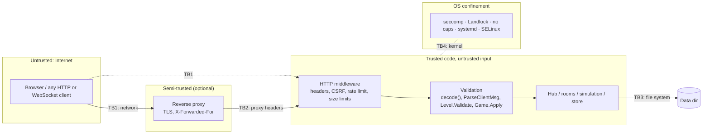
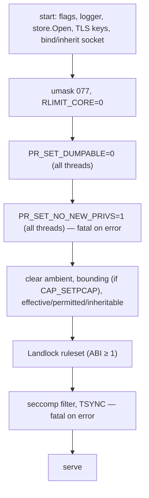

# Security

Lords of the Lowlands is an Internet-facing multiplayer game server. Its
security goals are, in order:

1. **Protect the host** — a compromised server process must not be able to
   read or modify anything but its own data, run programs or pivot to the
   network.
2. **Protect accounts** — passwords, sessions and player-made content.
3. **Keep games fair** — no client can see or do more than the rules allow.
4. **Stay available** — no single client can degrade the service for others.

## 1. Trust boundaries



| Boundary | Crossing | Controls |
|---|---|---|
| TB1 network → server | HTTP, WebSocket frames | TLS (optional), timeouts, size limits, rate limits, CSRF/origin checks, strict decoding and validation |
| TB2 proxy → server | `X-Forwarded-For` | ignored unless `-trust-proxy`; only the last hop is used |
| TB3 server → disk | JSON files | single data dir, `0600`/`0700`, atomic writes, validated on load |
| TB4 process → kernel | system calls | no_new_privs, no capabilities, seccomp, Landlock, systemd sandbox, SELinux |
| Server → browser | JSON, static files | CSP `script-src 'self'`, no inline script, DOM built with `textContent` only |

## 2. Threat model (STRIDE)

| # | STRIDE | Threat | Mitigation | Code |
|---|---|---|---|---|
| T1 | Spoofing | Password guessing / credential stuffing | argon2id (m = 19 MiB, t = 2, p = 1); 1 login/register per 5 s per IP (burst 8); identical error for unknown user and wrong password | `store.Authenticate`, `server.authLimit` |
| T2 | Spoofing | Session theft via XSS | `HttpOnly` cookie; strict CSP; no `innerHTML` in the client | `createSession`, `csp`, `web/js/util.js el()` |
| T3 | Spoofing | Session token guessing | 256-bit `crypto/rand` token; exact-length check; server-side session store with expiry | `newToken`, `sessionFor` |
| T4 | Spoofing | Impersonating another player in a game | player index derived from the connection's seat, never from the message (`Command.Player` is `json:"-"`) | `Room.command` |
| T5 | Spoofing | Guest squatting a registered name | guest names must not be registered or in use; registration refused while a guest holds the name | `handleGuest`, `nameInUse` |
| T6 | Tampering | CSRF on state-changing endpoints | `SameSite=Strict`; `Origin`/`Referer` must match `Host` or `-allow-origin`; `Sec-Fetch-Site` check; JSON content type required (no simple-form POSTs) | `Server.limit`, `sameOrigin` |
| T7 | Tampering | Cross-site WebSocket hijacking | `websocket.Accept` origin check; `SameSite=Strict` cookie | `Hub.serveWS` |
| T8 | Tampering | Cheating by sending impossible commands (other players' units, unaffordable builds, unexplored placement, future-age units) | server-authoritative simulation; every command validated in `Game.Apply` (ownership, visibility, affordability, age, placement, queue limits, finite coordinates) | `commands.go` |
| T9 | Tampering | Overwriting other users' levels | `author` forced to the caller; replacement only by the owner; deletion only by the owner | `store.SaveLevel`, `DeleteLevel` |
| T10 | Tampering | Corrupt data files after crash | temp file + `fsync` + `rename`; levels re-validated on load | `store.save`, `store.Open` |
| T11 | Repudiation | Disputed actions | structured JSON logs (slog) to the journal; panics logged with path | `main.go`, `recoverer` |
| T12 | Info disclosure | Map hack (seeing hidden enemies) | per-player snapshots contain only what the team can see; private fields (queues, carry, max HP, rally) only for allies; events filtered by visibility | `Game.Snapshot`, `canSee` |
| T13 | Info disclosure | Leaking password hashes | `User.Public()` for every API response; files `0600` in a `0700` dir | `store.go` |
| T14 | Info disclosure | Clickjacking, referrer leaks, MIME sniffing | `frame-ancestors 'none'`, `X-Frame-Options: DENY`, `Referrer-Policy: no-referrer`, `nosniff`, COOP/CORP | `securityHeaders` |
| T15 | Info disclosure | Core dumps with session tokens | `RLIMIT_CORE = 0`, `PR_SET_DUMPABLE = 0`, `LimitCORE=0` | `hardening.Apply`, unit |
| T16 | DoS | Request floods | 20 req/s per IP (burst 60) on `/api/*`; limiter memory bounded (100 000 keys) | `ratelimit.go` |
| T17 | DoS | Slowloris / huge headers / huge bodies | `ReadHeaderTimeout` 10 s, `ReadTimeout` 30 s, `IdleTimeout` 120 s, 16 KiB headers, 1 MiB bodies, 16 KiB WebSocket frames | `main.go`, `server.go`, `hub.go` |
| T18 | DoS | Slow WebSocket reader blocking the game | bounded 256-message queue per client; lossy snapshots dropped; reliable overflow disconnects; 10 s write timeout | `Client.enqueue`, `Hub.writer` |
| T19 | DoS | Command / chat floods | 25 cmds/s (burst 60) and 1 chat/s (burst 5) per connection; room channel 512, ≤ 1024 commands per tick; ≤ 120 unit ids per command | `hub.go`, `room.go`, `protocol.go` |
| T20 | DoS | Expensive simulation input | map ≤ 128², ≤ 6 000 objects, A* ≤ 4 000 expansions, queues ≤ 10, pop ≤ 200, ≤ `-max-rooms` rooms | `level.go`, `path.go` |
| T21 | DoS | Disk exhaustion via levels | ≤ 50 levels per user, ≤ 5 000 total, 1 MiB body, registered users only | `store.SaveLevel` |
| T22 | DoS | Panics killing the server | `recoverer` middleware; defensive bounds checks in the simulation | `server.go` |
| T23 | Elevation | RCE in the server leading to host compromise | no `execve`, no `ptrace`, no mounts, no namespaces, no BPF/io_uring (seccomp); write access only to the data dir and no outbound TCP (Landlock); no capabilities; systemd sandbox; SELinux `lotl_t` | `internal/hardening`, `deploy/` |
| T24 | Elevation | Stored XSS via names, chat, level text | names restricted to `[A-Za-z0-9_-]{3,20}`; text cleaned of control and bidi characters; client renders with `textContent`; CSP blocks inline/injected scripts | `ValidName`, `CleanText`, `el()` |
| T25 | Elevation | Malicious JSON (type confusion, unknown fields) | `DisallowUnknownFields`, single value, typed structs; `ParseClientMsg` whitelist of types, ranges and lengths | `decode`, `protocol.go` |

## 3. Application-layer controls

### 3.1 Input validation

| Input | Validator | Checks |
|---|---|---|
| REST bodies | `decode()` | JSON object of the exact struct, unknown fields rejected, no trailing data, ≤ 1 MiB |
| Names | `store.ValidName` | `^[A-Za-z0-9_\-]{3,20}$` |
| Passwords | `store.Register` / `Authenticate` | 8–128 bytes (over-long rejected before hashing) |
| WebSocket messages | `ParseClientMsg` | ≤ 16 KiB, known `t`, difficulty, team 0..8, slot 0..7, opp 0..7, string lengths, chat channel and text, slot kinds, command id count, command argument charset, skirmish bounds |
| Game commands | `Game.Apply` | player not defeated, coordinates finite and clamped, ownership, visibility, age, footprint, cost, queue length |
| Levels | `Level.Validate` | size, ages, objective, resources (finite, 0..100 000), difficulty, tile alphabet and length, object kinds and bounds, 2..8 starts on passable tiles away from edges, text cleaning |
| Score query | `handleScores` | `level` ≤ 64 bytes |

### 3.2 Browser security headers

```text
Content-Security-Policy: default-src 'self'; script-src 'self'; style-src 'self';
  img-src 'self' data: blob:; media-src 'self' blob: data:; connect-src 'self';
  font-src 'self'; object-src 'none'; base-uri 'none'; form-action 'self';
  frame-ancestors 'none'; worker-src 'self' blob:
X-Content-Type-Options: nosniff
X-Frame-Options: DENY
Referrer-Policy: no-referrer
Cross-Origin-Opener-Policy: same-origin
Cross-Origin-Resource-Policy: same-origin
Permissions-Policy: camera=(), microphone=(), geolocation=(), payment=(), usb=()
Strict-Transport-Security: max-age=63072000; includeSubDomains   (TLS / -secure-cookies only)
```

The client has no inline scripts or styles, no third-party resources and no
build step ([ADR-0004](adr/0004-vanilla-js-canvas-client.md)), which is
what makes `script-src 'self'` without `unsafe-inline`/`unsafe-eval`
possible. Art and audio are procedural, so `img-src`/`media-src` need no
remote origins.

### 3.3 Sessions and passwords

- argon2id via `golang.org/x/crypto/argon2.IDKey`, 16-byte random salt,
  32-byte key, parameters m = 19 MiB, t = 2, p = 1 (OWASP minimum);
  verification with `subtle.ConstantTimeCompare`; unknown users hash against a
  dummy salt to equalise timing ([ADR-0007](adr/0007-argon2id-sessions.md)).
- Sessions are opaque random tokens held only in server memory
  (`map[token]*session`) with a 7-day expiry; logout deletes them; expired
  entries are purged whenever a new session is created. A restart logs
  everybody out.
- Cookie: `HttpOnly; SameSite=Strict; Path=/`, plus `Secure` with TLS or
  `-secure-cookies` (which also enables HSTS).

### 3.4 Fair play

| Cheat | Why it does not work |
|---|---|
| Map hack | the client never receives hidden enemy units, events or private enemy data (see [design.md §8](design.md#8-fog-of-war-and-visibility)) |
| Speed / resource hack | resources, timers, HP and positions live only on the server; snapshots are views |
| Commanding enemy units | `ownUnits` / `ownBuilding` filter by the seat's player index |
| Targeting unseen entities | `canSee` check in `Apply` |
| Building in the fog or on blocked tiles | explored + `footprintFree` check |
| Skipping ages / training future units | age checks in `queueUnit`, `queueResearch`, `CmdBuild` |
| Flooding orders to out-micro | per-connection command limiter |

The AI uses the same code paths and sees only its own team's fog for
targeting decisions; its only advantage is the documented difficulty
multiplier.

### 3.5 Known limitations

- **Explored enemy buildings are live.** `canSee` reports enemy buildings on
  explored (not only visible) tiles with their current HP and progress, so
  new buildings placed in previously explored areas become known before they
  are seen. A "last-seen" memory per player would close this.
- **Public presence data.** Online player names, room lists and the
  leaderboard are visible to anyone with a session (and `/api/online` to
  anyone).
- **IP-based limits.** Behind NAT many players share a bucket; without
  `-trust-proxy` behind a proxy all clients share the proxy's bucket.
- **No account recovery, lockout or 2FA**; sessions are not bound to IP or
  user agent.
- **Global lock granularity.** The store re-serialises a whole file per
  write (fine at the intended scale; see [ADR-0006](adr/0006-json-file-store.md)).

## 4. Operating-system layer

Applied by `hardening.Apply` in `main.go` **after** the listener is bound and
TLS keys are loaded, before the first request is served
([ADR-0008](adr/0008-defence-in-depth-sandbox.md)).



| Layer | What it enforces | Failure mode |
|---|---|---|
| `no_new_privs` | no privilege gain via setuid/file caps; prerequisite for unprivileged seccomp and Landlock | fatal |
| Non-dumpable, `RLIMIT_CORE=0` | no core dumps, no `ptrace` attach by same-UID processes, `/proc/PID/*` owned by root | warning |
| Capabilities | all sets cleared (`capset`), ambient cleared, bounding set dropped when permitted | warning |
| Landlock FS | every file-system right handled; only the data dir gets read/write/create/remove/truncate of regular files; everything else (including reading `/etc`) is denied | warning if the kernel lacks Landlock |
| Landlock net (ABI ≥ 4) | `bind` only to the listening port; `connect` to no TCP port | applied when available |
| Landlock scopes (ABI ≥ 6) | no connecting to abstract UNIX sockets or signalling processes outside the domain | applied when available |
| seccomp-BPF | foreign architecture → kill; x32 → EPERM; 61 (+11 amd64 / +1 arm64) dangerous calls → EPERM; see [deploy/seccomp/README.md](../deploy/seccomp/README.md) | fatal |

The binary must be built with `CGO_ENABLED=0`: `syscall.AllThreadsSyscall`
(used to apply `prctl`, `capset` and `landlock_restrict_self` to every OS
thread) returns `ENOTSUP` in cgo builds. `-no-sandbox` disables this layer
for debugging only.

### systemd

`deploy/systemd/lotl.service` adds an independent outer sandbox:
`DynamicUser`, `StateDirectory`, `ProtectSystem=strict`, `ProtectHome`,
`PrivateTmp`, `PrivateDevices`, `PrivateUsers`, `ProtectKernel*`,
`ProtectControlGroups`, `ProtectClock`, `ProtectHostname`,
`ProtectProc=invisible`, `ProcSubset=pid`, empty `CapabilityBoundingSet`,
`NoNewPrivileges`, `RestrictAddressFamilies=AF_INET AF_INET6 AF_UNIX`,
`RestrictNamespaces`, `RestrictRealtime`, `RestrictSUIDSGID`,
`LockPersonality`, `MemoryDenyWriteExecute`, `SystemCallArchitectures=native`,
`SystemCallFilter=@system-service` minus `@privileged @resources …` plus
`@sandbox capset`, `UMask=0077`, `NoExecPaths=/`, resource limits. Socket
activation (`lotl.socket`) lets systemd bind privileged ports so the server
never needs `CAP_NET_BIND_SERVICE`.

`systemd-analyze security lotl.service` rates the unit **1.2 (OK)** on
systemd 255; the remaining points are inherent to a network service
(network access, `AF_INET`/`AF_UNIX`, host root directory).

### SELinux

`deploy/selinux/` defines `lotl_t` with access to `lotl_port_t` (bind,
listen, accept), `lotl_var_lib_t` (manage), `lotl_etc_t` (read) and the
journal — no `name_connect`, no `execmem`, no capabilities. See
[deploy/selinux/README.md](../deploy/selinux/README.md).

### Containers

The `Dockerfile` produces a distroless static image running as UID 65532
with `/data` as the only volume; `docker-compose.yml` adds
`read_only: true`, `cap_drop: [ALL]`, `no-new-privileges`, PID and memory
limits. The in-process sandbox works inside the container as well.

## 5. Supply chain

| Dependency (`go.mod`) | Version | Used for |
|---|---|---|
| `github.com/coder/websocket` | v1.8.13 | WebSocket server, permessage-deflate |
| `golang.org/x/crypto` | v0.41.0 | `argon2` |
| `golang.org/x/sys` | v0.35.0 | `unix` constants and calls for hardening |

- No JavaScript dependencies, no npm, no bundler; the client is served from
  `go:embed` ([ADR-0012](adr/0012-embedded-static-assets.md)).
- `go.sum` pins module hashes; `go mod verify` checks the module cache.
- Reproducible static build: `CGO_ENABLED=0 go build -trimpath
  -buildvcs=false -ldflags="-s -w" ./cmd/lotl-server` — no C toolchain, no
  absolute paths or VCS stamps in the binary; with the same Go version,
  `GOOS`/`GOARCH` and module versions the output is byte-identical.
- Vulnerability check: `govulncheck ./...`.

## 6. Verifying a deployment

```sh
# systemd sandbox rating
systemd-analyze security lotl.service

pid=$(systemctl show -p MainPID --value lotl.service)

# no_new_privs, seccomp mode 2 (filter), number of stacked filters
grep -E 'NoNewPrivs|Seccomp' /proc/$pid/status
# NoNewPrivs:      1
# Seccomp:         2
# Seccomp_filters: …

# no capabilities at all
grep -E '^Cap(Prm|Eff|Bnd|Amb)' /proc/$pid/status    # all 0000000000000000

# what the server applied (Landlock ABI, denied syscall count, warnings)
journalctl -u lotl.service -o cat | grep '"msg":"sandbox"'

# SELinux domain
ps -o label= -p $pid                                 # …:lotl_t:…

# security headers
curl -sI http://127.0.0.1:8080/ | grep -iE 'content-security|x-frame|referrer|nosniff'

# CSRF and content-type enforcement
curl -s -X POST -H 'Origin: https://evil.example' -H 'Content-Type: application/json' \
     -d '{}' http://127.0.0.1:8080/api/login           # 403 cross-origin request refused
curl -s -X POST -d '{}' http://127.0.0.1:8080/api/login  # 415
```

Example output from a development host (kernel with Landlock ABI 7):

```text
{"level":"INFO","msg":"sandbox","noNewPrivs":true,"caps":true,"landlockABI":7,
 "landlockFS":true,"landlockNet":true,"seccomp":true,"denied":72,"warnings":""}
NoNewPrivs: 1   Seccomp: 2   CapPrm/CapEff/CapBnd: 0000000000000000
```

## 7. Reporting

Please report vulnerabilities privately to the maintainers rather than in a
public issue, including the version (commit), configuration (flags, systemd
or container) and reproduction steps.
