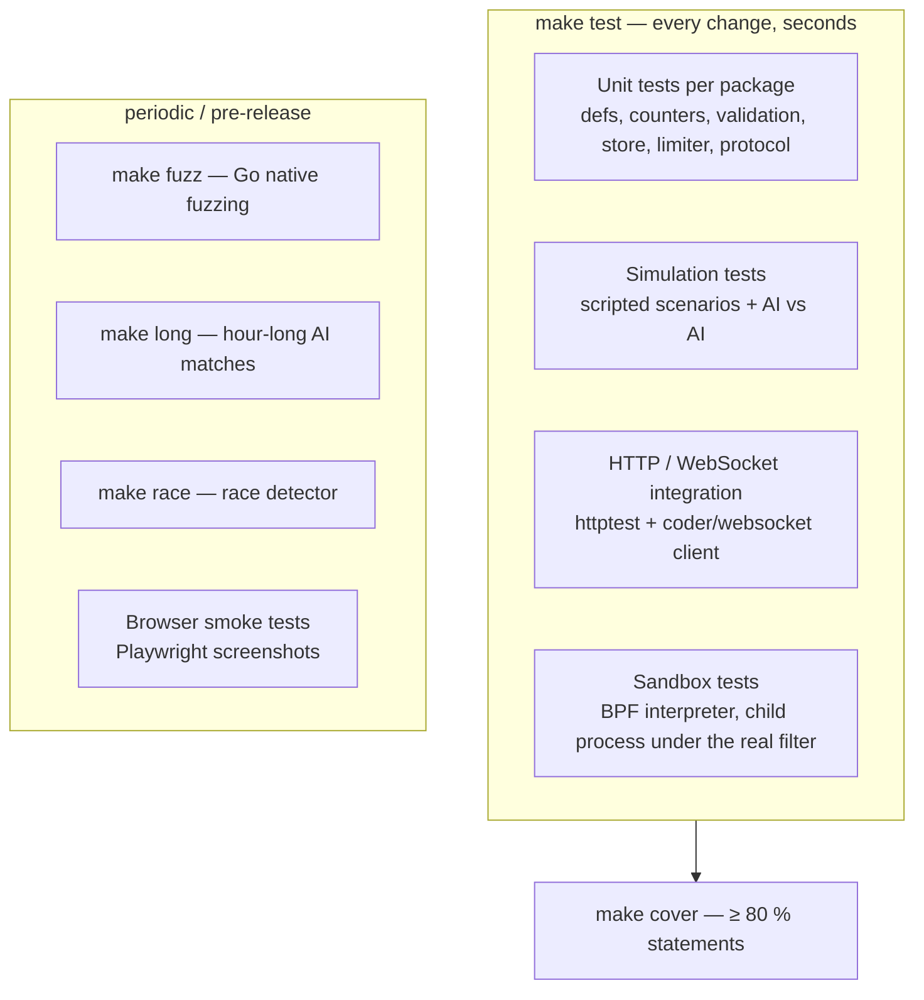

# Testing

## Strategy



| Layer | What | Where |
|---|---|---|
| Unit | pure functions and small types: `Res` ops, `Counter`, `CleanText`, `Level.Validate`, map generation determinism, `ValidName`, argon2id round trip, `Limiter`, `clientIP`, `ParseClientMsg` | `*_test.go` next to the code |
| Simulation | `NewGame` set-up, gathering/deposit, hunting and carcasses, aggressive animals, build/train/research, farms and housing, combat and victory, survive/advance objectives, fog and snapshot filtering, pathfinding, flying and siege units, AI behaviour | `internal/game/game_test.go`, `sim_test.go`, `long_test.go` |
| Integration | full HTTP handler under `httptest.NewServer`: auth flow and cookies, security headers, CSRF/content-type/size checks, recoverer, levels and scores APIs; WebSocket: session requirement, lobby, chat channels and rate limit, rooms (full room, host hand-over), quick games through to the `end` message and recorded scores | `internal/server/server_test.go` |
| Persistence | open/corrupt files, accounts, scores, level ownership and limits, write failures | `internal/store/store_test.go` |
| Campaign | all 17 levels validate and materialise; skirmish options | `internal/levels/levels_test.go` |
| OS sandbox | seccomp program checked with a small classic-BPF interpreter (native/foreign arch, x32, every denied number); Landlock access masks; `Apply` in a child process proving that `unshare`, `exec`, `ptrace`, writes outside the data dir (Landlock) and outbound TCP (Landlock ABI ≥ 4) fail while the data dir stays usable | `internal/hardening/*_test.go` |
| Fuzzing | parsers and validators against arbitrary input | `fuzz_test.go` in `internal/server`, `internal/game`, `internal/store` |
| Browser | page loads, menus, a short match and the editor render without console errors | Playwright (see below) |

Design choices that make this possible: `internal/game` has no I/O,
goroutines or wall clock, so a whole match can be stepped in a loop;
`Server.now` and `Limiter.now` are injectable clocks; the store takes a
directory (`t.TempDir()`); the server is an `http.Handler`.

## Running

```sh
make test          # go test ./...
make vet           # go vet + gofmt check
make race          # race detector on internal/server (needs cgo for -race)
make cover         # coverage over all packages; fails below 80 %
make cover-html    # coverage.html
make fuzz          # every fuzz target for FUZZTIME (default 30s each)
make long          # LOTL_LONG=1: hour-long AI vs AI matches across ages (≤ 30 min)
```

The Makefile exports `CGO_ENABLED=0` (as production builds do), except for
`race`.

Single tests:

```sh
go test ./internal/game -run TestPathfinding -v
go test ./internal/server -run TestLobbyChatAndMatch -v
go test ./internal/game -run TestAIvsAISim -v      # logs economy/army every 2 game minutes
```

### Coverage

Target: **≥ 80 % of statements** across all packages, measured with
`-coverpkg=./...` so that code exercised through integration tests counts
for the package that owns it. `make cover` prints the total and fails the
build below the threshold.

Coverage results: see `make cover`.

## Fuzzing

Go native fuzz targets (`go test -fuzz`), seeded with valid inputs and run
from `make fuzz`:

| Target | Package | Property checked |
|---|---|---|
| `FuzzParseClientMsg` | `internal/server` | no panic; accepted messages have a known type and in-range fields; accepted chat text is non-empty, ≤ 300 runes and free of control characters; accepted commands respect the id and argument limits |
| `FuzzHTTPAPI` | `internal/server` | arbitrary JSON bodies POSTed to the API (with and without a session) never yield a 5xx or a non-JSON response; anything stored via `POST /api/levels` re-validates |
| `FuzzLevelJSON` | `internal/game` | a level that passes `Validate` respects the name and size limits and (for small maps) can start a game, run 30 ticks and produce a snapshot without panicking |
| `FuzzApply` | `internal/game` | arbitrary commands applied to a running game never panic, never make a resource negative and never move an entity off the map |
| `FuzzFog` | `internal/game` | `DecodeFog(EncodeFog(v, e))` round-trips; arbitrary strings never panic the decoder |
| `FuzzCleanText` | `internal/game` | output is valid UTF-8 within the rune limit and contains no NUL, ESC or bidi override/isolate characters |
| `FuzzOpenCorruptFiles` | `internal/store` | corrupt `users.json`/`scores.json`/`levels.json` either fail `Open` or load only valid levels; no panic |
| `FuzzValidName` | `internal/store` | `ValidName` never accepts a name shorter than 3 or longer than 20 bytes |

```sh
go test ./internal/server -run=^$ -fuzz=FuzzParseClientMsg -fuzztime=30s
go test ./internal/game   -run=^$ -fuzz=FuzzApply          -fuzztime=2m
make fuzz FUZZTIME=5m
```

Failing inputs are written to `testdata/fuzz/<Target>/` in the package and
then run as regular test cases by `go test`; commit them together with the
fix.

## Simulation tests

- **Scenario tests** build a small level, place entities, issue commands
  through `Game.Apply` and step the game until a condition holds (e.g. a
  worker has deposited wood, a building finished, a player was defeated).
- **AI vs AI**: `TestAISimulation` plays 12 game minutes for each AI
  difficulty against a normal AI and asserts a working economy (population
  ≥ 10, ≥ 1 000 resources gathered, houses built); `TestAIvsAISim` runs a
  hard-vs-normal match for up to 25 game minutes and logs age, population,
  resources, techs and kills every 2 minutes. At full speed these take
  seconds.
- **Long games** (`make long`) run hour-long matches across ages as a soak
  test for balance regressions, stuck units and performance.

## Integration tests

`internal/server/server_test.go` starts the real handler with
`httptest.NewServer` and a store in a temporary directory and drives it like
a browser: register/login/guest with cookies, `Origin` headers and JSON
bodies; WebSocket clients via `github.com/coder/websocket`'s `Dial` with the
session cookie; then lobby creation, joining, chat, slot changes, starting,
sending commands, receiving `snap`, resigning and waiting for `end`. Room
and hub behaviour that is hard to reach over the network is tested directly
(`TestRoomUnit`).

## Browser smoke tests

The client has no build step, so browser tests run against a live server:

1. `make run PORT=8080` (or `./bin/lotl-server -port 8080 -data $(mktemp -d)`).
2. A Playwright script (Chromium, headless) that:
   - opens `/`, registers or plays as guest, screenshots the main menu;
   - starts the first campaign level (`quick`), waits for the canvas and
     the resource bar, screenshots after a few seconds;
   - opens `/editor.html`, generates a map, screenshots;
   - fails on any `console.error`/`pageerror` and on CSP violations.
3. Screenshots go to `docs/screenshots/` for visual review.

```sh
npx playwright install chromium
node smoke.mjs http://127.0.0.1:8080   # script kept outside the embedded web/ tree
```

Audio cannot be asserted headlessly; it is checked manually (Settings →
volumes; age fanfare on advancing).

## What to test when changing…

| Change | Add / update |
|---|---|
| a message type or field | `ParseClientMsg` table test, fuzz seed, `docs/api.md` |
| a command | `Game.Apply` scenario test, fuzz seed for `FuzzApply` |
| balance numbers | `TestDefsComplete` invariants, AI-vs-AI run, `docs/game-design.md` tables |
| level format/limits | `TestLevelValidate`, `FuzzLevelJSON`, `docs/level-editor.md` |
| sandbox | `TestFilterProgram`, `TestSandboxInChild`, `deploy/seccomp/README.md` |
| HTTP middleware | `TestSecurityMiddleware`, `docs/security.md` |
